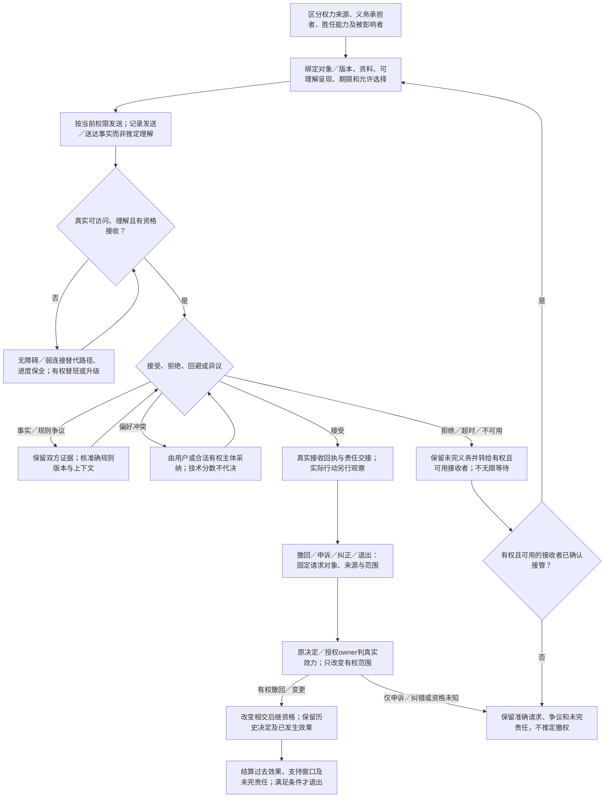

# 人类任务与责任交接

本篇细化[领域组合](../演进/领域组合与扩展条件.md)中的人工任务接合。职责、能力和权力来源独立，已有operation/权限/结果模型继续拥有实际发送、授权与结算；本篇不另建通用审批引擎。

## 人类任务、组织权责、异议与不可自动化的接受

参与者包括提出者、使用者、付费者、受益者、风险承担者、被影响者、运营者、审查者和退出后的责任接收者。它们可以是同一个人，也可以互相冲突。权限表示谁可实施何种动作，责任表示谁需承担什么义务，能力表示谁能胜任任务；三者不能因同一个角色名自动等同。

人工任务要有准确对象/版本、所需资料、实际可理解的呈现、期限、可接受选择、拒绝/回避/升级、代理与接管条件。任务发送、送达、阅读、理解、接受和实际行动是不同观察；没有接收回执则不能算交接完成。人暂不可用、离职或利益冲突时，需要有权替代和未完成义务转移，而非无限等一个永久审批节点。

明确区分事实争议、规则适用争议和偏好冲突。事实争议保留双方证据和解释；规则需要准确版本、主体与上下文；价值取舍由用户或合法有权主体采纳。系统可计算条件后果、暴露矛盾和提出候选，不能用不透明分数替代选择，也不能因为有多数投票接口就自动取得决定一切事项的资格。

无障碍与弱连接不是附加皮肤：键盘/触控/输入法、辅助技术、语言、文化解释、感官/运动限制、疲劳与认知负荷都会影响任务是否能完成。必须保持替代路径、进度保全和错误恢复；自动扫描的通过不替代真实任务验证。界面更少步骤不总是更好，对不可逆动作需要理解与确认；但不要为了制造“认真组合”强塞无价值步骤。

用户撤回、申诉、人工纠正和组织退出会产生新的工程事实。历史决定不因被撤回而从记录消失；未来授权可以终止，过去外部效果仍需结算。对长期运行系统，值班、替班、培训、支持期限和未完成责任都是实际依赖，不能被架构图里的一个Human框吞掉。

申诉送达、事实纠正与有权撤销是不同动作：开发者对发布决定提出申诉，不自动撤销生产Grant或停服；真正有权的撤回也不因另一个申诉流程未完而失效。没有合格接收者时保留原未完义务，并按实际权限限制相交新作用，不能把重新派任务的循环当成责任已经移交。

**适用范围：**系统支持有权决策，不生成权力来源或用技术分数替代价值选择。

**重新检查条件：**参与者、任务环境、权力来源、组织分工、语言/辅助设备或不可逆风险改变。

验收的具体触发与观察见[全域接合检查](验收/全域接合检查.md)；这里定义机制与条件，不签发任何实现、执行或现场合格状态。
