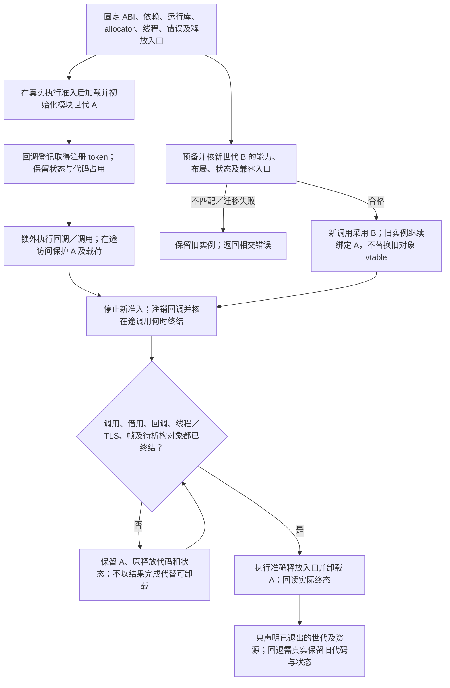

# 原生边界与模块驻留

> 条件能力设计；不改变已固定的基础画像，不表示实现或目标符合性已完成。

本页补充[跨实现调用与数据寿命](跨实现调用与数据寿命.md)中的相交能力；原章节继续拥有其已采用的有限语义。**当前选择：保留真实foreign边界与兼容岛。** 复用C++前端/bridge/shim，不承诺无依赖的完整C++ABI；实际供给和允许构建成员必须明确。

这里的选择不是删除能力或承诺全部默认启用。满足真实要求的成熟库、静态展开和原生适配可以作为最终方案；额外语义只在现有路线不能保持该使用点的明确要求时激活。未提供对应解释、实现或目标条件时保留作者要求并返回具体缺项，不强迫所有项目携带设施。

文中的类型名、操作名与代码块为合同记法，不向现有作者文法添加关键词，也不直接发布 wire 字段。作者仍通过已有 Definition/require/prefer 或已解析原生定义提供真实差异；内部信息归入原 MethodSpec/BoundaryView/UseBinding，公开扩展必须另有准确版本及能力协商。共同准入见[能力履行](../编译/目标/能力履行与接口差额.md)。

### 没有一个与工具链无关的完整 C++ ABI

ABI profile 固定实际相关的目标、编译器 ABI、标准库／运行库、编译选项、名称、类布局、异常域、allocator、线程与动态库版本。只在已经匹配的范围内承诺互操作；不因都是 C++ 或都使用 LLVM 就认为 vtable、异常和运行库可以任意混用。

桥接签名至少规定参数与返回的表示、所有／借用／转移、可空性、生命周期、线程、错误、回调与重入。外来指针必须有真实来源及有效性合同；不能先造 Rust 引用再检查它是否有效。

已有 CXX 等成熟桥接满足要求时优先复用。CXX 的 `extern "C++"` 是该桥接系统消费的声明，不等于 Rust 编译器提供完整通用的原生 C++ ABI 语言支持。[依据](../依据/来源/Rust与C++能力比较.md#baseline-s26)

可选的 C/C++ shim 是一个明确的外部依赖和构建成员，不是 TS＋Rust 通用目标范围之外偷偷新增的全语言后端。要求“只含 pure stable Rust、无额外原生对象”时，不能把必须的 shim 藏在生成目录。

### C variadic 与类型安全参数包不同

类型安全 pack 在编译期拥有各元素类型；C `...` 由 ABI 和调用者／被调用者约定解释。导入和导出分别检查，不能以“可以调用 printf”证明 stable Rust 可以定义任意 C 变参函数。[依据](../依据/来源/Rust与C++能力比较.md#baseline-s09)

跨 C varargs 边界执行正确的默认参数提升，例如 float 到 double 及小整数的相应整数提升，并满足目标寄存器／栈规则。解码必须有格式、标签或其他真实合同；没有元数据时不能安全猜参数个数与类型。

`va_list` 生命周期、复制、推进和结束由该 ABI 的实际规则管理，不能把它普遍当一个可随意复制的裸指针。Gift 管理域可用类型化变参序列；必须导出真实 C variadic symbol 时，通过合格原生入口或明确支持的工具链，无法满足就拒绝该导出。

### 异常和 allocator 边界

foreign exception 由支持它的域捕获，再转换为约定结果；回调错误按约定返回、记录或终止，不能意外穿越不允许展开的 Rust／C ABI 边界。采用 unwind ABI 也仍需遵守语言与运行库兼容条件。[依据](../依据/来源/Rust与C++能力比较.md#baseline-s10)

对象由哪个库分配、构造，就由约定的释放入口销毁与释放；不能让不匹配 CRT 或另一份 allocator 处理它。跨动态库的字符串、容器和错误 payload 尤其不能只看布局相似。

### 回调、热更新和卸载

回调登记返回拥有注册的 token；注销须规定并发在途调用是否完成、是否可重入，以及何时不再访问用户状态。释放状态必须晚于最后一个合法在途回调。

动态库的类型表、函数表、分配器、异常 payload 与协程帧引用所属模块世代。存在活跃调用、借用、回调或待析构对象时不能卸载所需代码。热更新创建新世代，新旧实例分别完成；不能把旧对象的 vtable 无条件替换为新布局的代码。

版本或能力不匹配时保持原对象和运行实例，返回相交错误；不先卸载旧库再发现新库不兼容。升级回退只在实际保留了旧代码、状态与兼容入口时存在。

## 使用点与可检验出口

这些分支保留各自的真实输入、替代路径与边界，不按条数声称更多底层能力；[比较记录](../依据/来源/Rust与C++能力比较.md)不拥有另一套语义。

- **不完整类与前置声明**：复用现有 opaque/模块依赖；不是为了模仿 C++ 头文件而增加前置声明系统。 硬边界示例：原生接口要求同一外来名义类型的精确按值布局，但定义并未提供；[具体比较与出口](../依据/来源/Rust与C++能力比较.md#a11)。
- **广义非类型模板参数**：保留真正需要的形状/值身份；不要默认纳入全部浮点NaN与符号指针模板规则。 硬边界示例：开放原生 API 必须按这种值身份自动匹配，或类型计算无法被有限提前展开；[具体比较与出口](../依据/来源/Rust与C++能力比较.md#a29)。
- **extern template**：明确有限实例、可继续实例化定义和原生泛型三类交付；按真实构建成本采用。 硬边界示例：必须直接保留原生泛型接口、外部实例所有权和稳定构建行为；[具体比较与出口](../依据/来源/Rust与C++能力比较.md#a37)。
- **long double / 扩展浮点**：保留格式与ABI区分；只为实际数值域选择供给，不默认造全浮点系统。 硬边界示例：要求x87扩展精度、double-double等原生ABI或严格性能/异常环境，不能用普通f64/软件替代；[具体比较与出口](../依据/来源/Rust与C++能力比较.md#a53)。
- **异常与foreign unwind：** 真实unwind/ABI边界不能被默认Result接口替换；类型化异常本体沿[错误传播](../领域/计算基础/错误传播与契约保持.md)，本页只拥有原生边界与模块驻留差额。
- **通用可定制协程**：先复用Future/Iterator或生成状态机；取消/清理必须正确，但不由此自动推出multi-shot或通用effect系统。 硬边界示例：库必须暴露原生通用resume/yield协议、保留地址/帧分配控制，且宏/手工状态机成本不可接受；[具体比较与出口](../依据/来源/Rust与C++能力比较.md#a55)。
- **定义C变参函数**：只在FFI适配器中处理，不让每个Gift函数都背C变参模型。 硬边界示例：禁止任何额外原生对象且要求pure stable Rust导出真实变参符号；[具体比较与出口](../依据/来源/Rust与C++能力比较.md#a56)。
- **原生C++ ABI与模板生态**：明确支持的ABI边界并复用成熟前端/编译器；不默认让Gift成为完整C++实现。 硬边界示例：不可加shim、不能改变现成API、没有可用兼容toolchain，或要求任意C++源码逐文件替换；[具体比较与出口](../依据/来源/Rust与C++能力比较.md#a58)。

实际组合与拒绝条件见[验收案例](验收/跨语言控制与组合案例.md)；从作者要求到再次修改见[连续开发情景](../../examples/连续开发/跨语言能力连续开发.md)。

## 旧读者、排队回调与释放代码分别排空

卸载或替换原生模块先阻止不再获准的新入口，再分别确认旧访问、排队回调、在途异步、返回对象和释放它们所需代码的责任。等待读者宽限期不证明延迟回调已运行；等待已排队回调也不证明没有活跃读者或未来回调。barrier的保证只及其真实协议规定的集合和时点。

反例为旧读者结束后排队回调仍未执行，模块却已卸载；反方向为没有排队回调而barrier立刻返回，旧读者仍在执行。新回调的准入和旧回调的完成需有相容的关闭关系；计数到零以后允许另一路无登记启动，也不能据此卸载。

这些是原驻留与数据寿命合同的提供者义务，不要求采用RCU。短锁、引用计数、任务域或宿主现有机制满足所求条件时直接复用。平台不支持证明真正停止或回调排空时保留未结算/不支持范围，不用进程退出通知代签全部资源和外部效果终结。
