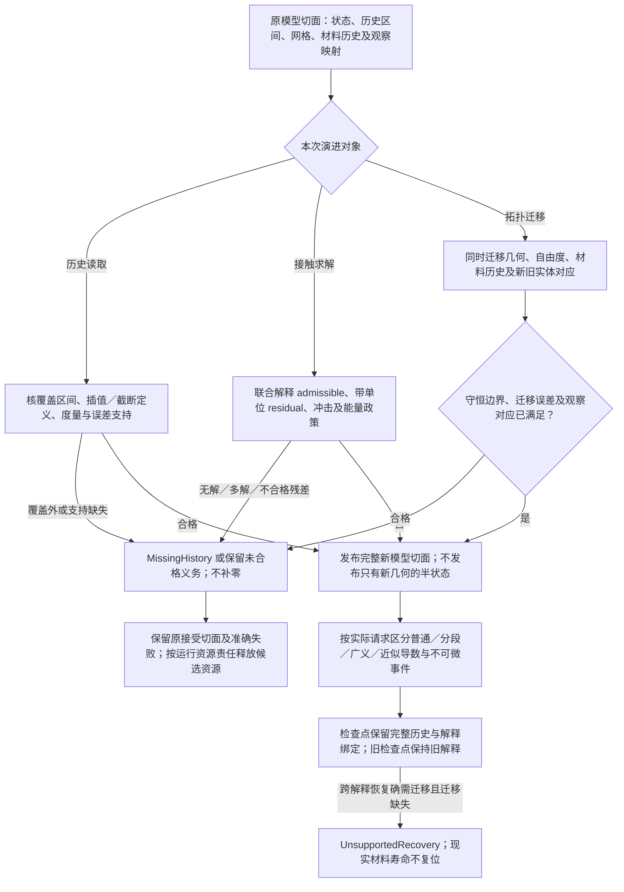

# 模型历史、接触与拓扑演进

本篇拥有仿真模型的历史与结构演进条件；基本值、时间、微分规则继续由原[自动微分与线性化](../数值/自动微分与线性化.md)及对象身份规范拥有。求解器可以复用成熟供给，以下条件不是要求作者重写求解器。

<a id="history-contact-topology"></a>
## 记忆、延迟、接触、拓扑变化与不光滑模型



**延迟与记忆模型**不只依赖当前状态。延迟微分、历史核或分数阶等模型需要初始历史区间、记忆截断/压缩策略、插值、历史误差及检查点格式。重新启动时只有`x(t)`通常不足以继续同一问题；未经接受截断过去会改变模型。对无法承受无限记忆的任务，明确有限时域、近似或外存路线与误差，不假称任意精度。

**接触与互补约束**包含非穿透、力/速度符号、激活集合和切换；不同摩擦/碰撞模型不是同一力函数调参。方法应声明冲击、能量处理、约束稳定、容差及无解/多解边界。迭代残差低不证明物理接触选择正确；为了终止偷偷允许穿透会改变任务。可视化平滑也不是接触精度保证。

**移动网格、断裂、相变与拓扑变化**需要把几何、离散自由度、材料历史和观察映射一起迁移。新网格不只改数组大小：守恒量如何投影、哪些误差引入、旧实体如何对应、过去指标是否仍可比较都须明确。材料损伤与塑性历史不能在重划网格后恢复为新材料；物理不可逆性不随模拟检查点复位而在现实消失。

**不光滑或离散事件的微分**需要明确梯度究竟针对哪个模型和变量。自动微分程序得到的导数、连续方程的敏感度、离散化后目标的梯度以及经过替代光滑模型的梯度，可能不同。接触切换点可能不可微；有限差分也受步长、数值误差和分支切换影响。可以提供分段、广义/近似、随机估计或无梯度方法的合格路线，但不统一包装为“精确梯度”。

这些模型仍通过普通数据、时间、关系、资源、来源与验证接口组合。真正新增的内容归领域owner；编译内核只要求方法能解释所需局部结构并履行目标合同。具体求解方法的选择与真实性能必须由所选问题和实现证据决定。

**适用范围：**是现有仿真族的具体子合同，不按每个术语新增核心能力枚举。

**重新检查条件：**模型记忆、网格拓扑、接触规律或所求导数定义改变。

验收的具体触发与观察见[全域接合检查](../../运行/验收/全域接合检查.md)；这里定义机制与条件，不签发任何实现、执行或现场合格状态。


<a id="simulation-history-values"></a>
## 历史、接触与拓扑变化的作者字段

复用[Model普通值](时间推进与状态恢复.md#simulation-model-values)，不另造历史运行时或通用反馈节点。下列普通名义型通过同一record/function/variant构造；S、H、X、T、B、R均由准确模型与规则实例绑定。

```text
History<H,X,T,B> = nominal record {
  begin:T, end:T, valueAt:(H,T)->Result<X,SimulationError> !{},
  data:H, approximation:HistoryApproximation<B>
}
HistoryApproximation<B> = Exact | Bounded { bound:B } | Unqualified
HistoryState<S,H> = nominal record { current:S, history:H }
ContactLaw<X,R> = nominal record {
  residual:(X)->Result<R,SimulationError> !{},
  admissible:(X)->Bool !{}, policy:NumericPolicy
}
TopologyChange<Old,New,Map> = nominal record {
  migrate:(Old)->Result<{state:New,correspondence:Map},SimulationError> !{},
  conserved:(Old,New)->Bool !{}, observationMap:Map
}
```

X是valueAt的返回型，必须由公开使用点准确绑定。begin<=end按所选TimeDomain检查，覆盖域外返回MissingHistory，不补0或复制最近值。B是该历史问题公开的准确名义界类型，复用[定量界与传播](../计算基础/定量合同与误差传播.md#quantity-error-source-interface)的ErrorContract或准确InputBound/OutputBound类型；不是任意JSON、自由Text标签或一份无单位F64。消费History的实际Rule/Method必须把B与同一X、所界定的点值/轨迹、T区间、Metric、单位/Frame、域、误差来源及其支持绑定。Bounded保存声明界而非已证明标志，缺上述准确对应或支持时保留原Needs/未合格义务；Unqualified不满足硬误差要求。跨单位/联合量的界不能仅比较打印数值，若采用标量归一化，归一化定义和分量尺度仍属于该准确界及规则绑定。插值与截断由valueAt和实际历史构造方法固定，改变这些绑定即改变问题。Model的I接收初始History，S采用HistoryState时恢复必须连同H及其解释所需界绑定，不能只保存current。

ContactLaw的admissible与residual是接触/互补的声明式联合条件，不由字段次序选激活集。R沿[EquationModel的准确残差](时间推进与状态恢复.md#simulation-model-values)同一原则使用公开名义记录/容器，保留各分量的单位、尺度及接触条件对应；长度、力或能量不因内存同为F64就共享接受阈值。实际Rule/Method绑定R的接受判据、归一化及支持，admissible返回Bool不自证该联合条件；摩擦、冲击与能量政策仍由实际该定义拥有，不复制方程求解或误差传播算法。TopologyChange中的New必须包含迁移后的几何、自由度和材料历史，Map给新旧实体及观察的准确对应；conserved是所选边界的声明检验而非守恒证明。它不能恢复现实材料寿命，不能在迁移失败后发布只有新几何的半状态。

被动构造不推进历史、不执行接触求解或拓扑迁移。相应运行方法才解释这些值并检查误差、状态和恢复资格；不可微事件按AD请求的实际导数种类判定，不以模型可推进推得可求普通梯度。历史域/截断、B及其Metric/单位/归一化/支持、R及其分量判据、接触律或拓扑对应改变时，按旧新真实依赖共同重核相交状态、导数、观察与检查点资格；值同而绑定来源改变仍更新实际读集。旧运行及检查点保持旧解释，缺迁移时返回UnsupportedRecovery。旧标量历史/残差只能在原准确画像中解释；迁移须取得其真实度量、域和分量映射，不凭error数值或数组位置补造新B/R，也不因为普通类型可构造就声称支持完整。
