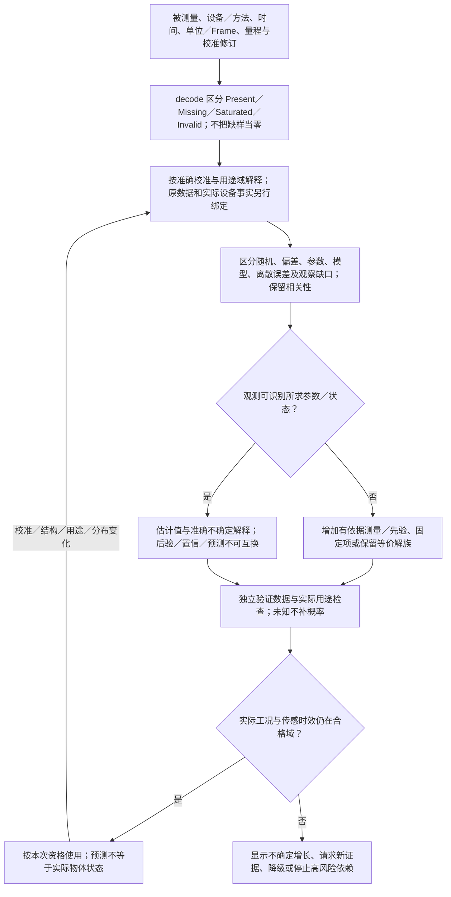
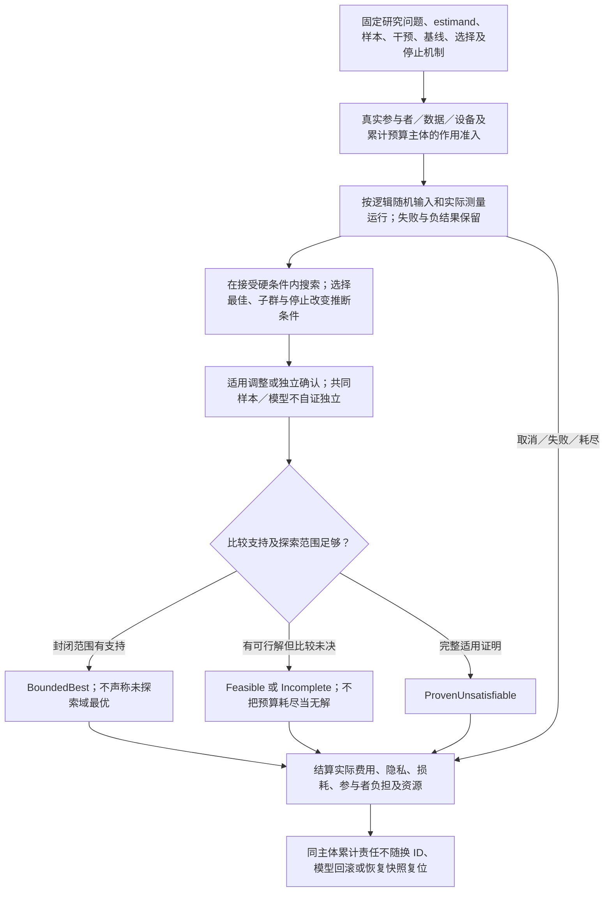

# 测量、校准与实验解释

本篇拥有仿真/科学计算消费测量、估计与实验时的领域条件。数据身份来自原信息模型，当前读取/释放/设备作用由原执行层承担；一般Claim和证据接纳不在此重复定义。

<a id="measurement-calibration-identifiability"></a>
## 测量、校准、可识别性与模型适用域



测量至少连接被测量、设备/方法、单位/参考框架、量程、采样与时间、校准修订、缺失/饱和/异常状态及适用的不确定性说明。测量值和对真值的估计分开；设备标称精度不自动覆盖安装、环境、处理算法或当前校准漂移。

区分随机波动、系统偏差、参数不确定、模型不足、数值离散误差和观察缺口。它们可能相关、非对称、非高斯或没有可靠分布。报告“95%区间”必须有方法与对象，不得把参数后验区间、重复采样置信区间、预测区间和工程安全界混用；资料不足时使用范围/候选/未知，而不编造概率。

估计模型参数之前，先检查观测能否区分参数或状态。例如两个参数只以和出现时，仅凭这个输出无法分别确定它们；优化器返回一组数值不证明唯一可识别。可以加有依据先验、增加测量、固定一项或保留等价解族，但不能把正则化选择当现实真值。

校准数据、模型拟合数据、验证数据和实际用途数据分别管理。用同一批样本反复调模型再评测容易把拟合当泛化；重用场景、共同数据源和共同参考实现不构成独立证据。改变校准、观测映射或用途，会使相交模型资格失效，即使源代码没有变。

数字孪生的观测状态、估计状态、预测状态与实际物体仍是独立对象。发生传感丢失时，模型可以继续给条件预测，但必须显示适用边界与不确定增长，不维持原“实时已知”标签。工况超出已验证域时可请求新证据、转低资格模型或停止依赖该预测的高风险动作。

**适用范围：**模型、参数、观测和现实用途分别有身份与资格。

**重新检查条件：**校准、测量布局、模型结构、数据分布、验证目的或实际使用环境改变。

<a id="experiment-selection-and-cumulative-effects"></a>
## 实验、因果、学习与累计风险预算



实验输入包括研究问题、估计目标、总体与样本、干预/观察方式、比较基线、随机分配或随机流、重复与停止规则、测量方式和允许作用。模型参数搜索、性能调优、A/B实验和临床研究不共享同一权限或证据模型；纯离线仿真也不自动具有现实因果解释。

自适应地看结果再改参数、选择子群、决定何时停止，改变了统计推断的条件。方法应预先声明或准确记录这种选择，并使用适用的调整或独立验证；不能只展示最佳run和成功完成者，删除负结果、失败轨迹与未完成样本。共同训练数据或同源生成器要计入证据依赖，不能因有多个模型就自动视为独立支持。

优化目标由作者接受：误差、延迟、资源、成本、隐私、可维护性和公平要求常互相约束。硬条件先保持；软偏好无明确权重则保留多种可行取舍。不存在依据时不能宣布唯一全局最佳；预算内最优、某成本模型最优和实际使用效果最优分别表述。优化器若修改了任务或基线，结果不再是原问题的改进。

涉及个人数据或实际资源的重复实验可能累计披露、费用、设备损耗和参与者负担。重启会话、回滚模型或换一个实验ID不会撤回已发生的消耗。对应预算归真实主体与已执行作用管理，不能藏在可重放仿真快照内。跨项目的共同数据、同一参与者或同一设备，按适用责任合并核算，不按界面数量拆开逃避。

ML目标继续使用真实训练/推理供给、数据与权重身份、特征版本和评测范围；Gift的正式编译解释不由模型自由补完。漂移触发的是相交资格重评和受控新候选，不允许在线学习静默改写已接受需求、权限和安全包络。

**适用范围：**计算设计不代替参与者授权、专业责任或未取得的现实数据。

**重新检查条件：**样本、选择/停止机制、估计目标、模型更新政策或累计风险主体变化。

验收的具体触发与观察见[全域接合检查](../../运行/验收/全域接合检查.md)；这里定义机制与条件，不签发任何实现、执行或现场合格状态。


<a id="measurement-probability-model-values"></a>
## 测量、联合概率与优化的强类型模型值

测量配置、统计模型和优化问题采用普通名义record/variant与纯函数值，复用共同TypeTerm/Expr；模型可以通过Value.expression被动构造、参数化和转传，不强制成为DefinitionRef。规则解释入口接收这些准确类型，真实被测设备、参与者与累计预算主体从Rule.subject槽另行绑定，不复制进记录。

```text
SampleStatus<X> = Present(X) | Missing | Saturated | Invalid
Measurement<X,T> = nominal record {
  sample:SampleStatus<X>, time:T, uncertainty:Knowledge<Uncertainty<X>>
}
Uncertainty<X> = Interval { lower:X, upper:X }
               | Law { law:JointLaw<X> }
               | CoverageRegion { region:(X)->Bool !{}, interpretation:IntervalMeaning, level:Rational }
IntervalMeaning = ParameterPosterior | SamplingConfidence | Prediction
MeasurementContract<Raw,X,T> = nominal record {
  decode:(Raw)->Result<Measurement<X,T>,ExperimentError> !{},
  calibrate:(X)->Result<X,ExperimentError> !{},
  validDomain:(X,T)->Bool !{}, uncertainty:(X)->Knowledge<Uncertainty<X>> !{}
}
JointLaw<X> = nominal record {
  sample:(RandomKey,Int)->Result<X,ExperimentError> !{},
  support:(X)->Bool !{}, domain:(X)->Bool !{}
}
ExperimentError = InvalidDomain | InvalidSample | NumericFailure
                | UnsupportedInference | BudgetExceeded | Cancelled
Estimate<X> = nominal record {
  value:X, uncertainty:Knowledge<Uncertainty<X>>, samples:Int
}
PreferenceOrder = Better | Worse | Equivalent | Incomparable | Unknown
Objective<X,V> = nominal record {
  evaluate:(X)->Result<V,ExperimentError> !{},
  compare:(V,V)->Result<PreferenceOrder,ExperimentError> !{}
}
OptimizationProblem<X,V> = nominal record {
  domain:(X)->Bool !{}, constraints:List<(X)->Bool !{}>,
  objective:Objective<X,V>, acceptance:(X)->Bool !{},
  stop:(Int,X)->Bool !{}
}
OptimizationResult<X> = Feasible(X) | BoundedBest { value:X, explored:Int }
                      | ProvenUnsatisfiable | Incomplete { frontier:List<X> }
```

Measurement不单凭值声明测量完成。MeasurementContract的decode解释已有Raw数据而不访问设备，calibrate固定准确校准函数，validDomain声明用途范围；原数据、方法、校准定义及用途的来源由原信息引用、实际输入与RunRecord绑定，不能靠复制record捏造测量事实。X使用相应Quantity等名义值，T使用真实时间域。Missing/Saturated/Invalid不是0，Knowledge.Unknown不是零误差。Interval的上下界要求同域有序且lower<=upper；CoverageRegion.level是0<level<1的精确Rational，region给该次实际集合。ParameterPosterior要求对该参数后验Law的集合质量依据；SamplingConfidence要求对实际抽样/区间构造过程的重复覆盖依据；Prediction要求对所预测对象及条件的覆盖依据，三者不能交换。Law只声明随机模型，不带隐含覆盖水平。区间方法、数据范围及选择前提由该实际uncertainty函数、输入与Rule解释取得，不能只靠标签签发统计覆盖。缺相应支持时保留Unknown或准确未决，不满足指定概率覆盖要求。

RandomKey沿原随机合同指固定逻辑随机输入，不是隐式全局生成器；Int索引必须非负，逻辑样本映射由实际sample定义固定。X可以是普通记录或元组的名义表示，从而一个JointLaw同时定义多个量的**联合**样本，保持相关性；将两个成员拆为独立Law需有相应依据，不能按边际相同替代。sample/support/domain是模型声明与算法，不自证分布正确、归一性或统计推断资格；需要密度、权重或条件推断的方法另接准确普通函数合同，缺方法返回UnsupportedInference，不猜一份通用PDF。构造JointLaw不产生新样本，不创建cursor或设备；实际抽样按运行输入、预算与逻辑流身份取得。

Objective的V是准确名义目标记录，字段可以是不同Quantity、误差或成本型；compare固定已接受的方向、优先序与允许取舍，返回Incomparable/Unknown时不能代选为更好。若采用加权，转换、单位与权重必须在该准确compare定义和实际要求中取得，不将不同量纲任意求和；约束List是合取，不是运行操作顺序。acceptance和stop不能降低原独立硬要求。BoundedBest必须对已封闭的探索范围取得满足全部硬条件且无更好候选的比较支持，explored非负并与实际搜索记录绑定；它不承诺未探索域最优。compare未决时只能保留Feasible或Incomplete，不把“当前最好”冒充比较完成；ProvenUnsatisfiable只由完整适用方法的证明取得，预算、未见可行解或stop=true都不能产生它。允许无限/连续X但方法可以有限未决；纯问题构造不执行搜索或现实实验。

共享校准、样本来源、逻辑随机映射、停止/选择、目标与支持方法是实际依赖；变更后重评相交测量与统计资格。相同key的确定重放不算新独立样本，旧源的最佳run不能贴到新问题。累计费用、隐私与设备损耗仍由真实主体的执行事实管理，重构模型、换实验ID或恢复仿真状态不重置这些责任。
