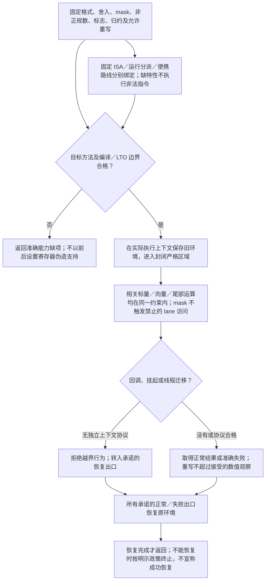

# 格式环境与向量控制

> 条件能力设计；不改变已固定的基础画像，不表示实现或目标符合性已完成。

本页补充[扩展语义与适配合同](../扩展语义与适配合同.md)中的相交能力；原章节继续拥有其已采用的有限语义。**当前选择：保留数值与目标差异，补动态FP环境。** ISA、格式、舍入、mask和归约有真实意义；不是默认实现所有数值格式/SIMD库，也不保证所有目标等价。

本页的条件采用、合同记法与公开扩展边界沿[共同能力合同](../../编译/目标/能力履行与接口差额.md#conditional-capability-contract)。

### 数值语义与 ABI 名称分开

数值类型明确格式：binary16／32／64／128、扩展精度格式、double-double、整数宽度和溢出政策等。`long double` 是 ABI 相关类型角色，不能无条件等同于 IEEE binary128。

合同需要时还规定舍入、非正规数、带符号零、NaN payload／比较、浮点环境与异常标志。仅需要普通数值结果的程序不承担完整浮点环境维护成本；要求这些观察的程序不能被普通 `Number` 或不同精度的宿主运算替代。

更高精度可选择软件数值库、合格原生供给或实际可用目标原语。软件实现可能保持数值结果，却不保持硬件格式、调用 ABI、指令序列、时间或空间要求；这些维度分别检查。Rust 数值类型或外部库必须按固定工具链及目标检查；存在 f128 等名字不构成稳定、全目标、正确 long-double ABI 支持。[依据](../../依据/来源/Rust与C++能力比较.md#baseline-s29)

### 向量和 mask

`Vector<T, N>`、`Mask<N>` 具有精确 lane 数、lane 运算、load/store、gather/scatter、转换及归约规则。被屏蔽 lane 是否允许访问内存、是否触发异常，必须属于操作合同；不能把所有 gather 都降低为先全量读再遮罩。

确定性归约规定结合顺序；允许重排、融合或近似的快速模式单独声明误差／数值观察范围。浮点加法不能因为 SIMD 更快就任意更改顺序。对齐未满足时选择合格非对齐访问或报告错误，不能直接执行目标不允许的指令。

固定 ISA、运行时 ISA 分派、可移植实现是不同计划。运行时分派须有实际探测和可用基线路径；CPU 缺特性不能执行非法指令。严格要求特定 ISA 或时限时，纯标量回退不构成满足。

Rust 可使用该目标上合格的架构 intrinsics 或明确允许的库；标准可移植接口的状态由固定工具链能力记录判断。[依据](../../依据/来源/Rust与C++能力比较.md#baseline-s12) TS 可在允许的宿主原生模块／Wasm 等已取得供给中实现，或执行标量数值代码；不是所有 JS 对象运算都能成为 SIMD。

### 优化提示与硬要求

`likely`、`unlikely`、cold-path、inline、向量化建议等是优化偏好，不能改变程序意义，也不能被当成性能保证。确需固定布局、无堆分配、最大栈空间或某条指令时使用可检查的硬要求。

Gift 保留目标源码可读性、调试位置和必要符号稳定性要求；优化前后映射要能回到作者定义／生成实例。代码更短、IR 更少不自动证明更快，选择保留证据所支持的范围。

## 数值结果的比较关系与目标资格

比较结果前，按本次Claim固定格式与精度、舍入、异常或饱和、NaN与有符号零、溢出与下溢、次正规数、运算融合、归约次序，以及函数库和硬件环境。逐位相同、按已声明规则值等价、有界误差和分布等价是不同观察关系；任何一种都不能默认升级为另一种，更不能默认推出位级重现。它们不是新增的核心枚举或统一结果协议，实际输出沿原数值与证据合同。

差分方法必须消费所声明关系：位级比较核准确编码；值等价核已声明的相等规则；有界误差核作者问题给出的意义、量纲及[误差合同](../计算基础/定量合同与误差传播.md)；分布等价核同一正文[随机与概率主张](../计算基础/定量合同与误差传播.md)所需的假设、采样和判据，不能由单个样本相等证明。`1e-6`不是任意算法的默认安全保证。[自动微分](自动微分与线性化.md)还要区分连续数学模型、离散程序和反向轨迹；不可微分支、随机估计、有限差分或变化的离散化须给准确导数解释及误差或未定义范围。

向量化、GPU或其他目标改变数值环境时，先确认相交要求允许，再按准确版本取得相应比较依据。性能提高和一次样例不能代签数值等价；设备控制、财务精度等任务的硬数值要求无法满足时，准确报告不支持该画像，不能静默放宽保证。

## 再次修改与失效

格式、舍入环境、允许误差、ISA 或 mask 语义改变时，重算数值、常量求值与目标证据；调度切换不允许泄漏线程浮点环境。

## 使用点与可检验出口

这些分支保留各自的真实输入、替代路径与边界，不按条数声称更多底层能力；[比较记录](../../依据/来源/Rust与C++能力比较.md)不拥有另一套语义。

- **long double / 扩展浮点**：保留格式与ABI区分；只为实际数值域选择供给，不默认造全浮点系统。 硬边界示例：要求x87扩展精度、double-double等原生ABI或严格性能/异常环境，不能用普通f64/软件替代；[具体比较与出口](../../依据/来源/Rust与C++能力比较.md#a53)。
- **标准portable SIMD**：按实际数值与ISA合同复用供给；C++26特性成熟度单列，不说Rust没有SIMD。 硬边界示例：固定标准库依赖、ISA、mask异常行为或确定性归约合同，现有库/目标无法满足；[具体比较与出口](../../依据/来源/Rust与C++能力比较.md#a63)。

实际组合与拒绝条件见[验收案例](../../运行/验收/跨语言控制与组合案例.md)；从作者要求到再次修改见[连续开发情景](../../../examples/连续开发/跨语言能力连续开发.md)。

<a id="dynamic-fp-region"></a>
## 动态浮点环境、代数运算与优化区域



格式、浮点环境和允许的代数重写是三项选择。默认生成遵循原数值合同的运算；更改舍入、异常掩码、非正规数处理或允许重结合，只有在原要求允许且真实目标能执行时才采用，不能通过一个 `fast` 标记同时改变全部区别。

选定动态环境能力时，生成器先固定格式、舍入/掩码/非正规数政策、需观察的状态标志及错误出口；选择能够把环境切换与全部相关运算封闭在同一真实严格区域的方法。进入前保存旧环境，区域内使用符合该方法的指令与编译约束，正常和被承诺的失败出口均恢复原环境；恢复完成后才返回调用者。区域内不允许未经适配的宿主回调、跨线程迁移或挂起，避免让其他代码在不同假设下执行；确需这些行为，必须由独立协议保存/恢复每个实际执行上下文，不能仅保存一个进程全局变量。无法保持旧环境或控制真实错误出口时，该方法不能提供可恢复保证；终止行为须按所接受合同明示。

Rust 的普通浮点表达式不能仅被置于“先设置寄存器、末尾恢复”的普通函数中，再假定优化器不会移入或移出运算。所选目标可能需要一个包含切换、运算和恢复的合格汇编区域，或具有严格浮点编译约束、明确调用边界与互操作条件的原生内核；链接优化也不能破坏该边界。直接支持指定舍入的指令、软件精确/区间算法或不修改环境的数学方案是独立替代，不假装它们有同一时延、状态标志或 ABI。**具体供给按工具链、编译选项和目标检查，不因为可写寄存器就认定合法。**

当前读取的 Rust 官方 `_mm_setcsr` 文档说明：相关环境改变与 Rust 默认浮点假设不相容，普通代码中的前后恢复并不能阻止重排；其建议的封闭汇编区域也必须恢复状态。这里只以此校准边界，不将某一架构寄存器要求推广到所有平台。来源见[浮点环境依据](../../依据/来源/Rust与C++能力比较.md#current-fp-evidence)。

代数运算是另一分支。已接受误差和非有限值等观察合同允许时，才能选择具备相应重写自由的运算；不能因其是稳定 API 就把普通 `+` 全部替换。编译期、向量化、标量尾部和运行时所选分支要消费同一数值要求。精确逐位、固定归约顺序或特殊 NaN/有符号零要求不能被吞掉。当前 Rust 文档已有稳定的 `algebraic_*`，但接口存在不证明任何具体程序更快，亦不证明适合当前误差合同。

验证分为合法结果、区域外环境恢复、异常/提前返回、回调拒绝、向量尾部、目标选项及反向优化检查；没有真实目标检查前只交付设计。更换 ISA、strict/fast 选项或 LTO 边界后，使受影响方法的资格重评，原默认数值路线仍可独立使用。


<a id="numeric-policy-values"></a>
## 数值值、政策与区域的共同源接口

下列是本领域的普通名义库类型与公开函数合同，沿共同`s:type`、TypeTerm、Expr、record/variant与函数引用编码，不添加Core数值kind。表和签名里的名字由本库公开声明绑定；不凭名字搜索任意实现。构造配置是被动纯值，不执行运算区域、不分配设备或改变线程环境。

```text
F64Bits = nominal record { bits:Int }
Rounding = NearestEven | TowardZero | TowardPositive | TowardNegative
Subnormal = Preserve | FlushToZero
NonFinite = Allow | Reject
ZeroObservation = DistinguishSigns | IgnoreSigns
NaNObservation = PreserveBits | Canonicalize
Reduction = SourceOrder | BalancedTree | Reassociate
Rewrite = ContractFMA | ReassociateArithmetic | ApproximateTranscendentals
NumericPolicy = nominal record {
  rounding:Rounding, subnormal:Subnormal, nonFinite:NonFinite,
  zero:ZeroObservation, nan:NaNObservation,
  reduction:Reduction, rewrites:List<Rewrite>
}
NumericDecodeError = BitsOutOfRange | NonFiniteRejected
decodeF64(bits:F64Bits, nonFinite:NonFinite) -> Result<F64,NumericDecodeError>
encodeF64(value:F64) -> F64Bits
```

F64Bits的合法域是`0<=bits<2^64`，bit63为符号、bit62…52为指数、bit51…0为尾数，采用IEEE binary64位值，不依赖宿主字节序。decodeF64保持负零与NaN payload；Reject拒绝指数全1的无穷和NaN。encodeF64保持实际F64位值。F64Bits可以通过共同纯数据构造器形成闭合default；一般decodeF64调用不因此取得default资格。显式设计值仅在原阶段求值方法支持该纯调用时取得F64；无此方法保留缺项，不先用宿主number解析或补0。十进制到F64的额外便利函数必须另外固定舍入及失败合同，本接口不暗增浮点字面量。 后继通用结构作者的 `Expr.literal(type=scalar.float)` 因此不接受普通 JSON number 作为不透明的 F64 位值；作者可经准确绑定的 F64Bits 纯构造/数值转换函数提供逐位输入，实际构造是否在静态阶段允许仍取决于已选择的求值方法。精确十进制定点值另按 `DecimalLiteral(coefficient,scale)` 表达并核类型刻度，不将十进制值到浮点的舍入隐式委派给宿主解析器。

这里的有限变体只拥有本节binary64数值画像的准确值域，不枚举未来所有数制、舍入或归约方法。新普通名义policy记录可经同一参数/Rule值字段和领域方法接入，未必扩展本变体；改动本公开变体则按原版本与未知节点规则迁移，旧消费者不能默认降为最接近成员。其他格式或政策的硬要求保留在其准确类型/定义中，缺方法返回相交缺项。NumericPolicy描述本次需求允许的观察与变换，不自签目标符合性。BalancedTree对有序非空输入递归以floor(n/2)个左项和其余右项分组，先取得左、右结果再合并，单项直接返回；空输入的单位元由所用运算另行定义。Reassociate及Rewrite成员只在原误差/非有限值合同允许时采用；重复Rewrite拒绝。源顺序和固定树不能被目标任意重排。

严格动态环境使用公开区域边界`withFP<R>(policy:NumericPolicy, body:()->R !E)->R !E`；R、E沿共同类型/效果合同绑定，此记法不新增一个裸字符串效果字段。其运行方法承担本页的进入保存、封闭运算、全部承诺出口恢复及回调/暂停限制；没有实际合格方法时返回能力缺项，不能执行普通前后设置来伪造支持。区域调用不是设计期纯构造，也不作为默认求值。格式、policy、归约、区域body或真实工具链改变时，重核相交数值、常量求值和目标资格；仅转传同一policy记录不创建第二环境。
