# 工作流执行、输入绑定与激活

本篇拥有工作流定义及其实际发生点的控制、数据就绪、正常进展、来源完成接合、失败和恢复含义。作者schema只编码这些含义；状态机拥有配置与转移，交互拥有输入/呈现，真实执行拥有Effect准入、尝试和结算，Method/Target拥有实现与降低资格。把UI、工作流和端口列在同一组件里，只证明成员存在。没有独立业务执行关系时不引入工作流、持久任务或操作台账。

## 从定义到一次运行

`workflow:plan`声明输入、输出和错误的准确类型、局部唯一步骤、`entry`、合法`completion`与未局部处理路径的`recovery`；需要时才增加截止和上下文角色。一个只返回Unit的纯计划可以只有一个成功terminal，不需要Effect、Grant或持久实例，也不能因此被称作已经保存文件。

定义、组件内的WorkflowUse、一次WorkflowExecution、外部Operation、Attempt及Settlement是不同对象。Step标识在组件实例、WorkflowUse和当前Execution的作用域内解析，不能读取另一个实例的同名结果。冻结/更新定义不热改旧Execution；恢复需保留原解释，跨版必须有准确迁移和禁止重复作用的依据。

```mermaid
flowchart LR
  cause["具体 UI、API、流、状态或时钟发生点"]
  route["有类型 ActivationRoute 与本组件 WorkflowUse"]
  execution["本次 Execution 的合法控制令牌"]
  needs["本次合法支路已成功前驱及准确输入"]
  resources["当前资源资格与实际权限"]
  admit["控制、数据和资源共同满足步骤准入"]
  compute["纯计算或有类型子流程"]
  effect["真实 Effect：原 Operation、Attempt 与结算"]
  next["显式后继与有类型结果"]
  terminal["流程逻辑 terminal"]
  recovery["失败、取消或未知：沿原身份恢复与查回"]
  cause --> route
  route --> input["按 workflow.input 固定本次有类型入站值；不覆盖成最近错误"]
  input --> execution
  execution --> admit
  needs --> admit
  resources --> admit
  admit --> compute
  admit --> effect
  compute --> raw["当前步骤发生的原始 outcome 与返回值"]
  effect -->|实际结果| raw
  raw -->|成功| project["省略保原值；显式 resultBindings 纯投影后才发布成功结果"]
  project --> next
  raw -->|真实错误、取消、超时或未决| channel["原标签与有类型载荷沿实际控制边到处理／恢复；不冒充成功 result"]
  channel --> recovery
  channel -->|已声明且合格的处理边| execution
  next --> terminal
  terminal --> output["按所选终点核 workflow.output 或 errors；取消／未决保持独立原因"]
  route --> completion["原来源完成合同及唯一完成能力；绑定同一 Run/Execution"]
  output --> completion
  recovery --> completion
  completion --> disposition["所选方法处理返回、责任移交或进度；不冒领实际发送/结算"]
  next -->|合法后继| execution
  effect -->|未结算或失败| recovery
  terminal -.->|仍有外部责任时| recovery
```

该链是解释与实现接力，不要求作者手填可以唯一派生的每段中间标识。真正被别处引用的局部发生点仍须准确定位；显示名、数组位置或成员同名不创造触发关系。

## 实参、结果与上下文

每项绑定属于一个具体签名使用点。函数形参绑定、构造单个有类型载荷、发布步骤结果投影是三种不同责任，不能因为都用JSON映射就套用同一形参名表。`compute.inputs`及实际批准方法的`human.inputs`按真实Param/角色名的Identifier检查；端口、工作流输入和终点结果则按其准确Type消费记录成员或整值。ValueSource区分：

| 来源 | 读取与资格 | 不能冒充 |
|---|---|---|
| literal | 准确类型和编码的固定值，保留整数、单位、variant含义 | 未解码JSON、缺席或未知的默认值 |
| input | 当前调用已验证的入站载荷及明确JSON Pointer | 其他触发源、编译期常量 |
| context | 当前Root/组件被批准的RoleBinding | 另一实例同名角色或私有变量 |
| state | 本组件准确StateParticipation及字段、读取修订和一致性 | 已完成写入、持久事务或当前写权 |
| result | 本次Execution当前合法支路中已成功步骤的输出 | 未来、未完成、未执行分支或别的Execution结果 |
| outcome | 本步结果投影阶段的准确原始完成帧，或本次控制令牌已绑定的因果前驱完成帧；按其标签取得有类型值或错误 | 任意最近异常、未返回步骤、别的发生点，或已投影结果的自引用 |
| resource | 声明的能力/资源参数槽 | 宿主已经签发的有效Grant、Lease或拥有权 |
| ui-input | 当前具体UI发生点的节点值，只在该UI动作载荷/激活绑定允许的位置取得 | 任意遍历其他界面、在后台步骤再次读取未冻结UI值或秘密 |

JSON Pointer只定位字段，不执行表达式。可缺、null、未知与错误分别解释；同字节但来源、授权、时间或抽样状态不同的值不合并成同一事实。复杂解析/计算/格式映射调用有资格的普通函数或领域Method，不向路径字符串塞代码。跨组件/子流程经公开签名传参，不直接访问私有临时状态。结构表示与[共同作者含义](../../作者/结构化源码.md)同一解释，不创造第二计算语言。

OperationUse的inputs在记录输入中按字段名绑定（名义记录先准确解析），标量输入使用所选结构画像的保留键value；不能按目标函数的偶然参数名猜映射。省略inputs精确为空映射，只在无必要输入且任何默认均已由专业合同合格固定时可接纳；显式空对象等义。ui-input先在有权激活点冻结为本次输入，下游通过input或准确前驱结果消费，不保持全局可读的活动UI句柄。

### 工作流单值映射与步骤公开结果

`workflow:plan.input/output/errors`各是一个Type，不是函数Param列表。`ActivationRoute.inputBindings`构造所调用流程的input，`subflow.inputs`构造子流程input，terminal的`resultBindings`按其显式outcome构造本流程output或errors。这三类映射使用MemberName键域；`value`仅在目标不是记录时表示整个值，不能将它当成记录的通用包裹槽。**目标Type决定唯一算法**：先在原签名所属模块解析直接/名义记录及其准确字段；显式映射逐字段构造该记录，保留`a-b`等合法名字，核必需/可缺、额外字段、类型、名义构造、拥有和寿命。记录确实有`value`字段时，该键只绑定此字段，不解包整记录。非记录目标的非空映射必须恰有`value`且该来源提供整个目标值；Unit允许显式`{}`构造其唯一Unit值，不能以null替代。显式`{}`在记录目标中构造空记录，只有全部必需字段已满足时合格；未知名义型或未声明默认不凭空补值。

这三处的映射**省略时传递准确原值并核目标类型**，不等于显式`{}`。激活的原值是本次cause已冻结的载荷；subflow与terminal的原值是当前真实入边携带的有类型载荷，entry的原值是本次已验证workflow input。未提供载荷且目标已确认为Unit时才可用Unit；其他缺值保持Need。`Int`载荷进入Unit子流程而省略inputs仍须类型失败；显式`inputs:{}`才表示有意构造Unit。普通OperationUse及compute/human形参映射继续采用各自原省略/必需实参规则，不因工作流单值传透而改变。

非terminal步骤的`resultBindings`只有一个含义：**公开成功步骤结果的纯投影**，不创建私有局部变量表。省略时发布真实正常返回值及其准确Type；显式map总是构造一个MemberName有类型记录，公开结果Type由各来源的已检查Type派生。空map发布空Record，不是保留原值，也不暗转Unit；`{"value":...}`在此构造含value字段的记录，不自动解包成标量。下游`source:result`及正常控制边消费该最终公开值。compute原值来自真实函数返回；effect来自所选operation正常结果；subflow来自子流程output；wait/human由真实恢复信号或批准方法的已绑定正常结果签名提供，不知道其准确Type就返回Need而非猜JSON。decision只选择路线并传递所选入边载荷，不定义第二计算结果。

输入准备先固定当前步骤发生、入站值、context/state/成功前驱等非outcome来源的准入basis、类型/权限、预算及选择器；这不宣称尚未执行的本步已经返回。动作返回后固定原始outcome，再求纯结果投影；全部来源、Type、编码与拥有关系成立才一次发布成功结果并走onSuccessStep。raw失败/取消/超时/未决不求正常resultBindings；普通函数正常返回的Result.Err仍是其正常值，不凭变体名触发onErrorStep。投影失败保留原始返回、实际Operation/Attempt及资源责任，沿原恢复报告缺项或故障，不发布部分成功帧，也不重放已完成Effect。重复选择同一Own不会制造两份拥有权，不可默丢的Result/资源责任也不因显式map消失，仍由原类型、线性/区域及错误合同消费者核验。

`source:outcome`恰含`stepId`及JSON Pointer `path`。在本步resultBindings中，stepId必须是该步，读取其刚取得、尚未投影的原始完成帧；其他有资格的工作流映射只能读取当前控制令牌准确绑定的已观察因果前驱帧。`source:result`仍只读成功发布的前驱，当前步自引用不因此合法；激活尚无Execution步骤，不能用result或outcome。循环、重入与并发下按真实令牌/步骤发生绑定，禁止按最近时间或同名ID选帧；无法唯一确定发生点则返回Need/Conflict，不重放、猜测或混用旧轮结果。

原始完成帧是已有执行结果的只读有类型投影，不是新的可写状态源。`kind`区分`succeeded/failed/cancelled/timed-out/unresolved`；成功的`value`来自真实正常返回，失败的`error`仅在生产者确有合格业务错误签名E时可取。Fault、取消、期限和未结算分别保留原执行/恢复诊断及身份，不自动产生E；专业元数据只有准确结果合同声明并获准披露时可经path读取。访问不存在的字段或不合标签的payload是缺项/类型诊断，不能补null、字符串或空错误。超时帧只证明期限结果，不认证真实停止；outcome引用、投影或消费都不额外取得Effect、Grant或释放权。

正常边携公开成功值，onErrorStep仅在原错误合同允许时携准确typed error及其原outcome，其他错误沿recovery；onCancelStep/onTimeoutStep携各自有资格的结果，不覆写workflow input。处理步骤需要错误E时显式从其因果前驱`outcome`的`/error`取得，不能用失败步骤的result冒充；该错误边也不使失败步骤成为“已成功needs”，不为处理错误等待一个永远不会出现的成功帧。terminal的succeeded结果须匹配output，failed结果须匹配errors；省略映射只传递真实可用且类型相容的入边值，不能把Fault/Cancel/unknown诊断自动提升为业务E。显式转换仍须原方法、类型和权限资格。cancelled/unresolved终点不携业务resultBindings，原原因、诊断、已成功结果和未结算外部责任继续由运行/恢复owner保留。

例如compute步骤Read正常返回T，`resultBindings:{"a-b":{"source":"outcome","stepId":"Read","path":"/value"}}`公开记录`{a-b:T}`，下游成功步骤用`result(Read,"/a-b")`读取；省略该投影则直接公开T，路径与Type不可互换。若Read以业务E失败，onErrorStep的处理步骤可以从`outcome(Read,"/error")`绑定E，而`result(Read,...)`仍非法。目标为`record{value:Int}`时单值map的value绑定该字段；目标为Int时同一键绑定整个Int；原始Int省略映射进入`record{value:Int}`不自动装箱。这些是明确的结构/语义区别，不是已运行示例。

## 三种边与步骤接纳

控制边决定一次发生是否能进入某步；`needs`只声明必须已完成的前驱依赖，缺省为空；资源允许来自当前真实共享/独占、预算和执行资格。三者必须同时成立。`steps[]`排列只作表示，不确定执行顺序；空needs不越过控制令牌或许可。结果引用本身也不能使其生产步骤自动执行。

每次进入步骤先固定本次令牌、输入基础和步骤发生身份，再核所需结果及资源。未就绪应等待对应合法生产者；未执行的互斥支路不能作为必等前驱制造假死锁。合法可重入、并发激活或令牌合并需要准确策略，不能以同名Step推断实例共享或重复执行。

正常、错误、取消和超时仅沿合法且显式的`onSuccessStep/onErrorStep/onCancelStep/onTimeoutStep`转移；decision另有条件路由及otherwise。后继必须在本定义唯一存在，terminal必须满足completion合同。无明示处理的错误回到实际recovery政策，不能落回正常路径。控制循环要有准确进展/终止或有界资源、取消和未完成含义，JSON有环不证明可进展。

## 七类步骤各自的动作

| Step | 正常消费 | 必须保持的失败与边界 |
|---|---|---|
| compute | functionRef解析真实有类型函数，按inputs求值 | 类型/效果与目标方法齐备；缺Method不生成空handler |
| effect | operationUse定位端口内唯一operation，按其inputs绑定 | 同端口多操作不靠portRef猜；授权、幂等、错误、未知结算沿真实Effect合同 |
| wait | 稳定resumeKey及准确恢复信号/时钟/来源，按政策等待 | 重复唤醒、超时、取消和重启恢复明确；取消等待不证明消息不会到达 |
| decision | conditionUse/routes在当前角色与Scope取得合格判定 | 多真需互斥依据或明确优先/仲裁；未知/冲突不能当False或落入普通otherwise |
| human | ActorRole/批准引用及允许的决定形成真实任务 | 身份、权限、拒绝、撤权、超时、可理解信息与接管分别核实，按钮不代签批准 |
| subflow | 准确子流程、实参、结果/错误及取消传播 | 不跨实例读帧；递归/资源/重入/结束需与签名和进展条件相容 |
| terminal | succeeded/failed/cancelled/unresolved及有类型结果绑定 | 只结算本次请求控制，不签业务Goal、持久提交或外部效果完成 |

步骤是判别联合；compute不能附operationUse偷渡执行，terminal不能附functionRef暗含动作。effect实参归operationUse，不再维护一套竞争的顶层inputs。具体结构字段由[作者设计schema](../../../schema/author/universal-author-module-2.schema.json)表达，语义资格仍由本篇及被引用owner取得。

分支依据具有真、假、未知、冲突或不可采纳的不同资格，不擅自压成Bool。若所选领域仅提供Bool Guard，就在它准确支持的范围消费；不能借工作流新结构改写[既定层级状态](层级状态与事件.md)的列表次序、叶祖选择和冲突算法。另一仲裁策略必须独立绑定其Profile/Method并提供保持依据，不相容时返回准确缺项。

在明确选择本结构画像及对应策略的decision中，多路线显式选择exclusive或explicit-priority：前者需在准确世界/时间范围的合格互斥依据，后者每条priority唯一、在合格为真分支中取较大整数，平局或缺必要优先值诊断，不按数组先后。priority只随explicit-priority出现；Schema约束是否必需及可出现，实际消费者另核跨路线唯一性和证据资格。这不改变其他状态机画像的仲裁。

otherwise仅在所有候选路线都取得合格False时可用；尚未知或冲突的候选不是False。显式优先级下，已知为真的低优先路线不能越过仍未知且可能胜出的高优先路线；冲突继续保留。只有合格证据及所选策略足以证明未知结果不会改变唯一获胜者时，才可选择已有路线，否则返回准确Need/Conflict。互斥资格亦须覆盖实际全部候选，不能只比较已知为真的子集。

等待或决定步骤消费合格四态证据时，`evidenceOutcomes.neither`与`evidenceOutcomes.both`分别处理支持不足与支持冲突；提供该画像时两者都必须明确。每项恰选`reject`、`wait`或`manual`：reject保留准确未决/冲突及原因，不走正常otherwise；wait必须有稳定resumeKey并按原等待合同取得后续观察；manual必须有唯一decisionStep，定位本Workflow内真实存在、当前Policy允许的处理步骤和有权主体。缺省没有自动分支，保留准确Need/Conflict/未决。未解释或无权证据不先转换为NEITHER/BOTH进入业务分支。

manual这个名称不创造必须由人操作的前置，有权人、AI或脚本可按实际委派合同处理；只有真实政策明确要求人类批准/专业确认时才限定对应human步骤。后继编码不另收onUnknownStep或humanStep竞争目的字段；历史实验若使用它们，先固定原Profile和原义，显式映射到neither/both的唯一目的，不能静默丢弃或按字段顺序择胜。处理步骤、resumeKey及实际主体的存在性与授权由真实语义消费者检查，Schema合法不代签。

resumeKey在准确组件、WorkflowUse及Execution调用域内稳定，补取得到新观察后以新判定basis重新评价，旧证据仍按原修订解释。reject停止相交正常转移并沿原recovery报告未决/冲突，不宣称无外部效果；manual只交接决策责任，不自动把原证据改为True或授予后续Effect许可。重新进入步骤仍须原控制、数据与资源准入。

## 组件激活与并发

组件的workflowUses只声明参与关系。activationRoutes还需准确cause、被引用workflowUseId及输入绑定：UI绑定具体uiUse/node，流绑定本组件streamUse，API绑定承担服务端职责的protocolUse/endpoint，状态绑定准确stateUse/event，调度绑定有资格时钟、规则、时域及期限。客户端声明不产生服务端，调度文本也不意味着已批准定时任务。

同源同目标不能因重复数组项派发两次。扇出多个Workflow需规定是否同时激活、顺序、失败隔离、共享上下文/资源和重入；独立纯支路可以在合同允许时并行。共享状态修改则经其真实串行/乐观版本/事务/冲突owner判断，拓扑上的并行不签安全。状态产生事件、事件触发工作流与工作流请求状态变更分别有明示因果关系，不因名称相同隐式双向同步；事件时间、去重和投递继续由[流合同](背压与事件时间.md)拥有。

### 本次来源与完成责任的接合

输入绑定只决定流程收到什么；还须确定本次来源由谁结束、何时允许推进及结果如何交回。ActivationRoute的可选`completionUse:DefinitionUse`引用普通`domain:meaning`、category=operation的准确完成定义，其既有`interpretationRef`和QualifiedMethod拥有实际算法。省略仅在已锁定来源合同唯一决定完整处置时可派生，不从相同I/O类型猜“等待终点”“先接纳”或“丢弃结果”，也不新增三值mode枚举、统一Receipt或第二运行时。

该方法的语义调用为`Complete(source:C, activation:Run) -> D`：C是原source owner实际交付的本次完成续体/能力，可为Unit；单路Run是生成入口捕获准确输入、route occurrence和Execution的原流程调用；同源扇出时Run是下述算法形成的普通聚合调用，持各分支同一批已固定的Run/Execution。D是所选来源真实返回或处置结果，可为Unit。这是签名记号，不增加公共Kind。同步/异步、函数捕获、Own、Borrow和错误通道按原函数/Task/资源合同专化。Run交付原完成帧或已声明聚合结果的有型值；需要作为普通值传递时，使用该画像已定义的类型/变体构造，保留O、业务E与Fault/Cancel/timeout/unknown的差异，不另造全函数结果代数。

C与Run在真实发生时由生成入口传入，不能写成作者`BusinessRoleActual.objectRef`或自签Grant。completionUse.bindings仅按原DefinitionUse绑定非计算上下文。可用普通函数主体实现完成方法，专业发送、确认、offset、作用和停止的实际规则仍由各原owner拥有；引用一个任意Method名称不证明完成算法已经具备。

正向检查与生成按以下接合执行，属于原编译/运行责任，不另加编译阶段：

1. **解析与专化。**从准确Root/组件、cause use、route及WorkflowUse解析源合同、I/O/E、scope和修订；解析或唯一派生completionUse，按C、原完成视图及D专化已选方法。检查正常返回、业务错误、取消、未知和关闭的总覆盖及Effect/资源/披露义务；缺算法回原供给责任，不以拒绝原合法能力冒充完成。
2. **固定本次采用。**原source入口完成协议解析、预算及准入后，冻结载荷与实际C。在暴露同步回调前固定route occurrence和同一Execution关联，构造Run。其启动门由原Execution关联处从未启动原子转为同一已启动任务；重复进入只join原任务或按合同诊断，不新建Execution。单线程可用词法状态，跨线程消费原协调原子能力；跨崩溃去重仍由真实来源/Execution持久合同承担。
3. **调用所选完成方法。**入口调用Complete(C,Run)，不能先独立启动流程再让方法启动第二次。未接纳来源可按原合同拒绝且零次调用Run；已接纳后须调用或真实交接同一个Run的责任。等待终点者取得原结果再转换D；先接受责任者先固定同一Execution的真实生命周期/恢复owner才交回接受结果；单向者没有反向值仍须结算执行和资源。跨崩溃承诺保存准确输入、定义/方法修订与Execution，不持久化宿主闭包字节；普通本地调用不强制持久账本。
4. **保持流程结果。**Run消费原工作流降低与本篇输入/结果规则。完成方法仅转换实际O或合格E；其他非正常通道保留原因、身份和恢复。结果Own/借用在转换、异步等待和交接时有真实寿命；不能复制完成权或提前释放底层仍使用的输入。
5. **完成同一来源。**C是本次唯一完成通道，并发成功、取消、超时的胜出关系由原source合同裁决。不可逆提交后不发送第二结果；晚到结果先清理或转交原Own/Effect再决定披露。准备D、交给宿主、实际发送、远端接收和最终结算分别报告，不能由函数返回代签。
6. **推进原来源。**有确认/offset/replay的source按所选策略固定允许推进的真实屏障：完成处理、实际责任已接纳或合格拒绝等。每个原有序域/分区的连续offset只能推进到已满足屏障的前缀，后项完成不能越过未完前项；无全序的不同分区不凭空合成全局offset。恢复把input位置、去重、输出、Execution与未结算作用按原checkpoint合同关联；保证强度取决于真实共同事务/去重能力。纯cursor只具有其读取、推进和关闭，不生成broker ack。
7. **取消、关闭和恢复。**先停止新的采用/结果安装，向原Execution请求停止；是否仍可交回或确认由原来源政策决定。关闭排空、取消或有权交接在途责任，超时不证明物理停止。未知沿原Operation/Attempt/Execution查回，重投递依原去重、retention及epoch join或合法重新采用，不换ID掩盖旧未知。旧在途保持source/profile、route及方法修订，升级只影响新采用；迁移仍须真实前像和唯一owner。

**同源扇出的形成算法。**组件编译先按已解析的组件实例、source参与发生与准确cause建立路由组；相同字符串/载荷不构成同源。source在一次实际接纳时固定本次匹配组及修订，新的匹配或后继修订不追加到已启动组。单路继续上述路径，多路按以下步骤组成：

1. 原concurrencyUses/policyUses、组件要求及实现绑定确定本组的顺序/并行、失败隔离、输入共享/移动和结果聚合含义。组内显式completionUse约束的是同一个来源完成定义：解析引用、上下文与类型后须得到一个唯一共同完成绑定，或有合格等义/组合依据收敛到一个聚合定义；矛盾时返回该组准确冲突，不能按路由数组取第一项。省略仍只消费source已固定且唯一的处置；分支所需不同结果处理由聚合定义的普通函数/有型组合表达，不给各分支复制C。
2. 为每条已选route完成输入绑定、资源分配与scope检查，构造仅捕获该分支输入和原Execution的冷Run_i。一个Own输入不得复制给两支；合法共享、借用或分拆按原owner取得。生成普通闭包/函数作为聚合Run，持有这些Run_i及已选聚合算法，C只由外层Complete持有。聚合结果采用该算法已检查的普通record/tuple/variant或已有原结果视图，不新增统一多流程Outcome。
3. 聚合Run只在其同一启动门获准后工作：顺序策略沿准确声明次序启动/领取，合法并行策略在原TaskGroup/scope及预算内登记后启动；每支仍消费自己的原启动门，重入只join。由实际策略决定短路、继续或请求取消，按准确分支身份存放原结果并调用已选普通结果聚合函数一次。业务E与Fault/Cancel/unknown不因汇合混同；迟到/未领取的Own及未停止分支仍归该scope的原结算责任。
4. 入口只调用一次Complete(C,聚合Run)。先接纳路线须真实移交整个组及其分支恢复责任；等待路线消费所选聚合结果；组的来源推进屏障按全部必需分支及结果/接纳策略判断，不能由任一分支单独推进同一offset或发送第二结果。跨崩溃恢复保存原组成员/策略/输入修订及各Execution关联，按原去重/恢复入口join，不能重建一批新Execution掩盖部分完成。

这段组装属于原组件方法、调用与任务机制，P6复核每支及共同结果/资源义务，P7发出实际入口/聚合函数和依赖；不增加activationRoutes字段或第二执行器。正常轨迹须有本次C→已固定单路或聚合Run及其Execution→原结果/非正常通道→所选D/进度→原资源结算的可追踪关系。独立反例覆盖重入双启动、并发取消后晚结果、准备成功但发送失败、先接纳但无真实接手者、后序先完成、纯cursor被误加确认、跨版恢复、同名不同Execution串用、扇出完成绑定冲突及部分分支未知。

旧源仅在原source合同确已唯一固定完整处置时可机械补出该引用并给依据；其余保全旧字节，提出准确选择，不补默认或丢弃旧承诺。新准确Reader/Profile采用后才写completionUse，旧strict reader不忽略该字段；旧Execution和续体不能因源重写而重建、重派或被新策略解释。

## 失败、补偿与恢复

未知步骤/操作/角色、类型或作用域非法是设计诊断；Meaning/Method缺失是准确供给义务；观察未知与冲突可保留待决；已派发效果未知必须保留原作用身份。错误定位拥有者、发生点、影响范围和可继续边界，不由统一异常处理器吞掉。

`recovery=fail`报告流程失败而不宣称无效果；retry仅在真实操作身份、幂等窗口、前像和安全重试依据成立时执行；compensate调用具真实方法和授权的新动作，其失败/未知单独结算，不普遍恢复原状；manual必须有可接手主体、足够状态与审计交接，通知送达不等于责任已接受。任何恢复先保留已成功支路、未执行范围、等待/队列、资源与未结算Attempt，不盲重放已成功步骤或已发外部命令。

关闭/取消先停本次新的合法激活与采用，再结束或移交在途步骤、回调、结果资源和真实作用；取消确认与底层停止分开。纯值流程可在完整逻辑结果结束，不强制OperationLedger；文件、付款、发布、远端计费等沿[真实权限与资源](../../运行/权限与资源管理.md)取得准入及readback，过程terminal不删除它们。

## 降低、再次修改与验收

Method/Target将既定计划降低成真实入口、控制、类型结果、合法异步/并发及必要持久恢复；只输出步骤数组或stub不算可执行产品。原始结果到纯投影到公开成功帧的顺序、有类型错误边、发生点绑定及Own责任必须保持，不能在目标端把所有错误变成正常返回或把映射失败重新执行Effect。更改签名、控制/needs、来源、激活、仲裁、资源或恢复政策时沿真实消费者重核，新旧Execution继续绑定自己的解释。

验证至少区分：未来/错误支路result、跨实例同名Step、空needs但未激活、多真/未知/冲突、重复触发、取消后晚到、子流程错误、补偿自身未知及纯单步正常完成。值边界另核a-b及value记录字段、名义记录、标量/Unit、省略与空map、缺必需/多余字段、正常原值与显式投影、当前outcome与非法result自引用、循环/重入的发生歧义、业务E与Fault/取消/超时/unknown不混代、投影失败不重放Effect。旧Reader/Profile与旧Execution保持原解释；没有可证唯一含义的旧resultBindings或输入map保全原字节并返回NeedsWorkflowBindingMigration，不能仅改helper引用后猜测旧义。同标签不同结构内容按[单写者迁移](../../演进/兼容迁移与退役.md#author-profile-one-writer-migration)核实真实消费者，没有已部署使用者时不虚构一次部署迁移。相交真实Provider、目标、运行、持续恢复和外部结算仍需实施证据；这份设计不会自签任何调度器、端口或产品已经运行。
