# 工作流执行、输入绑定与激活

本篇拥有工作流定义及其实际发生点的控制、数据就绪、正常进展、失败和恢复含义。作者schema只编码这些含义；状态机拥有配置与转移，交互拥有输入/呈现，真实执行拥有Effect准入、尝试和结算，Method/Target拥有实现与降低资格。把UI、工作流和端口列在同一组件里，只证明成员存在。没有独立业务执行关系时不引入工作流、持久任务或操作台账。

## 从定义到一次运行

`workflow:plan`声明输入、输出和错误的准确类型、局部唯一步骤、`entry`、合法`completion`与未局部处理路径的`recovery`；需要时才增加截止和上下文角色。一个只返回Unit的纯计划可以只有一个成功terminal，不需要Effect、Grant或持久实例，也不能因此被称作已经保存文件。

定义、组件内的WorkflowUse、一次WorkflowExecution、外部Operation、Attempt及Settlement是不同对象。Step标识在组件实例、WorkflowUse和当前Execution的作用域内解析，不能读取另一个实例的同名结果。冻结/更新定义不热改旧Execution；恢复需保留原解释，跨版必须有准确迁移和禁止重复作用的依据。

```mermaid
flowchart LR
  cause["具体 UI、API、流、状态或时钟发生点"]
  route["有类型 ActivationRoute 与本组件 WorkflowUse"]
  execution["本次 Execution 的合法控制令牌"]
  needs["本次合法支路已成功前驱及准确输入"]
  resources["当前资源资格与实际权限"]
  admit["控制、数据和资源共同满足步骤准入"]
  compute["纯计算或有类型子流程"]
  effect["真实 Effect：原 Operation、Attempt 与结算"]
  next["显式后继与有类型结果"]
  terminal["流程逻辑 terminal"]
  recovery["失败、取消或未知：沿原身份恢复与查回"]
  cause --> route
  route --> execution
  execution --> admit
  needs --> admit
  resources --> admit
  admit --> compute
  admit --> effect
  compute --> next
  effect -->|合格结果| next
  next --> terminal
  next -->|合法后继| execution
  effect -->|未结算或失败| recovery
  terminal -.->|仍有外部责任时| recovery
%% portable-canonical-v2:eyJhY2Nlc3NpYmlsaXR5IjpudWxsLCJkYXRhIjp7ImRpcmVjdGlvbiI6IkxSIiwiZWRnZXMiOlt7ImZyb20iOiJjYXVzZSIsInRvIjoicm91dGUifSx7ImZyb20iOiJyb3V0ZSIsInRvIjoiZXhlY3V0aW9uIn0seyJmcm9tIjoiZXhlY3V0aW9uIiwidG8iOiJhZG1pdCJ9LHsiZnJvbSI6Im5lZWRzIiwidG8iOiJhZG1pdCJ9LHsiZnJvbSI6InJlc291cmNlcyIsInRvIjoiYWRtaXQifSx7ImZyb20iOiJhZG1pdCIsInRvIjoiY29tcHV0ZSJ9LHsiZnJvbSI6ImFkbWl0IiwidG8iOiJlZmZlY3QifSx7ImZyb20iOiJjb21wdXRlIiwidG8iOiJuZXh0In0seyJmcm9tIjoiZWZmZWN0IiwibGFiZWwiOiLlkIjmoLznu5PmnpwiLCJ0byI6Im5leHQifSx7ImZyb20iOiJuZXh0IiwidG8iOiJ0ZXJtaW5hbCJ9LHsiZnJvbSI6Im5leHQiLCJsYWJlbCI6IuWQiOazleWQjue7pyIsInRvIjoiZXhlY3V0aW9uIn0seyJmcm9tIjoiZWZmZWN0IiwibGFiZWwiOiLmnKrnu5PnrpfmiJblpLHotKUiLCJ0byI6InJlY292ZXJ5In0seyJhcnJvdyI6Ii0uLT4iLCJmcm9tIjoidGVybWluYWwiLCJsYWJlbCI6IuS7jeacieWklumDqOi0o-S7u-aXtiIsInRvIjoicmVjb3ZlcnkifV0sIm5vZGVzIjpbeyJpZCI6ImNhdXNlIiwibGFiZWwiOiLlhbfkvZMgVUnjgIFBUEnjgIHmtYHjgIHnirbmgIHmiJbml7bpkp_lj5HnlJ_ngrkifSx7ImlkIjoicm91dGUiLCJsYWJlbCI6Iuacieexu-WeiyBBY3RpdmF0aW9uUm91dGUg5LiO5pys57uE5Lu2IFdvcmtmbG93VXNlIn0seyJpZCI6ImV4ZWN1dGlvbiIsImxhYmVsIjoi5pys5qyhIEV4ZWN1dGlvbiDnmoTlkIjms5XmjqfliLbku6TniYwifSx7ImlkIjoibmVlZHMiLCJsYWJlbCI6IuacrOasoeWQiOazleaUr-i3r-W3suaIkOWKn-WJjempseWPiuWHhuehrui-k-WFpSJ9LHsiaWQiOiJyZXNvdXJjZXMiLCJsYWJlbCI6IuW9k-WJjei1hOa6kOi1hOagvOS4juWunumZheadg-mZkCJ9LHsiaWQiOiJhZG1pdCIsImxhYmVsIjoi5o6n5Yi244CB5pWw5o2u5ZKM6LWE5rqQ5YWx5ZCM5ruh6Laz5q2l6aqk5YeG5YWlIn0seyJpZCI6ImNvbXB1dGUiLCJsYWJlbCI6Iue6r-iuoeeul-aIluacieexu-Wei-WtkOa1geeoiyJ9LHsiaWQiOiJlZmZlY3QiLCJsYWJlbCI6Iuecn-WuniBFZmZlY3TvvJrljp8gT3BlcmF0aW9u44CBQXR0ZW1wdCDkuI7nu5PnrpcifSx7ImlkIjoibmV4dCIsImxhYmVsIjoi5pi-5byP5ZCO57un5LiO5pyJ57G75Z6L57uT5p6cIn0seyJpZCI6InRlcm1pbmFsIiwibGFiZWwiOiLmtYHnqIvpgLvovpEgdGVybWluYWwifSx7ImlkIjoicmVjb3ZlcnkiLCJsYWJlbCI6IuWksei0peOAgeWPlua2iOaIluacquefpe-8muayv-WOn-i6q-S7veaBouWkjeS4juafpeWbniJ9XX0sImRlc2NyaXB0aW9uIjpudWxsLCJpZCI6IndvcmtmbG93Iiwia2luZCI6ImZsb3djaGFydCIsInNvdXJjZVNoYTI1NiI6IjhjZTYyMjg1ZWJiM2UyNDZkYjdhOTE4YjRjNzQwNTk0YmFlNWQ4OGY1OTM2MTM4MDRlMzJlOTcyMGNmMDRlZWYiLCJzdHlsZXMiOltdLCJ0aXRsZSI6IuW3peS9nOa1geeahOa_gOa0u-OAgeWHhuWFpeS4jue7k-eulyIsInZlcnNpb24iOjF9
```

该链是解释与实现接力，不要求作者手填可以唯一派生的每段中间标识。真正被别处引用的局部发生点仍须准确定位；显示名、数组位置或成员同名不创造触发关系。

## 实参、结果与上下文

每项绑定属于一个具体签名使用点，形参名、数量、必要性与类型必须和实际被调函数/操作一致。ValueSource区分：

| 来源 | 读取与资格 | 不能冒充 |
|---|---|---|
| literal | 准确类型和编码的固定值，保留整数、单位、variant含义 | 未解码JSON、缺席或未知的默认值 |
| input | 当前调用已验证的入站载荷及明确JSON Pointer | 其他触发源、编译期常量 |
| context | 当前Root/组件被批准的RoleBinding | 另一实例同名角色或私有变量 |
| state | 本组件准确StateParticipation及字段、读取修订和一致性 | 已完成写入、持久事务或当前写权 |
| result | 本次Execution当前合法支路中已成功步骤的输出 | 未来、未完成、未执行分支或别的Execution结果 |
| resource | 声明的能力/资源参数槽 | 宿主已经签发的有效Grant、Lease或拥有权 |
| ui-input | 当前具体UI发生点的节点值，只在该UI动作载荷/激活绑定允许的位置取得 | 任意遍历其他界面、在后台步骤再次读取未冻结UI值或秘密 |

JSON Pointer只定位字段，不执行表达式。可缺、null、未知与错误分别解释；同字节但来源、授权、时间或抽样状态不同的值不合并成同一事实。复杂解析/计算/格式映射调用有资格的普通函数或领域Method，不向路径字符串塞代码。跨组件/子流程经公开签名传参，不直接访问私有临时状态。结构表示与[共同作者含义](../../作者/结构化源码.md)同一解释，不创造第二计算语言。

OperationUse的inputs在记录输入中按字段名绑定（名义记录先准确解析），标量输入使用所选结构画像的保留键value；不能按目标函数的偶然参数名猜映射。省略inputs精确为空映射，只在无必要输入且任何默认均已由专业合同合格固定时可接纳；显式空对象等义。ui-input先在有权激活点冻结为本次输入，下游通过input或准确前驱结果消费，不保持全局可读的活动UI句柄。

## 三种边与步骤接纳

控制边决定一次发生是否能进入某步；`needs`只声明必须已完成的前驱依赖，缺省为空；资源允许来自当前真实共享/独占、预算和执行资格。三者必须同时成立。`steps[]`排列只作表示，不确定执行顺序；空needs不越过控制令牌或许可。结果引用本身也不能使其生产步骤自动执行。

每次进入步骤先固定本次令牌、输入基础和步骤发生身份，再核所需结果及资源。未就绪应等待对应合法生产者；未执行的互斥支路不能作为必等前驱制造假死锁。合法可重入、并发激活或令牌合并需要准确策略，不能以同名Step推断实例共享或重复执行。

正常、错误、取消和超时仅沿合法且显式的`onSuccessStep/onErrorStep/onCancelStep/onTimeoutStep`转移；decision另有条件路由及otherwise。后继必须在本定义唯一存在，terminal必须满足completion合同。无明示处理的错误回到实际recovery政策，不能落回正常路径。控制循环要有准确进展/终止或有界资源、取消和未完成含义，JSON有环不证明可进展。

## 七类步骤各自的动作

| Step | 正常消费 | 必须保持的失败与边界 |
|---|---|---|
| compute | functionRef解析真实有类型函数，按inputs求值 | 类型/效果与目标方法齐备；缺Method不生成空handler |
| effect | operationUse定位端口内唯一operation，按其inputs绑定 | 同端口多操作不靠portRef猜；授权、幂等、错误、未知结算沿真实Effect合同 |
| wait | 稳定resumeKey及准确恢复信号/时钟/来源，按政策等待 | 重复唤醒、超时、取消和重启恢复明确；取消等待不证明消息不会到达 |
| decision | conditionUse/routes在当前角色与Scope取得合格判定 | 多真需互斥依据或明确优先/仲裁；未知/冲突不能当False或落入普通otherwise |
| human | ActorRole/批准引用及允许的决定形成真实任务 | 身份、权限、拒绝、撤权、超时、可理解信息与接管分别核实，按钮不代签批准 |
| subflow | 准确子流程、实参、结果/错误及取消传播 | 不跨实例读帧；递归/资源/重入/结束需与签名和进展条件相容 |
| terminal | succeeded/failed/cancelled/unresolved及有类型结果绑定 | 只结算本次请求控制，不签业务Goal、持久提交或外部效果完成 |

步骤是判别联合；compute不能附operationUse偷渡执行，terminal不能附functionRef暗含动作。effect实参归operationUse，不再维护一套竞争的顶层inputs。具体结构字段由[作者设计schema](../../../schema/author/universal-author-module-2.schema.json)表达，语义资格仍由本篇及被引用owner取得。

分支依据具有真、假、未知、冲突或不可采纳的不同资格，不擅自压成Bool。若所选领域仅提供Bool Guard，就在它准确支持的范围消费；不能借工作流新结构改写[既定层级状态](层级状态与事件.md)的列表次序、叶祖选择和冲突算法。另一仲裁策略必须独立绑定其Profile/Method并提供保持依据，不相容时返回准确缺项。

在明确选择本结构画像及对应策略的decision中，多路线显式选择exclusive或explicit-priority：前者需在准确世界/时间范围的合格互斥依据，后者每条priority唯一、在合格为真分支中取较大整数，平局或缺必要优先值诊断，不按数组先后。priority只随explicit-priority出现；Schema约束是否必需及可出现，实际消费者另核跨路线唯一性和证据资格。这不改变其他状态机画像的仲裁。

otherwise仅在所有候选路线都取得合格False时可用；尚未知或冲突的候选不是False。显式优先级下，已知为真的低优先路线不能越过仍未知且可能胜出的高优先路线；冲突继续保留。只有合格证据及所选策略足以证明未知结果不会改变唯一获胜者时，才可选择已有路线，否则返回准确Need/Conflict。互斥资格亦须覆盖实际全部候选，不能只比较已知为真的子集。

等待或决定步骤消费合格四态证据时，`evidenceOutcomes.neither`与`evidenceOutcomes.both`分别处理支持不足与支持冲突；提供该画像时两者都必须明确。每项恰选`reject`、`wait`或`manual`：reject保留准确未决/冲突及原因，不走正常otherwise；wait必须有稳定resumeKey并按原等待合同取得后续观察；manual必须有唯一decisionStep，定位本Workflow内真实存在、当前Policy允许的处理步骤和有权主体。缺省没有自动分支，保留准确Need/Conflict/未决。未解释或无权证据不先转换为NEITHER/BOTH进入业务分支。

manual这个名称不创造必须由人操作的前置，有权人、AI或脚本可按实际委派合同处理；只有真实政策明确要求人类批准/专业确认时才限定对应human步骤。后继编码不另收onUnknownStep或humanStep竞争目的字段；历史实验若使用它们，先固定原Profile和原义，显式映射到neither/both的唯一目的，不能静默丢弃或按字段顺序择胜。处理步骤、resumeKey及实际主体的存在性与授权由真实语义消费者检查，Schema合法不代签。

resumeKey在准确组件、WorkflowUse及Execution调用域内稳定，补取得到新观察后以新判定basis重新评价，旧证据仍按原修订解释。reject停止相交正常转移并沿原recovery报告未决/冲突，不宣称无外部效果；manual只交接决策责任，不自动把原证据改为True或授予后续Effect许可。重新进入步骤仍须原控制、数据与资源准入。

## 组件激活与并发

组件的workflowUses只声明参与关系。activationRoutes还需准确cause、被引用workflowUseId及输入绑定：UI绑定具体uiUse/node，流绑定本组件streamUse，API绑定承担服务端职责的protocolUse/endpoint，状态绑定准确stateUse/event，调度绑定有资格时钟、规则、时域及期限。客户端声明不产生服务端，调度文本也不意味着已批准定时任务。

同源同目标不能因重复数组项派发两次。扇出多个Workflow需规定是否同时激活、顺序、失败隔离、共享上下文/资源和重入；独立纯支路可以在合同允许时并行。共享状态修改则经其真实串行/乐观版本/事务/冲突owner判断，拓扑上的并行不签安全。状态产生事件、事件触发工作流与工作流请求状态变更分别有明示因果关系，不因名称相同隐式双向同步；事件时间、去重和投递继续由[流合同](背压与事件时间.md)拥有。

## 失败、补偿与恢复

未知步骤/操作/角色、类型或作用域非法是设计诊断；Meaning/Method缺失是准确供给义务；观察未知与冲突可保留待决；已派发效果未知必须保留原作用身份。错误定位拥有者、发生点、影响范围和可继续边界，不由统一异常处理器吞掉。

`recovery=fail`报告流程失败而不宣称无效果；retry仅在真实操作身份、幂等窗口、前像和安全重试依据成立时执行；compensate调用具真实方法和授权的新动作，其失败/未知单独结算，不普遍恢复原状；manual必须有可接手主体、足够状态与审计交接，通知送达不等于责任已接受。任何恢复先保留已成功支路、未执行范围、等待/队列、资源与未结算Attempt，不盲重放已成功步骤或已发外部命令。

关闭/取消先停本次新的合法激活与采用，再结束或移交在途步骤、回调、结果资源和真实作用；取消确认与底层停止分开。纯值流程可在完整逻辑结果结束，不强制OperationLedger；文件、付款、发布、远端计费等沿[真实权限与资源](../../运行/权限与资源管理.md)取得准入及readback，过程terminal不删除它们。

## 降低、再次修改与验收

Method/Target将既定计划降低成真实入口、控制、类型结果、合法异步/并发及必要持久恢复；只输出步骤数组或stub不算可执行产品。更改签名、控制/needs、来源、激活、仲裁、资源或恢复政策时沿真实消费者重核，新旧Execution继续绑定自己的解释。

验证至少区分：未来/错误支路result、跨实例同名Step、空needs但未激活、多真/未知/冲突、重复触发、取消后晚到、子流程错误、补偿自身未知及纯单步正常完成。相交真实Provider、目标、运行、持续恢复和外部结算仍需实施证据；这份设计不会自签任何调度器、端口或产品已经运行。
