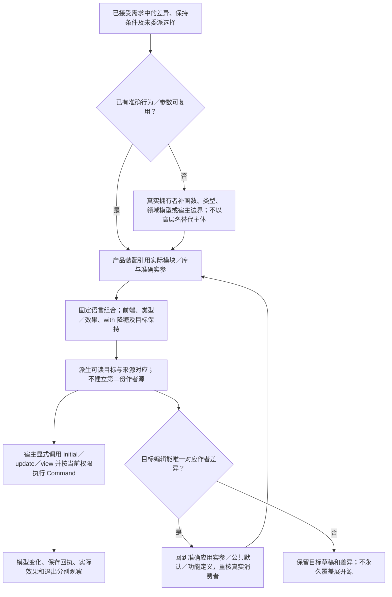

# 计算表示与实现分工

<a id="作者源码结构与需求抽象"></a>

> **阅读范围**：采用范围内的设计规范；实现状态另查未决。


**材料角色：可选计算表示与实现供给范本，不是产品作者的必需源码。** 本文的`.gift`类型、函数、记录更新和28模块定义保留其完整行为、反例及宿主责任；新产品作者主面见[完整结构化意图源](../../../examples/结构化工作台/说明.md)。库/供给维护者可以选择本文形式，下钻能力不等于普通应用作者必须手写；没有合格供给时仍保留需求并准确登记缺额。 资料与采用边界见[作者语言与模块依据](../../依据/来源/语言编译与目标工具.md#author-product-sources)。

本章拥有**选择计算作者/实现供给形式后留下什么内容，以及已确定行为怎样进入这种表示**；产品主面的需求结构由结构化意图规范拥有。动作、权限、工具请求和流水线仍由原开发操作规范拥有；词法、类型、效果与每种构造的精确规则仍由语言和领域规范拥有。本章不增加另一种Intent Language、顶层软件对象、作者SDK或手填镜像。

本计算画像包括基础文法、类型、对象、局部控制、模块、领域模型和供给机制。[完整计算范本](../../../examples/实现校准/内存编辑器计算范本.md)展示这些构造怎样形成多模块实现；开发动作的完整性、计算画像的完整性和产品作者抽象的完整性分别验收。

<a id="author-result"></a>
## 1. 最终结果是分层可展开的程序，不是自然语言咒语或操作记录

在本文计算/实现表示中，开发者维护的是**所需差异、领域定义和必要边界**；产品侧Block声明可以完全不展开这些主体。含义已由库确定时，一项使用可以是一行；含义尚未有人实现时，真实主体必须由本工程或真实供给承担。抽象隐藏的是已经定义并能实现的内部细节，不是删除实现义务。

```gift
import "../product/definition.gift";
import "../product/settings.gift";
export fn product() -> Result<definition.Program, settings.Error> !{} =
  definition.define(settings.standard with {title: "Workspace Editor", historyLimit: 200});
```

这里`definition.define`的实现、`Program`类型、设置校验、事件分派、文件编辑、搜索、预览和保存状态全部在范本中可下钻，不以一个未定义的`makePerfectIDE`结束。`with`是该可选计算画像的记录更新构造，其文法、求值、封装和资源约束见[语言规范](文法类型与求值.md#record-update-expression)。这两行不是声称整个工作台只需要两行；它们是复用者的完整差异。功能维护者要改对应模块，语言/宿主实现者还有真实供给责任。

成品有四个相互关联、但不强制一对一的层次。**产品装配**选择功能、参数、连接和目标；**功能模块**定义一项可独立使用的能力及其边界；**普通程序或领域模型**表达准确行为；**已有库/适配**提供可替换实现和外部交接。它们可以在同一文件起步，再按变化边界拆开；没有四层强制目录、每层强制包装或每个调用一个永久节点的要求。

目标TS、接口投影、类型与效果、源对应、构建成员和检查结果由现有编译链派生。可读展开帮助理解，但不成为第二份作者源。独立需求和接受证据保留自己的信息，不能因为现在的实现恰好这样做，就倒过来抹掉原要求。

## 2. 需求不是都变成一种函数，也不是全部变成配置

一条需求至少可能同时描述对象、输入/状态域、允许与必须的观察、条件、保持范围，以及尚可选择的自由。已有RequirementTerm和CompletionView承担需要的分析投影；作者不逐项填表，也不把普通源码先翻译成需求JSON才能编译。具体动作算法仍由[跨软件意图合同](../../作者/组合/跨软件需求合同.md#cross-software-intent-contract)拥有。

**选择计算表示后的落点规则：**已有准确行为就引用它；只改变已有可变参数就改实参；多个定义可以完成就组合；出现新的独立行为就写函数、类型或领域模型；目标接口/布局才写相应稀疏控制；运行配置与秘密留在运行边界；没有实现的准确命题仍可在产品需求结构中正式保存；实现缺额与研究/语义不确定分别处理，并明确由什么取得实现或证据。普通编译只读已经确定的内容，不再次调用AI解释旧聊天。

| 需求中独立的内容 | 作者源中的准确落点 | 不可偷换的区别 |
|---|---|---|
| 输入输出的精确规则 | 表达式、函数、递归/循环、真实库调用 | 只写结果范围不决定唯一算法；已有合格算法也不须复制主体 |
| 实体和合法数据 | 名义类型、和类型、opaque及构造/解码函数 | 同字段不等于同身份；序列化、物理布局和内存身份不是同一项 |
| 表格策略与业务选择 | if/match、真实规则表或参数 | 优先级、覆盖、空值和失败由已绑定定义决定 |
| 结构、关系与查询 | 真实领域记录、关系模型、查询定义 | 一对多、顺序、重数、闭包和反向关系不能归并成无类型边 |
| 持续状态与交互 | 状态/事件/转移、对象或适用状态模型 | UI状态、协议状态、设备实际状态不因同名合并 |
| 时间、连续流与进展 | 任务/流/状态的时间合同、截止/背压参数 | eventually不是固定期限；取消请求不是物理结束 |
| 外部作用与资源 | 显式端口或传入的有型接口、Own/Borrow与生命周期 | 能调用不等于已有权；纯计划值不是I/O已经发生 |
| 安全与隐私 | 准入位置、能力、隔离/信息流条件及相交证据 | 两次运行非干扰不能由单次函数后置代签 |
| 可用性和恢复 | 真实持久协议、幂等/关闭依据、故障模型 | 相同终值不能证明没有重复收费或中间可见写入 |
| 性能、容量和能耗 | 有对象和场景的质量要求、实现策略、预算与基准 | 小O、实测时延和物理硬期限不同；不得凭源码短推快 |
| 数值、概率和学习 | 数值画像、误差、随机源、模型/数据版本、统计判据 | 浮点不是Int换名字；置信度不是样本已证明的确定保证 |
| 界面、交互和媒体 | 视图/布局/样式/资源、事件映射、平台可访问性合同 | 应用画面不是Gift开发画布；美观偏好可采纳但不伪装形式定理 |
| 部署、拓扑与接口兼容 | 应用入口、目标绑定、配置、编码、迁移 | 模块不是进程，包不是权限域，源兼容不等于ABI兼容 |
| 规范、协作与外部责任 | 原需求、决定、验证/发行资产及各自拥有者 | 法律/组织接受不能由函数名、工具绿色或AI自述签发 |

这些是已发现的作用路径，不是世界需求的封闭类别或最小数学原子数。一项“协同编辑”会同时触及身份、并发、冲突语义、通信、历史、权限与离线恢复；不能因为已经有`State`与`List`就宣布对应设计全部完成。新需求可由现有构造组合，也可能暴露新的语义或宿主缺口，应在真实拥有者补设计，不预先说“都能配置出来”。

### 一个不能只列关键词的分解

需求为“在多文档编辑器中预览替换，只修改预览里的当前内容，并允许以后安全地保存”。该计算范本将已确定行为落成以下对应，而不是把它包成一个`safe=true`：

`documents.Document`保存可编辑值、单调修订和保存基线；`search.snapshot.Scope`固定会话与搜索论域；`literal.find`规定标量位置、非重叠字面匹配；`plan.make`检查选择并计算确切后像；`apply.apply`要求相同快照、先形成完整的新值再交给模型拥有者；`save.Request`冻结待保存内容；`Receipt`区分真实写成、确定拒绝、未知；`settle.accept`不会拿旧保存回执覆盖新编辑；`presentation`准确展示“模型已改、保存另行进行”。

这些定义足够描述本例有限行为。它们不自动提供工作区全部磁盘扫描、正则、全文件磁盘事务、协同算法或崩溃恢复存储。新增其中任一要求，要扩充对应定义和实际供给，不能只把标题从“loaded scope”改成“entire workspace”。

### 何时已经完成抽象

不以“源码足够短”作唯一标准。对所承诺的范围，必须能从作者源恢复：它观察什么，接受什么输入，正常和失败行为，哪些决定已固定/继承/委派，未出现的行为由哪个真实定义承担，哪些原生观察不能被中立表示抹去。再看第二次需求变更是否能改准确拥有者，而不必展开所有复用实现。

一个要求可以允许很多实现，不需要先证明实现唯一。但不能通过禁止全部有意义输入、永不产生输出或降低保证来假装满足。推导的类型仅说明这版程序的形状，不能替独立需求接受其行为。范本中的性能数字是明示产品选择，不是语言的普遍阈值。

<a id="source-structures"></a>
## 3. 新源码具体由哪些结构组成

这里区分**可写的构造**、**普通库定义**和**工程配置**，而不是将三个层次都叫“Block”。

| 结构 | 当前作者形式 | 具体责任 |
|---|---|---|
| 值与局部名字 | 字面量、`let`、记录/列表、字段访问 | 表达真实值，保持一次求值和词法作用域 |
| 精确行为 | `fn`、lambda、调用、`if`、`match`；已选通用组合的局部控制 | 表达算法和决策，不要求注册每种业务语义 |
| 数据抽象 | `type`、名义记录、和类型、`opaque`、已有泛型 | 固定可构造值与可见表示；缺少新字段会影响真实构造者 |
| 局部不可变更新 | `base with {field: value}` | 保留未改字段、类型身份和短作者源，不成为对象写入或JSON Patch |
| 契约与效果 | `require`、`ensure`、效果上界和推导 | 输入前提、正常结果和作用范围；不自动提供活性、事务或权限 |
| 供给边界 | `port`、`bind`或作为普通参数传入的有型接口 | 声明所需行为与实际选择，不按名字搜索任意世界实现 |
| 模块与公开门面 | `import`、`export`、相对模块与包出口 | 隐藏可变选择、复用合同，控制真正消费者 |
| 状态与对象 | 已有对象合同、状态函数/模型 | 有身份和生命周期时才引入，不强制万物变class |
| 关系、流、数值等 | 当前领域库构造与方法，必要的明确语言组合 | 保留各域独立语义，不都降成万能字符串或一个普通函数黑盒 |
| 应用装配 | 普通函数返回的有型产品定义/组件组合 | 连接功能、策略与目标入口；不是自动运行所有子功能 |
| 非源码与目标约束 | 原资源、配置、既有project/lock和稀疏目标控制 | 保留不能由公共语义推导的信息；不复制函数体 |

例如表中应用装配在本例是`Program`记录，但它不是Gift核心新增顶层类型。另一个编译器产品可以以编译阶段和符号表为中心；数值工程可以是算子与离散化；数据库服务可以是状态/事务边界；硬件工程有时钟、端口与布局。共享的是语言组合、模块与合同，不要求这些系统全使用一个全局Model/Event/Command。

### 不新增的东西也已经作出决定

不新增`intent`、`feature`、`workflow`、`component`、`perfect`等全局关键字；不要求一个需求一张卡、一个表达式一个管脚；不把普通lambda写成嵌套构造器SDK；不让通用JSON字段的拼写变成可执行语义；不将每个模块都配一份`.gift`和TS双写真源。现有对象/状态等能力继续可用，未在本例使用不等于删除。

`with`是该计算画像中有明确合同的词形位置，理由是跨领域的不可变记录更新在实际多模块源中反复需要；它扩展了真实文法，不能靠“只是糖”宣称没有语言设计成本。可用普通完整记录重建表达相同含义，所以它改善作者表达和维护，不提高可计算能力。

<a id="large-source-layout"></a>
## 4. 大工程的最终组织：按共同变化分模块，按独立采用分包

一个大型编辑器工作区可以具有下列布局；只有完整范本列出的28份源已经逐份给出。其他目录说明准确扩展位置，不是假装已经实现整个IDE。

```text
workspace/
  apps/                 桌面、Web、CLI各自装配；同一功能不重复手写
  features/             文档编辑、搜索、工作区、语言服务、调试、终端、扩展等边界
  domains/              文本/位置/工程关系/协议等真正共享且稳定的语义
  platform/             文件、进程、渲染、网络、设备的真实适配与签名
  product/              共同产品选择、消息、目标入口及有限的跨功能协调
  resources/            图标、样式、消息、字体许可等原始资产
  requirements/         仅独立的验收要求、质量/保持条件；不是源码镜像
  checks/               自有用例与实际框架文件；不复制框架发现表
  gift.project.json      需要持久工程时的定位与输出要求
  gift.lock.json         工具维护的精确解释/依赖选择，非手写算法
```

文件与定义、包与模块、组件与实例、进程与部署相互独立。大型版本不必须把每个features目录发布成一个包；真正分发/独立版本边界出现才建立exports和依赖。已有工程保留原生布局，不因本示例强制移动。

局部组合遵守几个实际约束。领域模块不读取最上层产品配置；所需策略通过参数或有型接口进入。共享定义不能反过来依赖某个具体应用。跨功能共同不变量由一个明确的组合拥有者处理，不让两个模块各自更新同一份权威状态。初始化、释放与跨进程效果不是普通导入顺序。动态扩展使用版本化消息和能力合同，不能把任意第三方扩展塞进编译期闭合Event枚举。

本例在内存编辑层使用Model/Event/Command，是此编辑器壳的一个可审阅选择，不是全工程永远只有一个全局状态、全部事件均串行或全部算法都要发送消息。高频文本表示、搜索工作器、持久化、扩展隔离仍各有真实边界。源级状态可以由后端在保持语义后用持久结构或其他布局实现，不能把默认List演示当成百万行性能成绩。

### 抽象能压缩到什么程度

对使用者，重复的定义可以只剩引用和参数；对维护者，差异仍保存在所属模块；对整个生态，源、供给、规则和证据的总内容没有凭空消失。泛型、模块、领域模型和编译特化可以消除重复劳动，不能无中生有恢复从未表达或接受的选择。

比较应使用相同需求和相同成熟库。不能拿两行Gift应用调用对比别人从零实现的整个编辑器，更不能以生成TS行数长来证明作者被省去了等量独立思考。若同一需求用现有语言与同样库更清晰、更便宜，就应把差距落在相应语法/库/适配决定，不能用隐藏源码掩盖。

## 5. 从两端落实到目标：不把“编译”当成一根没有内容的箭头



本次源以当前基础语义加有限记录更新为解释，不要求第二目标语言。普通类型、函数、sum和不可变记录走原前端、类型/效果、降低和TS生成；`with`有明确降糖，不调用AI。语言中的Int保持精确整数，不能直接换成未经范围检查的JS Number；Text操作按标量位置实现，不能直接套UTF-16偏移。

产品定义工厂返回`Program`是正常函数返回记录。生成器可以输出工厂和普通函数；原生宿主取得结果后明确调用`initial/update/view`并执行Command。没有一条`define(...)`在编译时隐式运行整个产品。宿主可以成熟复用，但必须符合范本列出的输入绑定、顺序、接纳、保存和退出合同，不能只因为叫“Elm runtime”“editor host”或“Code-OSS adapter”就获得资格。

源与目标对应保留到字段更新和语义定义。改生成的`historyLimit`参数应回到对应应用实参；改公共默认应回到`settings.standard`；改导出的类型声明要检查真实原型与消费者。共享生成代码被不同作者使用时，不得仅按同一数值把多个来源一起修改。不能唯一恢复时保留目标草稿并指出差异，不强行把短源展开永久覆盖。

## 6. 连续需求变化怎样改变源码，而不是只是改流程

**改历史长度**只动`apps/desktop.gift`的参数；库主体和另一个应用不变。**更换匹配器的内部实现**可在保持原Query含义时只改私有算法，范本给出完整后继。**增加新的匹配语义**则需要一起明确Query、位置、预览与替换合同，不把原字面查询伪装成正则。**从内存应用扩成磁盘原子替换**不是增加一个布尔参数，必须有真实跨资源事务或接受准确的分项保证。**允许插件增加命令**需要开放消息边界与动态生命周期，不能靠旧闭合枚举未知分支自动成功。

**改实现不改公开行为**可以把搜索或List存储换成合格索引/持久树，作者实参不变；相应实现依赖、复杂度和表示版本仍重核。**改表示又影响保存协议**则必须处理解码与数据迁移，不把源兼容外推成旧数据可直接用。

这些变化分别落在参数、功能定义、领域语义、平台能力和独立要求上。若一个改动必须修改与它没有语义关系的大量模块，应查共享类型、全局配置和隐式副作用是否边界错误；但真实公共协议变化影响所有消费者是事实，不应为追求“只改一行”而隐藏。


<a id="conditional-advanced-abstraction-profile"></a>
## 高级抽象的条件画像与推断边界

以下是明确启用高级SourceProfile时的设计合同，不改变基础rank-1、显式泛型和有限局部推断，也不启用隐式let多态。完整词法/结构接口、实际类型器和Target消费者仍需分别取得；普通函数不因高级画像缺项被阻断。没有真实解释绑定时保留抽象设计和精确能力Need，不能以目标语言支持同名构造推定中立支持。

类型种类区分值类型与有参数的类型构造器；应用先核参数个数/种类再核约束。高阶参数的kind在公开边界明确，不从任意运行值求类型。高秩量化显式进入签名，检查引入新鲜刚性变量且禁止逃到调用方局部解；存在封装打开产生局部抽象身份，未重新封装或有明确依赖合同不得逸出。任意隐式非直谓实例化不是默认路线。

接口/关联类型实例在声明与类型拥有者的一致性范围内选择，重叠默认冲突。同一有权范围采用显式特化时固定严格包含的适用域及唯一更具体关系；不可比较不靠导入/搜索顺序解决。尚无更具体实例的负观察进入真实读集，新重叠项使相交旧选择失效。公开关联类型解随准确实例固定，不能让两个编译单元自行选择不同解。

类型级方法固定归约规则、修订和相位，并取得终止依据或显式预算；不暗读环境。预算结束保留未决等式，不能报类型相等或确定非法；一般运行计算能力不意味着全部一般函数可在编译阶段无限求值。候选库、约束/重载一致性和二义性分别保留，不把未决变量填Any。

效果行由准确效果身份、参数和可选行变量构成；替换做出现检查与作用域检查，合并保留排除约束。handler只消去真正覆盖且履行合同的操作，其自身和未处理效果仍在上界内；具handler不获得现实文件/网络/设备权限。多次恢复continuation需有资源可复制资格，不能复制仅单次安全的Own。借用跨async/闭包须联立所有者、挂起点、帧、重入、waker与取消清理；无法保持时拒绝相交lowering，不伪造兼容。

单态化、字典传递、共享表示与存在封装都是候选目标方法，须保持公开布局、名义类型、错误、效果和寿命；没有依据不降成无类型JSON。验证区分重复导入/实例重叠、高秩或存在身份逃逸、效果行循环、跨await借用、取消清理与新库负依赖。普通泛型和当前已选有限画像继续按原合同使用，这个条件设计不声称真实实现已加载或运行通过。

<a id="structured-trait-profile"></a>
### 开放 trait、关联类型与默认方法的结构接合

ripgrep 的 `Captures`、`Matcher`、`Sink` 和 `SinkError` 暴露了不能靠有限函数展开消除的使用点：未来下游可以实现接口，关联错误/捕获类型依实现而变，默认方法必须调用该实现的覆盖方法。现有 `core:interface` 是端口输入/输出/错误合同，把这些普通方法改成 `perform` 会增加原先没有的 Result/Effect 含义。对象方法和若干已知类型的单态化也不能代签开放下游兼容。因此本节只补既有高级画像的 trait 声明、实现和调用接合，不新增业务 Kind、全局实现注册库或运行时对象协议。

准确载体为[trait body Schema](../../../schema/author/first-layer/trait-body.schema.json)。声明与实现仍用 `extension:definition`，其 `bodySchemaRef` 选择该 Schema，`dialectRef/bindingRef` 必须共同定位支持本节及准确 Schema 内容的解释。通用 Definition Schema 只保全 payload；专业 Decoder 另校验 payload、绑定和语义，不能因通用 Json 接受就执行任意内容。没有生产解释绑定时保留准确缺项，设计源码和结构向量仍可独立审查。第一层候选的递归 Type/Expr/TypeParam 通过原 codec 图接入下列构造，旧 `/2`、共享 TypeTerm 和基础 `.gift` 文法不因此自动支持它们。

| 构造 | 准确输入与含义 |
|---|---|
| trait payload | `kind:"trait"`、单独的 `selfParameter`、可选有序 `typeParams/superTraits`、`associatedTypes` 和 `methods`。selfParameter 是显式 Type binder，由实例的 selfType 绑定，不占 traitArguments 或运行参数槽。所有 binder 先收集再卫生检查，重名拒绝 |
| 方法声明 | `parameters/returns/effects` 必填；复用普通 `TypeParam/Param/Effect/EffectRow/Contract`、调用方式、参数和捕获合同，可有 `defaultBody:ExecBody`。`receiver` 存在时准确指第一参数；省略表示静态关联函数。借用/移入/可变性仍由真实类型和 Param.mode 决定 |
| 实现 payload | `kind:"implementation"`、可选泛型参数/前提、准确 `traitRef/selfType/traitArguments`、全部关联类型解以及实际覆盖方法。每个覆盖方法是原普通函数的签名与 ExecBody，处于实现的词法泛型环境；不以未绑定 Ref 暗补自由参数 |
| `TraitBound` | `{traitRef,selfType,traitArguments?,associatedTypes?}`。最后一个映射仅表达该约束要求的关联类型相等式；必须是真实声明成员。traitArguments 省略恰为空数组，有参数的 trait 必须给完整实参，不再创建一套推断入口 |
| `Type.associated` | `{tag:"associated",traitRef,selfType,traitArguments?,member}`。标识包含准确 trait 身份/修订、Self、全部实参和成员身份；不同 trait 的同名 Error 不相等 |
| `Expr.trait-method` | `{op:"trait-method",traitRef,selfType,traitArguments?,method}`。形成已约束方法的 callable，不求值或捕获 receiver；现有 `call.arguments` 显式传全部运行参数，`call.semanticArguments` 只绑定方法自身参数，沿原唯一推断及 fresh 规则 |

普通泛型函数、函数类型和相交 lambda 需要同一个约束入口：候选 `TypeParam.traitBounds` 为有限 TraitBound 数组，原 `constraintRefs` 原义保持。数组贡献到整个泛型头的共同前提，selfType 可以引用该头中任何已声明 binder 或其合法关联投影，不按字段出现顺序另推类型。先建 binder/kind 环境，再核所有约束、方法/结果/效果和关联等式；静态未知不填 Any。类型器在泛型定义内使用受约束的抽象 witness；只有具体实例、导出或需要归约时才取得实际合格 witness。约束求解预算耗尽是未完成，不是“没有实现”。

实现接纳在原声明/类型拥有者的一致性范围内完成。关联类型键须恰好覆盖声明集合，不允许附加或遗漏；方法键只能覆盖已声明成员，省略成员必须有默认主体。发布 witness 前，在同一环境同时代入 selfType、traitArguments 与全部关联类型解，证明实现已声明的合法前提蕴含声明 selfParameter 与 trait 参数的约束、superTraits，以及每个 associatedTypes 成员的 bounds；具体实例还须满足实现前提。任何相交约束未知时保留未决，不发布“已合格” witness。不能因方法签名碰巧匹配就让 Matcher 的 Captures 解绕过 Captures 约束。实现方法在卫生重命名、Self/trait 参数和关联类型代换后匹配声明的泛型量化、参数/receiver、返回、所有权、捕获、效果和终止边界；不能增加调用者前提、削弱保证、复制独占资源、把 total 降成 partial 或静默变成一次性调用。其 body 省略 effects 可以沿原规则推导，但须落在声明显式上界内。trait 不声明默认效果为空；无主体方法不能从空白推出纯。

receiver 除了准确命中第一参数，还必须有该 trait 的 Self 类型或经已合格借用/拥有包装保持同一 Self 的 receiver 形式；任意 Int/Text 参数不能仅靠标记取得原生 self 语义。普通共享/独占借用沿原 Borrow 合同核验，其他目标 receiver 形式须有准确 Target 方法资格。静态关联函数不带 receiver 标记，即使某个显式参数恰好与 Self 同型，也不改变公开调用形状。

默认主体只在声明处保存一次，以声明的抽象 Self、关联投影和 trait 约束检查。实际采用时以同一实现 witness 实例化；默认主体中的 trait-method 调用仍选择该 witness 的覆盖方法，不能固定调用原默认函数。显式覆盖不再执行默认主体，也不能由导入顺序选择方法。静态关联函数无 receiver，仍有准确 Self；例如 `SinkError::error_message<T>` 不能被改写成需要一个错误对象才能调用。

公开函数返回值保持原 Type：`Result<Result<T,CallbackError>,MatcherError>` 的两层错误、`Option`、普通 Bool 和 Fault 各自保留，trait 调用不增加隐式 Result，也不自动获得 I/O 或捕获环境。receiver 与其他实参沿普通 call 顺序求值一次；`&mut` 重借、生命周期关系、非 Copy 移入以及回调 Fn/FnMut/FnOnce 责任继续由原借用和共同调用 owner 判断。trait 定义自身没有独立运行状态，方法的资源终结不因分派而换 owner。

此修订覆盖普通关联类型、显式 generic method、默认方法和不重叠的条件实现。它不通过额外字段暗启用 GAT、关联类型默认值、负实现、specialization、auto trait 或 dyn trait 对象。通用高级规范保留这些能力的独立需求；碰到实际使用点应返回相交缺项。类型参数也不会因选 Rust 目标自动获得 `Sized`、`Send`、`Sync`、Copy 或 Clone，公开 Rust 接口要求的默认 Sized / `?Sized` 差异须在真实约束和目标映射中保全。

实现候选和排除重叠的负观察均进入原读集；新 impl、关联解、默认主体、效果上界或约束变化使相交选择与实例失效。当前修订拒绝无法证明不重叠的实现，不能以最先导入或先前缓存解冲突；上层通用规范的特化条件不代表此载体已经实现排序。Rust 原生开放导出还要核 orphan/coherence、可表达的泛型/关联投影、下游未来实例化和公共路径；有限测试实例不能代签。旧 Reader 不认识这些节点时保全源码并给缺项，不丢字段、不转成无类型 JSON、不退回同名端口。

最小语义审查须包括：默认 `as_match` 调用覆盖 `get`；Matcher 的两种 Error/Captures 解不混同；关联相等约束在普通函数中传递；Sink 的 `&mut` 与 `Box<S:?Sized>` 实现不吞掉所有权；静态泛型 error_message 无伪 receiver；嵌套 Result 不扁平化；缺成员、未知关联键、重叠、约束不成立及 bound 未决准确拒绝或保留未决。结构向量只能验证字段与组合，不能代签以上分派、类型或目标运行。
