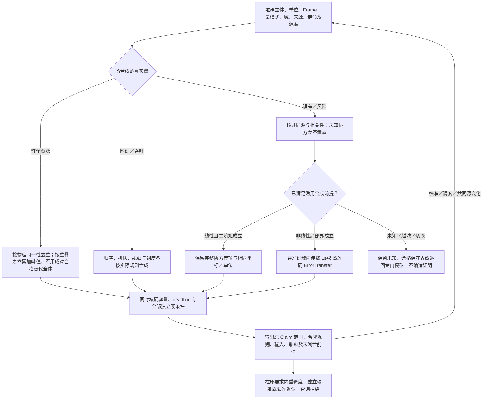

# 定量合同与误差传播

本篇细化既有[C5组合资源与领域摘要](../../编译/组合前提与进展闭合.md)。数值/统计领域提供合格合成规则，编译器按真实连接调用，保证评价保存范围；不新增全局评分或强制预算对象。

<a id="quantitative-composition"></a>
## 定量合同的合成：资源、误差、风险与相关性



内存、时延、误差、失败概率、能耗、隐私损失和金额不是同一种预算。内存峰值取决于对象寿命重叠；顺序时延包含各阶段与队列，流水吞吐由瓶颈和调度决定；并发支路的总资源不能用最大值替代；可靠性依赖故障相关与共同原因；概率风险不能用未校准“信心分”相加。

每个可计算定量合同保留量纲、范围、聚合对象、运行模式、前提、估计/实测/硬界类型，以及使用的合成方法。通用组合器仅调用该量的合格组合规则，不自行认为所有指标“越小越好”。峰值预算必须基于生命周期区间或经接受的保守上界；测到平均负载低不允许声称最坏情况下安全。

两个误差`e1,e2`相加时，恒等式为`Var(e1+e2)=Var(e1)+Var(e2)+2Cov(e1,e2)`，前提是这些二阶矩存在。若标准差同为1且完全同向相关，和的标准差是2；当且仅当协方差为0时该例得到√2。不能因来源是两个服务就认为误差独立；共同校准设备、共享训练数据和同一物理扰动均可连接它们。未知协方差应保留未知，或采用有依据且说明范围的保守界。

非线性流水线还会放大上游误差。对具有已证局部Lipschitz界L的后段，输入误差上界ε与该段新增误差δ可在相同域内给出`Lε+δ`的界；不能默认得到`ε+δ`。接近不连续边界、接触切换或奇异点时，该界可能不存在或失效，应缩小已接受域或换方法，不把数值预算标签当证明。

资源核算按物理同一资源避免重复计费，又按同时活跃消费避免漏计。定量解释应输出哪个生命周期区间、误差通路或共同原因造成瓶颈，并保留重新调度、独立校准、改变允许近似或明确拒绝的不同分支。三方容量与寿命重叠的具体见证见[可复算见证与输出条件](#quantitative-witness-inputs)。

**适用范围：**不同量有不同合成规则；未知相关性不能自动假设独立。

**重新检查条件：**新共享资源或共同误差源出现，线性/独立/稳定前提失效，或测量口径与消费口径改变。

验收的具体触发与观察见[全域接合检查](../../运行/验收/全域接合检查.md)；这里定义机制与条件，不签发任何实现、执行或现场合格状态。

<a id="quantitative-witness-inputs"></a>
## 可复算见证与输出条件

对总量、最坏界、统计区间和估计值先分型。组合输入引用实际主体、单位、所选模式、有效域、寿命区间、依赖关系与证据，不要求把每个算术节点永久记账。结果给出原Claim范围、使用的合成规则、实际输入和未闭合前提；更新校准或调度时沿这些读取重评。

三个任务同时各占4、容量10时，成对均为8不能支持三方同时准入。若只有两项寿命重叠，峰值8可以支持该调度；若串行违反deadline，不能用较低峰值冒充原任务已满足。报告必须指向实际寿命区间，而不是仅保留三项数字。

对具有有限二阶矩的误差，已知各标准差而未知协方差时，可以按适用的协方差界形成保守区间；不能将未知直接置零。非线性误差界仅在所用局部域、映射与Lipschitz条件成立时传播；越域、接触切换或奇异点交回专门模型，不隐式使用线性界。

验证把三方约束、误差相关、单位换算、寿命重叠和真实目标放在同一输入中。算式可成立而测量或域前提未知；数学计算结果不代签这些外部事实。


<a id="quantity-error-source-interface"></a>
## 单位、误差与预算的有类型作者值

本节公开普通名义库类型，参数、Rule值字段与领域模型通过共同TypeTerm/Expr传递它们。类型声明、构造器、函数和静态符号使用真实公开绑定；不是一个任意JSON属性袋。真实设备/资源Subject仍从Rule的subject槽独立传入，不藏在可复制record内。

```text
Rational = nominal record { numerator:Int, denominator:Int }
DimensionPower = nominal record { key:Text, exponent:Int }
Dimension = nominal record { powers:List<DimensionPower> }
QuantityRole = Point | Difference
UnitSpec<Frame> = nominal record {
  dimension:Dimension, scale:Rational, offset:Rational, role:QuantityRole
}
Quantity<Rep,Frame> = nominal record { value:Rep, unit:UnitSpec<Frame> }
Knowledge<T> = Known(T) | Unknown
QuantityMode = HardBound | Estimate | Measured
Metric<X> = nominal record { distance:(X,X)->Result<F64,MetricError> !{} }
ErrorContract<X,Frame> = nominal record {
  domain:(X)->Bool !{}, metric:Metric<X>, magnitude:Quantity<F64,Frame>,
  mode:QuantityMode, assumptions:List<(X)->Bool !{}>,
  sources:List<ErrorSource>, composition:ErrorComposition<X,Frame>
}
ErrorSource = nominal record { key:Text }
ErrorComposition<X,Frame> = WorstCase
  | Linear { coefficients:List<F64>, covariance:Knowledge<List<List<F64>>> }
  | Lipschitz { constant:F64, domain:(X)->Bool !{}, mapping:(X)->X !{} }
LifeInterval<T> = nominal record { start:T, end:Option<T>, startClosed:Bool, endClosed:Bool }
BudgetDemand<Frame,T> = nominal record {
  amount:Quantity<F64,Frame>, mode:QuantityMode, interval:LifeInterval<T>
}
MetricError = OutsideDomain | NumericFailure
ErrorTransfer<X,Y,InputBound,OutputBound> = nominal record {
  mapping:(X)->Result<Y,MetricError> !{},
  inputBound:InputBound,
  propagate:(X,InputBound)->Result<OutputBound,MetricError> !{}
}
QuantityError = InvalidUnit | DimensionMismatch | FrameMismatch
              | RoleMismatch | NumericFailure
convert<Frame>(x:Quantity<F64,Frame>, to:UnitSpec<Frame>)
  -> Result<Quantity<F64,Frame>,QuantityError>
```

Rational的denominator严格为正，分子分母互素；零唯一编码0/1。Dimension按key的Unicode标量序排列、key非空且唯一、exponent非零，空powers为无量纲。key属于所选量纲定义命名域，显示词不能证明两个域相同。scale严格为正；Difference的offset必须为0。Frame是公开声明的名义坐标/参考框架类型，不是运行Subject，帧标签不能凭同名Text强转。转换要求维度、Frame与role相同：Point先按`v*scale+offset`进入共同基准再逆变换，Difference只缩放。乘除点量没有默认含义。浮点实现的舍入/误差仍消费原NumericPolicy；类型正确不证明转换误差为零。

assumptions是本误差分析域的声明谓词，Bool不自证成立；跨轨迹/分布的更强义务仍由原Rule解释。ErrorSource.key只在该固定问题的源命名域内标识，非空且唯一声明；跨问题组合必须由真实共同源绑定显式对齐，不能仅因同名合并。它不签发独立性。Linear的系数与sources逐项对应，已知协方差矩阵必须同维、对称且满足所用方法的半正定条件；未知矩阵不置零。该F64矩阵画像要求坐标和单位已由准确问题固定，不能接收未经转换的异量纲项。Lipschitz的常数非负，domain和mapping准确绑定所用局部自映射，支持依据由原Assurance/Claim消费这些真实定义与域取得，不能由一个数字自签。没有合格支持仍保留合同及未决；不新增可信Bool。来源标签被复用表示同一误差源，重复出现不能冒充独立。

跨空间、异量纲或非标量误差使用同一普通ErrorTransfer值：X、Y独立绑定，InputBound和OutputBound为准确名义界类型，可含有类型协方差、相关源及各自Metric/单位。propagate消费本次x与inputBound，返回mapping在所声明域内的输出界；Rule解释必须将mapping、两个界类型及真实共同源绑定为同一传播关系，并取得对应方法与保持依据。不能以propagate返回值或函数纯度自证有效界。这样扩展改变普通类型和函数，不增加ErrorComposition业务成员；未知相关性、越域、失败和未决仍沿本篇原合同处理。magnitude必须为所用Metric的非负差量，不能使用带偏置Point；公共边界不支持其准确界类型时保留缺项。

BudgetDemand与独立Rule主体绑定。LifeInterval使用所选T时间域的开始/结束边界和开闭规则；end=None表示尚无已知结束界，不能当已释放，此时endClosed必须为false。已知end要求start<=end，空区间不产生驻留峰值但不能删除真实初始化作用。组合器消费共享主体映射、寿命区间和实际调度，仍执行本篇已有代数；不把资源ID复制进record形成第二账本。配置记录可设计期被动构造，实际测量、支持依据与运行资源余额分别取得。改单位、Frame、域、相关源、协方差、合成方法或寿命区间时重核真实消费者；值同而来源变化先安装新依赖再截断传播。

<a id="numerical-error-acceptance"></a>
## 残差、数值误差与现实准确性的分界

数值结果固定准确问题、输入与边界条件、单位和坐标、离散化/网格、算法及实际方法绑定。接受规则分别说明残差的定义、范数和缩放、前向或后向误差、局部步误差、累计/全局误差、守恒/可行性及模型与现实的偏差。未要求的保证不凭算法名附加；要求而没有依据时保留相交未知。改变单位时同步容差与缩放，不把异量纲分量直接代入无权重范数。相对误差在真值接近零时需要准确绝对容差或其他已接受尺度；区间包络需要目标环境和向外舍入资格。

小残差不普遍蕴含小解误差。取 `A=diag(1,10^-12)`、`b=(1,10^-12)`，准确解为 `x=(1,1)`，候选为 `x̂=(1,0)`。无穷范数下 `||b−Ax̂||∞=10^-12`，而 `||x−x̂||∞=1`。可逆线性系统有 `x−x̂=A^-1(b−Ax̂)`，相容算子范数下误差不超过 `||A^-1||·残差`；逆算子尺度不能省略。奇异问题另有解集合及选择条件。这个代数见证不依赖产品运行，也不指认任何库存在缺陷。

ODE局部步接受、子迭代容差与最终用途误差分别判断。接受内部一步不证明全局轨迹或现实预测准确；模型差额、初值/参数不确定、离散化和舍入沿真实耦合传播。需要全局界时取得相应稳定性/估计依据，不复制 `rtol` 为最终相对误差保证。NaN/Inf、溢出、病态、未收敛、域越界、事件不连续、预算不足和正常终止分别返回；预算耗尽可以保留候选，不能自签收敛或自动降低阈值。`fast-math`、融合或归约顺序变化时重核相交环境与误差资格。

<a id="random-source-and-replay"></a>
## 随机来源、并行消费与统计主张

伪随机流、真实熵源、抽样分布和现实数据生成机制是不同对象。实际方法绑定算法与种子或受权熵来源、分布参数、样本权重/相关结构、停止与缺失规则。伪随机可重放不证明样本代表现实总体，也不赋予密码安全性质；真实熵读取按效果或已捕获输入解释。

并行随机流按稳定逻辑任务身份和准确拆分算法分配，不让线程完成顺序暗改随机输入归属。明确采用顺序相关随机过程时保留其顺序合同。随机计算的缓存要绑定流状态及消费范围，不能只按普通函数参数重复第一次样本。检查点保留流和样本位置；续算不悄悄重设种子挑更有利结果，相同随机输入的确定重放不计作独立样本。

概率或置信主张绑定估计目标、抽样/依赖/选择/停止制度及实际覆盖依据；一个p值或一次模拟成功不签发现实概率。并行度、样本来源、分布、随机拆分或统计方法变化时重新判断相交资格；费用、资源和隐私的实际累计仍由真实作用拥有者结算，不因恢复随机状态归零。实验解释见[测量、校准与实验](../仿真/测量校准与实验.md#causal-identification-and-intervention)。
