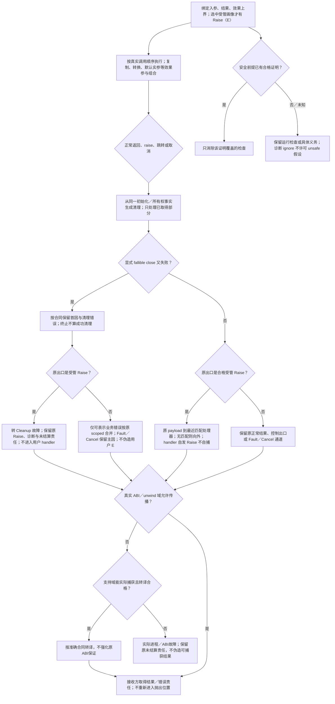

# 错误传播与契约保持

> 条件能力设计；不改变已固定的基础画像，不表示实现或目标符合性已完成。

本页补充[通用计算与任务语义](通用计算与任务语义.md)中的相交能力；原章节继续拥有其已采用的有限语义。**当前选择：保留错误/清理事实；撤销完整effect/refinement体系的必做地位。** Result和成熟异常转译足够时就结束；契约检查、typed unwind、证明求解分别按需求加入。

本页的条件采用、合同记法与公开扩展边界沿[共同能力合同](../../编译/目标/能力履行与接口差额.md#conditional-capability-contract)。

### 函数的合同不能只有入参与返回类型

设计记法：

```text
fn(args) -> R ! { Raise<E>, Allocate<Region>, Suspend, Block, Foreign<Domain>, ... }
```

只记录实际有关的效果，纯函数无须显式写空表。用户复制、隐式转换、默认实参、析构、反射执行、运算符调用所引入的效果都参加组合，不因为表面语法是 `x = y` 就隐藏分配／异常。

效果参数和泛型 witness 共同参与实例化。动态调用的可见效果是其接口承诺的上界；override 不得增加调用者没有接受的效果。底层 unknown foreign behavior 不能被自动当成 pure。

### 类型化异常

提供 abortive、非恢复式跳转的 `raise`／`handle`：异常在当前动态调用链中寻找最近的匹配处理器；恢复到处理器后不重新进入抛出位置。异常值的类型、拥有关系、析构器与模块寿命均保留。

支持精确类型、显式错误族及名义错误继承匹配，按声明顺序处理；基类处理器遮蔽后面的派生处理器应诊断。跨函数传播的 payload 必须拥有必要数据或具有足够寿命，不能悬空引用已展开的栈。

正常 domain failure 可以直接返回 `Result`，也可由受管 `raise` 路径传播；二者的目标 ABI 与控制流合同不能被一句“都等价”抹掉。

**Rust 路线：** 对 Gift 控制的完整调用链，可将恢复性异常显式降低为带 cleanup 边的 `Result`／状态协议，保持声明观察中的处理器、效果与析构顺序。外部回调、原生异常展开或要求实际 unwind 机制的入口不能因此自动满足。`panic`／`catch_unwind` 不是完整的 C++ typed-exception 兼容层。[依据](../../依据/来源/Rust与C++能力比较.md#baseline-s10)

**TS 路线：** 在受管域中用带身份的异常值和 `try/finally`／显式状态清理；外来任意 throw 值保留为 foreign error，不能凭字段名伪装成合法错误类型。原生对象所有权、错误跨 worker 序列化另有合同。

<a id="structured-throw-try"></a>
### 后继结构throw/try的条件接合

`gift.author-module/2`的`Expr.throw(error)`与`Expr.try(body,errorName,onError)`消费本节同一套受管、abortive的raise/handle。只有SourceProfile/LanguageUse、固定解释与Method准确绑定该错误画像时才取得可解释资格；不扩展`gift.semantic/1`基础文本，不从Schema合法推断Target支持。未选画像、错误类型/效果域未闭合或无合格降低时，保留唯一作者源并返回相交Need/Unsupported；普通Result程序不因此承担异常设施。

**类型、绑定与效果。** `throw`先在当前环境求error一次；正常取得准确类型E且拥有/寿命允许传播的payload后，产生`Raise(E,payload)`，无正常后继，类型为Never。error求值自身的效果、先发生的Raise/Fault/Cancel原样传播，不由外层throw重新包装。节点效果是error的效果加`Raise<E>`，名字和宿主Error外观不创造名义错误身份。

`try`先检查body的准确正常结果R及可恢复Raise域，并取得唯一既有错误承载型E：同型错误沿原E；异型错误只有在已绑定错误族及显式无损映射下才能共同绑定，不自动造Any、新和类型或按运行对象形状猜型。开放未知错误域、缺公共承载型或不明映射分别返回`NeedsEffectBound/NeedErrorType`。body无可恢复错误时，errorName按Never检查，handler仍作结构、词法和类型检查，但运行不调用它；允许保守保留其静态效果上界。

errorName只在onError的子词法区域可见，不能在body或try之后读取；重复与遮蔽沿原绑定规则。body与handler的正常结果按既有分支规则取得同一R，Never分支不要求正常值，无公共类型则诊断。函数类型、lambda、公开导出及高阶实参沿同一`Effect{class:"raise",errorType:E}`传递错误上界；调用只消费已检查签名，不能把未知补成空效果。显式上界遗漏实际Raise或不包含其准确错误型时拒绝；捕获错误不会移除body的其他效果，handler的效果继续加入结果上界。

**激活、退出与清理。** body正常返回时直接交付其值，不求onError。body的合格Raise到达最近匹配的try时，先清理真正离开的激活区域；全部应完成清理成功后，以原payload绑定errorName并求onError一次。handler自身在本try捕获域之外，其Raise向外寻找处理器，不能自捕重入。Fault、Cancel、Return/Break/Continue、预算失败和foreign未知出口不被本try吞掉；Result.Err仍是普通正常数据，不自动抛出。

清理由同一初始化/拥有事实生成，按实际获取逆序进行。Raise期间payload保有自己的拥有者、依赖和模块代码寿命；不能引用已展开的栈。清理失败转入既有Cleanup故障通道，保留原Raise及有序清理诊断，不伪造E或运行一个假成功handler；未停止资源责任仍由原运行owner结算。handler取得payload责任后沿原拥有/借用合同消费或弃置，不恢复已展开栈、不重复释放。未处理Raise不执行正常结果ensure；handler正常恢复后，所属函数仍在自己的收尾成功后执行正常ensure。

TS受管异常与Rust的显式Result/状态降低须保持以上同一合同；目标不得把任意unknown throw、panic、Fault或Cancel默认转成E。外部异常只有在明确错误型、无损转译、ABI/unwind域和清理保持均合格时才加入此域。没有准确文本Reader/Writer及往返方法时保留结构作者源，不猜throw/try文本，不暗增保留词。

**后继变更与验收。** 公开错误型、错误族映射、Effect上界、画像、Method/Target、ABI或清理变化，重核真实绑定、类型/BodyAnalysis、高阶调用、目标降低及回源消费者；旧Reader遇到新raise效果或不同解释不能静默纯化。旧源沿原修订保全，只有保持值、效果、来源及错误的合格迁移才改写。最小轨迹包括：正常body不求handler；`try(throw(e),x,h)`恰求e和h各一次并先清理；payload先Raise(F)不包装为E；handler再次Raise向外；异型域无映射返回Need；Fault/Cancel不捕获；Raise期间清理失败保留原错误且不进入handler；闭包创建不执行潜在throw，调用时才计入其效果。这些是设计符合性要求，不是已运行结果。

### 清理失败与 nofail



正常返回、异常传播、分支跳转和取消都由同一份初始化／所有权事实生成清理计划。不得为每种控制流维护一套彼此冲突的析构规则。

析构中出现第二个错误不能无意遮掉原始错误。默认同步析构不允许恢复性抛出；显式的 fallible close 可以聚合首因与清理失败，或按已规定的故障政策终止。终止不是成功清理，结果应如实区分。

`nofail`／`noexcept` 风格保证只禁止指定的恢复性错误越过该边界，不自动承诺不会出现 bug、外部进程终止、故障、资源耗尽或永久阻塞。要求 abort-free、bounded 或实时上界时单独验证。

### 契约不等于可随意删除的断言

契约表达 pre、post、invariant 与必要的 `old` 观察。默认检查表达式纯且终止；需要旧值快照时仅捕获实际使用的数据，并保留成本／拷贝／分配效果。不能为一个只读 postcondition 深拷贝整个对象图而不报告。

override 的接受输入不得更窄，保证不得更弱；能够静态证明则消除检查，不能证明时保留运行时检查或要求具体依据。逻辑蕴含无法判定时返回 unknown，不随意认定子类满足。

`observe`／`ignore` 只能应用于明确属于诊断／建议层的契约。某个 precondition 支撑内存安全时，不能在未证明条件下关掉检查却继续生成依赖该条件的 unsafe 访问。`assume` 是独立受限操作，不是普通 assert 的优化模式。

C++ 契约具有自己的标准语义和评估模式；需要精确源语言兼容时按该 profile 保留，而不是把本节默认政策冒充 C++ 原文。[依据](../../依据/来源/Rust与C++能力比较.md#baseline-s24)

## 再次修改与失效

公开错误、清理次序、契约或 unwind 域改变时，检查完整传播闭包及原生调用者；旧的成功测试不证明新失败域，取消与原操作结算仍分开。

## 使用点与可检验出口

这些分支保留各自的真实输入、替代路径与边界，不按条数声称更多底层能力；[比较记录](../../依据/来源/Rust与C++能力比较.md)不拥有另一套语义。

- 默认实参的求值环境与次序沿[默认参数与推导指南](调用定制与源语言选择.md#默认参数与推导指南)，其效果继续参加本页的传播与清理检查。
- **consteval**：编译期执行合同有用，但只对确实需要的调用生效；不要为简单常量计算复制整套历史constexpr机制。 硬边界示例：要求函数名在任意正常调用处强制编译期，并参与开放泛型组合；[具体比较与出口](../../依据/来源/Rust与C++能力比较.md#a38)。
- **更广泛泛型 constexpr**：保留阶段和目标数值输入；先做真实所需操作，不默认开放无界元程序/整个编译期堆。 硬边界示例：需要通用库操作在目标语义下静态运行、类型检查一致，不能另写host脚本/复制算法；[具体比较与出口](../../依据/来源/Rust与C++能力比较.md#a39)。
- **复制/移动赋值**：默认显式更新和所有权转移；保留allocator/失败保证。 硬边界示例：必须与固定原生赋值语法/第三方generic接口配合，或必须保持源对象post-move状态；[具体比较与出口](../../依据/来源/Rust与C++能力比较.md#a45)。
- **volatile类型限定**：常规设备访问可库化；volatile不等于atomic或CPU屏障，分别履行真实硬件合同。 硬边界示例：固定外部类型/overload/volatile调用约定无法改，或未知代码必须靠原生qualifier传播；[具体比较与出口](../../依据/来源/Rust与C++能力比较.md#a52)。
- **类型化栈展开异常**：新代码优先显式错误与统一清理；实际unwind属于有界互操作能力，不能一律说Result无损，也不默认新增完整异常语言。 硬边界示例：固定外部调用链要求实际C++异常展开、catch层级或错误表/正常路径成本，不允许更改ABI；[具体比较与出口](../../依据/来源/Rust与C++能力比较.md#a54)。
- **语言级contracts**：保留真实安全前提与检查，是否提供通用契约语法按需求决定；不能因此宣布Gift必须有全套effect/refinement系统。 硬边界示例：必须兼容C++契约语义/诊断模式，或公共API工具必须消费标准contract实体；[具体比较与出口](../../依据/来源/Rust与C++能力比较.md#a64)。

实际组合与拒绝条件见[验收案例](../../运行/验收/跨语言控制与组合案例.md)；从作者要求到再次修改见[连续开发情景](../../../examples/连续开发/跨语言能力连续开发.md)。
