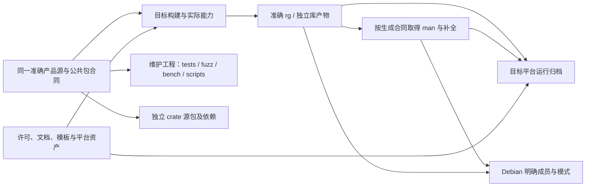

# 完整工程的构建、验证与发行合同

本源具体化[联合产品](WHOLE-PRODUCT.md)的工程交付。固定 P 为 `4c2362d359d9913c7a5e391ccd79cb4da22bc89b`，完整跟踪集合为 224 个成员，包含产品源码和其他材料；成员数不表示语义覆盖或完成率。此源不执行参考 workflow、安装或发布，也不把其中的命令当作当前工作指令。完整 Target 与资产装配尚未形成。

## 产品包与准确构建输入

| 公开包 | 固定 P 版本 | Rust crate/成品 |
| --- | --- | --- |
| ripgrep | 15.2.0 | 命令 rg |
| globset | 0.4.20 | globset |
| grep | 0.4.1 | grep |
| grep-cli | 0.1.12 | grep_cli |
| grep-matcher | 0.1.9 | grep_matcher |
| grep-pcre2 | 0.1.10 | grep_pcre2 |
| grep-printer | 0.3.1 | grep_printer |
| grep-regex | 0.1.14 | grep_regex |
| grep-searcher | 0.1.17 | grep_searcher |
| ignore | 0.4.33 | ignore |

根依赖声明中的版本范围不是成员的实际 package.version，例如根 ignore 范围仍为 0.4.29；两者由实际 Cargo 语义解释。workspace edition 为 2024、rust-version 为 1.96，globset 与 ignore 独立声明 1.88；不能用根摘要覆盖成员要求，也不能据此声称全部依赖在每个旧工具链可构建。

公开 package/crate 名、可见性、feature 和类型身份保持；私有文件位置由目标布局决定。依赖范围、锁定内容、原生依赖与 host/target/profile 共同进入构建输入，沿 Cargo 成熟解析，不新增 Gift 的 semver 解算器。普通重新构建消费固定采用内容；主动升级形成新候选和相交审查。

root pcre2→grep/pcre2→可选 grep-pcre2；printer 的 serde 默认开启并控制 JSON；globset 的 log/arbitrary/serde1 及兼容空 feature，grep/searcher/ignore 的旧 no-op feature 分别保留。musl 且 64 位的根目标额外使用 tikv-jemallocator；不能推广到所有平台或当作任意内存上限保证。

release 保留 debug=1；release-lto 的独立要求包括高优化、去符号、关闭 debug assertions/overflow checks、fat LTO、panic=abort、非增量及单 codegen unit，deb 继承后者。profile 会改变相交 panic/溢出与调试观察，不能把 debug 的证据无条件转给发行。此处记录采用输入，不保证二进制字节、精确耗时或全平台实际可用。

## 构建来源与平台资产

版本文字消费 package version 和可选 RIPGREP_BUILD_GIT_HASH；缺 package 值时为 N/A，有 hash 时附 rev。长版本还读取实际编译/运行 CPU 能力及 PCRE2 资料，不能作为一段无条件静态文字生成。

参考 build.rs 请求 `git rev-parse --short=10 HEAD`，成功取得进程输出后对 stdout 有损 UTF-8 转换并 trim，非空即嵌入，不额外核 exit status 或 SHA 形状；空输出/启动错误走各自构建警告。它不自动认证未修改上游。完整目标必须固定产品版本上下文与真实 Gift 候选来源，不能误读外层 SEC HEAD，也不能把一个展示 hash 当成整个制品身份。新目标怎样保留这份公开版本合同及真实来源尚须完成具体接合，不能擅自删版本字段来通过等价比较。

Windows manifest 只在目标 OS=windows 且 env=msvc、实际 cwd 和字符串路径可取得时进入原链接接合；包含 UTF-8 code page 与 longPathAware 声明，后者不证明宿主已开启对应支持。原链接项包含 manifest 嵌入/路径及链接警告视为错误。该资源、文件模式与相交输入必须进入真实构建，不授予当前任务更改宿主 registry 的权限。

## 测试、fuzz 与 benchmark

根 autotests=false，显式 integration 入口是 tests/tests.rs；它实际消费 macros、hay、util 和 binary/feature/json/misc/multiline/regression 模块。只保存某个测试函数而遗漏入口、fixture 或辅助模块不构成完整测试工程。各库自己的单元、集成、例子及公开接口测试按真实 Cargo membership 保留，不能按十个产品根的数量删去其他 target。

tests/data 包含带 NUL 的文本及 Z、br、bz2、gz、lz4、lzma、xz、zst 等格式输入。压缩文件的字节及真正外部解压器是不同输入：保存 fixture 不证明对应平台工具已安装，错误或不可用不能变成测试通过。测试中的独立期望保持来源，不能让目标生成器同时改期望以证明自己。

固定树实际 fuzz 工程位于 **fuzz/**，并非根 exclude 中遗留的 crates/fuzz。它有独立 workspace、Cargo.lock、edition 2024、publish=false，以及 fuzz_glob target；依赖 libfuzzer-sys 与开启 arbitrary 的 globset。此 target 只对两次构造都成功的字符串核 new/from_str 相等及 glob 原文字，任一构造失败会直接返回；不能把它表述为所有非法输入的错误等价证明，更不能作为全 glob 匹配语义证明。目标构建中保留这个独立工程和目的，不把一次短 fuzz 运行当全域证明。

benchmark 有 globset benches/bench.rs 和独立 benchsuite/benchsuite；benchsuite/runs 的历史 setup、raw.csv 与 summary 属原环境记录。它们不能成为新候选性能通过，也不能因非运行资产而静默丢失。工具、语料、参数和环境变化须分别绑定实际测量。

ci/test-complete 消费实际 rg help 和 Zsh 补全定义，既依赖二进制，也依赖 shell/补全路径；它是该一致性的检查，不是所有 shell 的执行或全 CLI 正确证明。CI 矩阵保存目标、Rust 版本、交叉环境和测试输入的参考配置；读取这些文件不触发 hosted CI，本次不以托管运行探索设计。

## 发行集合与生成成员

箭头是成员与内容依赖，不授予发布权限，不要求所有产物都在同一次查询生成。各集合有独立成员，不能用根 exclude 删除维护工程的源身份。

参考运行归档带 rg/rg.exe、README、COPYING、UNLICENSE、LICENSE-MIT；doc 下带 CHANGELOG、FAQ、GUIDE、生成 rg.1；complete 下带 Bash、Fish、PowerShell、Zsh 补全。这些生成内容消费[现有文档合同](CLI-DOCUMENTATION.md)，不是另写的旗标说明。交叉目标需要合格执行或等义生成路径；参考 release 使用相应 QEMU 执行某些目标程序，不能直接用任意宿主 rg 代替所声明目标。

Debian 明确使用 pcre2、对应 profile 及成员目标/模式：命令进入 usr/bin，许可和说明进入文档路径，man、Bash/Fish/Zsh 补全进入各自安装位置。其生成素材目录与最终包路径不同；不能因 Cargo 元数据列了目标路径便宣称文件已生成或可安装。

根 Cargo exclude 包含维护/平台分发之外的具体排除请求；独立 crate 源包仍由实际 Cargo packaging 解析，不能从这个表手工猜最终成员。HomebrewFormula 是指向 pkg/brew 的源树链接；源对象模式、宿主检出和发行物链接分别保持，Windows 文本检出不代签 Unix 符号链接和执行位。

release.yml 中的版本核对、归档、checksum、来源证明和 upload 是参考发行消费者。实际来源、签名/证明、托管 release 与普通分支 push 是不同动作；本任务只获设计与分支提交推送授权，不生成新的发布回执。滚动 runner/toolchain 或未固定外部镜像的原配置，也不因文件保存而获得可重现构建资格。

## 作者差额与剩余接合

作者明确成品、公开兼容、目标及必要资源/版本控制；系统利用上述真实输入形成 manifests、依赖/锁、布局、测试/维护入口和发行集合。独特许可、文档、fixture、脚本和来源按合适原格式保全，不把全部产品 Rust 留作第二套行为源。现有工程工具的原生源可保留其独立用途，目标产品实现仍由第一层已接受含义取得。

当前活动 Project 只捕获已有 legal/CLI 资产及设计合同，没有完整引入上述全部成员，也没有真实 Target 输出根。其余原字节继续由固定 Git 对象、旧对照与恢复材料保全；保全不等于新工程已经装配。完整成员生成、版本来源、每个包的公开定义/目标、平台、独立测试、fuzz、benchmark、安装和发行验证仍需分别闭合，不预填 PASS。

## 固定来源

包/feature/profile 来自根与 crates/*/Cargo.toml；目标版本来自 build.rs 与 crates/core/flags/doc/version.rs；平台资源来自 pkg/windows/Manifest.xml；维护入口来自 tests/tests.rs、fuzz/Cargo.toml、fuzz/fuzz_targets/fuzz_glob.rs、各 bench 和 ci/test-complete；发行成员来自 Cargo 的 deb 元数据及 .github/workflows/release.yml。跟踪集合由固定 P 的 Git tree NUL-safe 读取取得，不以工作目录临时文件补造成员。
