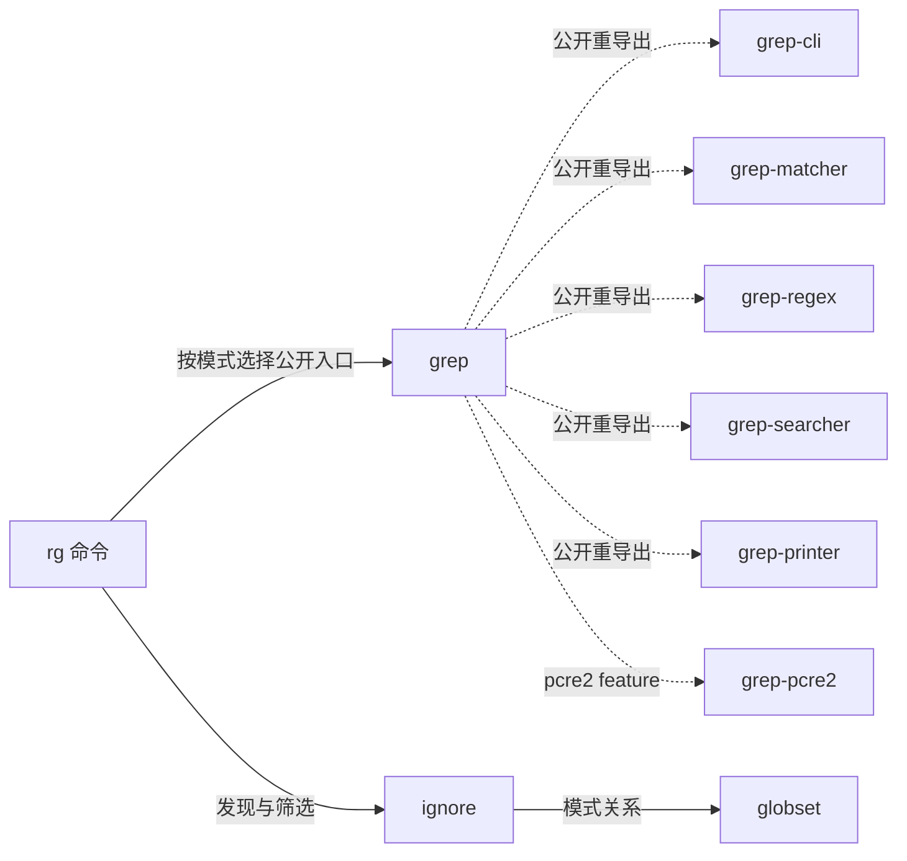

# ripgrep 的联合产品合同与 V1 开发面设计

本源拥有本工程各成品之间的关系、共享与独立状态、完整交付及修改的共同义务。命令、路径、模式、格式等已有含义继续由各自实际定义拥有，本源只增加它们组成同一产品时不可省略的关系。固定参考为 P `4c2362d359d9913c7a5e391ccd79cb4da22bc89b`；P→Q 的有意变化由[唯一名称政策](PATH-SELECTION.md#path-name-policy)及其[实际补丁](../changes/tail-dot-name.patch)拥有。

这是 Project 捕获的产品设计源，尚未取得完整九库定义、固定机器解释或可生成的输出根。下列具体义务已经确定，缺项不由文件存在、库名或“与上游一致”补足。

作者从 [PRODUCT](PRODUCT.md)进入。它选择本产品要交付和保持的含义；本页拥有这些含义怎样组成一个工程、怎样进入固定编译与再次修改。详细行为仍在原合同维护，不将本页扩成第二份旗标表、类型表或实现程序。

<a id="v1-development-surface"></a>
## V1：作者操作到完整工程的设计

本版把开发面确定为**对产品含义的持续编辑**。人能够提出、审阅和改变所求结果与必要区别，系统形成准确内容、选择或创作实现并落实目标。公开的第一层不等于只有用户亲手写的几句话：它也包含系统形成并经相应用途接受的准确内容。默认隐藏的是无需人同步维护的展开与实现细节；隐藏不取消内容、责任、成本和可检查性。

### 直接使用的方式

| 作者动作 | 本工程的实际操作 | 系统必须给出的结果 |
| --- | --- | --- |
| 创建完整产品 | 取得 PRODUCT 的范围与已有 P 对照，使用本地正文形成候选 | 成品、已有准确含义、尚缺内容及落实选择在一个候选中相互连接；不要求作者先建业务能力库 |
| 查看现在到底做什么 | 从 `rg`、某个公开库或一项政策进入，展开当前有效含义 | 展示本次实际继承、已确定决定及未决；可沿引用到正文、类型与实现，不展示一份脱离源的“已完成”摘要 |
| 修改一项行为 | 修改 PATH-SELECTION 的名称条款或某一旗标要求 | 一个新候选，准确的含义差额、保持项、实际影响与失效证据；不把编辑转成逐函数重写任务 |
| 加入没有现成名字的新要求 | 在所属产品范围表达新增结果、关系或保持条件 | 从上下文形成准确 Definition/Meaning/Requirement；缺语义与缺实现分别定位，不先增加 Gift 核心业务枚举 |
| 明确控制实现 | 在实际使用点指定算法、布局、资源或目标条件 | 控制仅约束相交选择；不满足时给出具体冲突，不静默回退另一语义 |
| 固定与重建 | 对已具备准确内容的候选选择目标并固定输入 | 消费同一语义、选择和目标的确定性结果；缺内容时给准确缺项，不让构建重新解释自然语言 |
| 交付与继续开发 | 取得完整目标源码工程，再回原意图位置改下一版 | 新源、新制品和旧运行有明确对应；原生工具验证、发布和运行分别取得自身证据 |

此表是交互合同设计；仓库当前没有实现这一完整产品界面。作者可以先用文件完成同样的设计编辑，不因此把 Markdown 当作已实现的编译语言。

### 什么值得保存，什么不需要作者填写

对任一决定，先取得原要求与范围，再使用已绑定定义、确定推导、有效缺省或已授权选择。只有仍能改变可接受结果且无法从这些信息确定的内容，才需要作者补充。无法实现的准确要求仍保留；不能把技术缺口伪装成用户漏填参数。

本例的独立控制已经具体存在：交付 CLI 加九库；兼容 P；名称政策当前采用 P、下一候选采用 Q；目标是具原公开包边界的 Rust/Cargo 工程；实现可在保持义务内改变。104 个旗标的独特拼写和行为、格式原文及原始数据也是真实产品信息，不能通过“更高抽象”推导掉。它们已经有来源，不要求用户重新输入。

系统形成的公共类型、字段、端点、状态作用、实现和目标成员同样需要准确保存。应保存到现有 Definition、Requirement、Control、Binding 与源/目标内容的各自责任位置；它们可以在一个工作区中有多个文件，但每项含义只有一个可写拥有者。生成视图可展开全部内容，日常用户只改影响所求结果的部分。

判断是否减负，要看同一变化要求人维护了多少独立决定、是否还需同步其他表示，以及首次形成、检查和后续修改的总代价。入口变短、换成 JSON、将函数移到 library 或让 AI 代写一份冗长程序，都不足以证明这个目标已经达到。

### 共同抽象与精确含义

通用机制处理有身份的对象、值和关系，允许发生的行为与作用、状态/时间/资源约束，以及组合和精化。具体的搜索、付款或其他业务含义在工程中按需形成；它们不是必须事先枚举的核心能力。这些语义维度也不是每个项目必须填写的七张表。

可以用“可接受实现的集合”解释本版的含义，但这只是设计说明，不是新增语言或通用求解器：每个候选实现须在规定环境与所有适用输入中满足产品的正常结果、失败、作用、允许顺序和保持项。两个硬要求共同满足时取共同约束；明确允许替代才保留选择；有条件要求只约束其实际适用范围。运行的先后、并发和资源共享由它们的真实语义决定，不由要求列表的排列猜测。

组合要求必须落到**同一个实现、同一主体与真实发生关系**。不能用实现 A 证明输出正确、实现 B 证明资源有界，再说有一个同时满足两者的产品；也不能先见到未来输入再选择本次已发生的输出。开放回调、流、错误和不终止的区别保留，有限样本表只证明样本覆盖。环境假设来自有效合同，不能为保住实现临时添加“外部调用者从不触发这个错误”。

精化可以决定原先开放的算法或布局，但不能扩大获准行为、删除独立要求或缩小必须接受的输入。政策变更是经接受的含义差额，与保持原义的实现替换分开。共同原则分别消费现有[意图完成](../../../../docs/作者/组合/跨软件需求合同.md#112-i0至i8从请求到可以继续的真实结果)、[结构定义](../../../../docs/作者/结构化源码.md)和[整体编译](../../../../docs/编译/内核/领域方法与整体根.md#whole-project-compilation)，本例不另立一套语义核。

### 实际字段与固定构建的接合

作者不用记一套新的 `goal/ability/step` 字段。当前既有字段各有明确用途，不能互相冒充：

| 现有保存或消费入口 | 本版使用方式 | 不能据此声称的结果 |
| --- | --- | --- |
| `Project.sourceScopes` 的 `root/kind/editSource/include/exclude` | 捕获本项目作者设计、局部语义及资产的真实集合；PRODUCT 为 `design` | 捕获不证明文字已被机器解释 |
| `Module.moduleId/definitions/imports/exports` | 保存真实定义身份、准确内容和公开引用；同一公开定义可重导出 | 填十个名字不产生十个成品；当前缺项不能填占位主体 |
| 各 Definition 的真实 `kind/body`、已有 Requirement 与 Control | 固定具体含义、参数、关系及必要控制；普通定义不强制包成 Rule | `kind` 标签或自然语言 body 不能代替其实际解释 |
| 既有源码绑定、解释映像及 `UseBinding/RealizationPlan` | 固定使用点、实际方法、前提、输入与实现结果 | 方法名或方案名不等于可调用主体和目标实现 |
| `Project.targets` 中的 `profileRef/outputRoots` | 在真实公开定义、入口和目标方法存在后选择完整成品；各根共同检查 | 当前 Project 没有完整 Target；旧 Mixed 模板的 native 根不转授资格 |
| `TargetProgramIR/ArtifactPlan/ArtifactTree` | 承接准确目标类型、控制/清理、文件成员与源码 | 目标树存在不证明原生编译、运行、等价或发布成功 |

这些字段已有规范拥有者；V1 没有扩展 Schema。当前设计正文到完整有类型定义的内容缺项不能靠调整 JSON 格式解决。需形成真实内容时，由创作责任写入唯一候选；固定构建只消费已取得内容。

确定性接合沿现有[已接受意图到程序](../../../../docs/编译/内核/输入与阶段总览.md#accepted-intent-to-program)：工作区取得候选与固定输入；语义检查解析定义、关系、类型与作用；实现选择取得合格方法或明确缺项；具体化形成完整目标结构；发射产生源码与工程成员。创作可以使用人或模型，普通重建不使用模型补业务含义。缺实现返回实际供给创作责任，不能把该缺项移到产品作者的必填清单。

LLVM 一类编译系统启发的是有类型表示、明确变换和保持条件；本版不把 LLVM IR 当作第一层意图，也不指望从 IR 自动恢复人的所求结果。目标需要高层公开 API、包、配置与资产时，由相应目标结构保留；降为 LLVM IR 本身不会提供这些产品决定。本例尚未接入 LLVM/MLIR，没有把接入它们列为本次作者设计的先决条件。

### 一次保存与再次修改

用户编辑或系统创作形成候选时，保留原接受条件和前像，计算真正改变的含义。候选中未解释内容可以保存、展示和继续设计；只有已具备准确内容的区域进入相应用途的固定解释和编译。保存草稿、接受产品选择、生成、验证和发布有不同结果，不用一个“完成”布尔值统管。

一次名称修改的完整路线是：原名称条款发生变化；其实际解释与依赖成为需重算对象；共享政策传到 ignore 的开放查询和 CLI 的真实路径选择；再影响实际到达的搜索、呈现和终结；目标代码与相交验证随之更新。无影响的引擎、格式和原资产可在证据仍适用时复用。具体边界由已有 [changes](../changes/README.md)拥有，而非要求作者填写此依赖图。

编辑失败不改旧接受候选；冲突返回具体源位置和相反要求；实现不足保留已有准确设计与独立成果；目标失败保留未完成的目标和原因；验证失败返回所反驳的含义或实现；已经产生的外部作用由原执行责任结算。新源不会改写旧进程、旧对象缓存或既有发布。相交源发生变化时，旧结果不能因名字相同就当作新证据。

当人需要修改系统形成的细节时，从当前视图回到原拥有位置，或明确接管该局部控制。编辑生成 Rust 不默认变成第二作者源；只有现有[受管回源](../../../../docs/编译/表示/编辑与受管回源.md#managed-edit-roundtrip)能够准确表达并验证该差额时才回写，否则保留为未采用候选，解释冲突，不双向覆盖。

<a id="v1-delivery-state"></a>
### V1 的交付状态与剩余设计

本次交付的是一套可阅读和可修改的整体作者候选及完整开发面责任设计：PRODUCT 是使用入口，本页拥有组合与生命周期，各详细正文拥有具体产品行为。它覆盖作者如何创建、查看、控制、组合、修改和要求目标源码的设计，不等于已经取得完整机器源或证明原最终任务完成。

| 尚缺内容 | 对当前结果的准确影响 | 下一项具体结果 |
| --- | --- | --- |
| 全产品有类型内容与固定解释 | 无法把全部 Markdown 合同作为确定性编译输入；部分公开 API 仍只有人工合同 | 在同一个整体候选中形成真实公共声明、关系及消费者；复用原表达路径，只补候选确实需要的语义差额 |
| 完整实现与目标接合设计 | 尚没有从全部要求到真实实现、Rust 类型/调用/清理、包/成员的完整绑定 | 形成同一产品的可落实实现选择与目标计划，保留独立库和工程资产；不能将缺设计统称为待写代码 |
| 完整逐项等价及再次修改证据 | 既有静态审查与局部纯值证据不足以证明整个 Native/Gift 工程等价 | 将原接受项接到真实实现与目标，再以适用方法分别核对 P 与 Q，以及允许差额之外的保持 |
| Reader、生成器与运行验证 | 本版不是可安装运行的 Gift 产品；也未编译运行完整 Gift 版 rg | 按上述设计另行实现并验证；本次设计授权不将它们虚报为已执行 |

公开九库的最终范围保留，下一步不以“九库逐个先设计完”作为统一前置；从整体候选真正依赖的内容继续。第一次形成规格、实现和检查的工作没有被隐藏，也没有已测得的总复杂度降低结论。此边界是 V1 的真实交付说明，不撤销用户要求的最终完整第一层源与全工程验收。

## 作者维护的成品与共同含义

本工程同时交付 `rg` 命令和 `globset`、`grep`、`grep-cli`、`grep-matcher`、`grep-pcre2`、`grep-printer`、`grep-regex`、`grep-searcher`、`ignore` 九个独立库，以及与这些成品相交的工程资产。独立库的公开能力不以 CLI 当前是否调用它为保留条件；某库作为成品交付，也不表示它必须进入每次命令的运行闭包。

| 成品 | 与其他成品共同成立的含义 |
| --- | --- |
| `rg` | 同次 argv、配置、环境与实际输入决定命令的行为。路径选择、搜索、输出、诊断和终结共同满足 [COMMAND](COMMAND.md)，共享 [ARGUMENT-SOURCES](ARGUMENT-SOURCES.md) 与 [CLI-OPTIONS](CLI-OPTIONS.md) 的决定。 |
| `globset` | 模式、候选字节、单项及有序集合匹配由 [globset 合同](../library/globset-contract.md)拥有；被路径筛选、工具库或外部调用者消费时保留相同含义。内部索引与匹配策略保持实现自由。 |
| `ignore` | [公开遍历合同](../library/IGNORE-CONTRACT.md)拥有规则构建、visitor、条目、缓存与错误；[PATH-SELECTION](PATH-SELECTION.md)拥有唯一选择政策。CLI 实际接纳的条目继续进入同次搜索、结果、统计与退出关系。 |
| `grep-matcher` | [共享匹配协议](../library/MATCHER-CONTRACT.md)连接后端、搜索器、打印器和外部实现，保持字节范围、捕获状态、默认/覆盖、替换、两层错误及保守知识。内置后端的额外性质不能提升为所有合法 Matcher 的前提。 |
| `grep-regex`、`grep-pcre2` | [两后端合同](../library/ENGINE-CONTRACT.md)固定各自模式、控制、捕获、错误、JIT/资源和导入边界；同一 Matcher 不使语义相等，选择须满足该次要求。 |
| `grep-searcher` | [内容搜索合同](../library/SEARCH-CONTRACT.md)把真实输入、解码、行/多行、二进制、上下文与 Matcher、Sink 连接，保持公开入口、回调、停止、错误和资源区别；P 的实际停止例外也在相交兼容范围内，最终匹配集合不能替代已发生作用。 |
| `grep-printer` | [公开呈现合同](../library/PRINT-CONTRACT.md)把同次事件接到标准/摘要/路径、颜色、链接、统计及真实 Writer；[JSON-OUTPUT](../library/JSON-OUTPUT.md)独立拥有 JSON 结构和写入差异，开放库入口不被 CLI 特例合并。 |
| `grep-cli` | [工具库合同](../library/CLI-LIBRARY-CONTRACT.md)拥有终端、路径、模式来源、转义、解压与子进程。使用该库不自动启动 `rg`、消费 argv 或取得命令的消息/退出状态；真实读取、close 与部分结果沿其公开合同。 |
| `grep` | 按原公开边界重导出 cli、matcher、regex、searcher、printer，以及 feature 允许的 pcre2。别名指向原公开定义，不创建另一套类型、搜索行为或运行实例。 |

这些关系不规定一条统一流水线。Files 不需要内容 matcher/searcher；Types、Generate、Special 各有自己的正常结果与条件性准备；不可匹配快捷结果也不产生虚构的搜索回执。路径、命令及格式的内部义务仍沿原正文，不能因本表只列一个单元格而缩小。

表中尚未形成完整正文的独立库仍是本工程的设计缺项。系统须形成其真实公开类型、方法、错误、泛型/关联项、回调、借用、feature/cfg 与作用合同；本表不签发这些内容已经完成。

下图的实线是产品的按需使用关系，虚线是公开重导出；它不规定运行顺序，也不要求每次命令调用全部库。重导出保持原定义身份，`pcre2` 边只在其 feature 成立时存在。



## 共享定义，不混合运行

同一工程修订可以共享准确定义、公共类型、常量与合格实现。定义相同不使运行状态相同，产品根数量也不决定运行实例数量。

- 一次命令调用 κ 的输入、配置决定、模式、quiet、selected、错误累计、停止、stdout/stderr 与总统计只关联 κ 的真实观察。不得从不同调用分别取一个有利值组成满足合同的结果。
- `grep` 重导出不构造新的 Matcher、Searcher 或 Printer；同一公开定义经两个路径访问仍保持其名义身份。不同实际包实例中的同名 trait/type 则不能凭名字合并。
- Matcher、Searcher、Sink、Writer、Walk 和 IncrementalIgnore 按真实构造、拥有与公开复用关系保持各自状态。只读值可在合同允许时复用；文件句柄、可变缓存、回调与子进程不能按内容相等直接去重。
- CLI 每次搜索建立 sink 的用法不限制外部调用者的合法复用。现有 JSON 合同中的 begin 状态和累计统计由同一个真实 sink 的寿命决定，不能在下一次搜索前擅自重置，也不能将不同 sink 混成一个。
- 同一 IncrementalIgnore 的父目录缓存可以影响后继查询。新建与复用不是相同观察；源修订不会倒改已有实例绑定的含义。具体缓存和调用条件由路径合同拥有。
- 并行工作可共同贡献命令级停止、错误和统计，仍须保留每个实际输入的路径、结果、偏移与错误来源。跨文件允许的调度自由不取消文件内部的顺序及完整块约束。

系统从真实连接和作用取得这些关系；作者不维护 κ 字段、事件台账、线程图或逐变量资源记录。实现需要的身份、借用和同步由下层承担，公开可区分的寿命和顺序保持。

下图只展开真实搜索发生时的两种消费边界。两侧可以共享定义，实例和状态按实际构造独立；同一侧复用 sink 时保留其原状态，不能按“下一次搜索”自动重建。未进入搜索的命令模式不经过此图。

```mermaid
flowchart LR
  definitions["同一固定 Matcher / Searcher / Sink 定义"]
  subgraph command["一次命令 κ 的实际使用"]
    inputs["κ 的输入及有效决定"] --> search["实际搜索与回调"]
    search --> sink["实际 Sink / Writer 实例"]
    sink -->|结果或写入错误| handling["κ 按失败位置处置"]
    search -->|搜索错误或正常结果| handling
    handling --> result["κ 的累计、诊断、继续或终结"]
  end
  subgraph library["独立库调用者的实际使用"]
    external["合法输入与调用者配置"] --> call["独立搜索与回调"]
    call --> owned["该使用者构造或复用的 Sink / Writer"]
    call -->|公开返回或错误| caller["返回原调用者"]
    owned -->|公开返回或错误| caller
  end
  definitions -.->|定义与类型约束| search
  definitions -.->|相同定义；不共享实例状态| call
```

## 库结果与命令处置各有边界

CLI 使用某个库时，该次库调用的前提、结果、错误、回调、借用与资源责任继续成立。CLI 在自身合同内选择配置并处置结果；独立库使用者保留原公开返回与回调，不能被统一改成进程退出码。

| 库侧观察 | CLI 增加的关系与保持条件 |
| --- | --- |
| 搜索、Sink 或 Writer 返回错误 | 按 [COMMAND 的实际失败位置](COMMAND.md#失败位置部分结果与终结)决定传播、累计、诊断、停止或继续；原错误被包装时保留准确包装结果，不能从最初原因重新制造已丢失的错误链。 |
| Printer 的写入失败 | 库调用者能取得的错误仍保留。CLI 忽略结束处统计/summary 写错误的特例只作用于该处，不扩展成 Printer 总会成功。 |
| Searcher 的回调、停止与完成 | 保留真实回调条件、次数、先后与失败；相同最终集合不许可预先执行原本被短路的回调、读取或写入。不能把某条接口说明推广到参考实现未满足它的全部路径。 |
| 一项搜索的选中结果 | 以真实 sink 及其二进制/统计政策产生 selected，再进入该次命令决定；不能用输出是否非空替代 selected。 |
| 路径资格、来源和附带错误 | CLI 继续按实际分支处理诊断、错误累计与搜索输入。规则诊断与遍历错误不会因都来自 ignore 而合并为同一种退出原因。 |

同一合同只在其实际定义处维护一次。每个消费者增加的是独立选择和处置，不再复制一个同义 Matcher、名称政策或 JSON 格式。

## 包、功能与目标工程

成品保持公开 crate 边界、模块公开性、重导出、泛型、关联项、feature/cfg 和公开类型身份。私有函数、文件划分、局部状态、算法和线程组织没有因此被固定；明确接受的布局、算法、ABI 或资源要求仍在相交范围内保持。

固定 P 已提供以下真实装配决定，系统利用这些上下文形成目标工程，不要求作者重新选择一遍：

| 输入事实 | 目标工程必须保留的关系 |
| --- | --- |
| 根 `ripgrep` 包提供二进制 `rg`，参考入口为 `crates/core/main.rs` | 存在满足命令合同的真实可执行入口。它不是 public export，不能按“零公开函数”生成空程序；目标入口的私有文件位置可由布局责任决定。 |
| 根 `pcre2` → `grep/pcre2` → 可选 `grep-pcre2` | 原 feature 传播与受条件控制的公开重导出保持。关闭支持时不假称 PCRE2 可用；feature 启用也不证明 JIT 在现实环境可用。 |
| `grep-printer` 的默认 `serde` 与 JSON 支持条件 | API 可用性、实际依赖和目标能力按完整 feature 闭包共同判断；不能只凭有一个 JSON Schema 宣称该构建提供 JSON。 |
| `globset` 的默认 `log`、可选 `arbitrary` / `serde1` 以及兼容的空旧 feature | 可接纳的构建输入、对应 API 与依赖条件保留。空 feature 没有运行作用，不等于可以删除公开构建输入。 |
| 独立 crate 包与完整工作区 | 每个发行包声明其真实依赖；工作区内存在某路径不代替独立包的依赖。共享名义类型的连接按实际解析版本检查。 |
| edition、最低工具链、平台 cfg、原生依赖和特定目标配置 | 按所选目标与已接受支持范围落实。构建工具、CPU/OS 与依赖不能静默改变公开要求；具体生成文件和工具链选择由下层承担。 |

选择多个目标或包时，共享成员由原目标布局责任统一拥有。重复输出路径、不同包实例的名义冲突、缺原生能力或 feature 不相容都是相交缺项；不能为凑齐十个根输出同名空文件。正确的依赖与目标源码是系统结果，作者只需决定无法由已接受上下文确定的公开支持或资源差异。

## 完整工程与资产

实际包版本、工具链/feature、测试与独立 fuzz、benchmark、构建来源和各发行集合由[工程交付合同](ENGINEERING.md)具体承接；本节保留它们与产品含义之间的共同责任。

运行成品、库源码包、维护工程和平台安装包具有不同成员集合。参考 Cargo 的 exclude、平台打包项、测试与维护入口说明它们不能由一个通配目录自动视作同一包。

| 内容 | 唯一含义及装配责任 |
| --- | --- |
| 产品行为与公共 API | 由第一层准确合同和定义拥有。目标 Rust 随之形成；保留全部旧产品 Rust 为另一个可编辑行为源，不满足本次交付。 |
| 许可、原文档、fixture、模板和现存脚本 | 保持其真实内容、来源、文件模式及链接责任；原格式仍有实际消费者时直接复用。未知材料先保全，不能从文件后缀推定它已被语义化或可以删除。 |
| help、man 和 shell 补全 | 共同消费 [CLI-DOCUMENTATION](CLI-DOCUMENTATION.md)、旗标词表、别名和原格式资产，不再维护同义的第二套公开旗标信息。 |
| Cargo、构建接合、依赖锁和发布布局 | 从真实包、公开 feature、目标与资产关系形成；锁和生成结果不要求作者逐项同步。普通构建消费固定输入，不能每次重新猜参考工程。 |
| tests、fuzz、benchmark 和维护入口 | 保留独立接受来源及实际用途。它们的程序属于工程工具，不因此成为产品规范；相交 crate、feature、命令或路径改变时随消费者修订。不能只留下测试文件而遗漏 harness、fixture 或构建入口。 |
| Windows manifest 与平台资产 | 仅在其实际适用目标承担嵌入、路径与安装责任；产品能力不授予本次设计过程修改宿主配置的权限。 |
| 版本与发行身份 | 绑定该产品的准确构建输入与版本政策；不得误读外层 SEC 的 Git HEAD。源包的 Git 模式、符号链接和平台物化分别核对。 |

当前 Project 实际捕获的资产仍只有 legal 与 CLI 部分，不能签发这一完整集合已装配。系统负责清点、形成成员与真实消费者接合；作者不为 224 个原成员再填写一份分类表。未承接成员及旧草稿的恢复责任明确保留，不能因新 Project 未选择便自动退役。

## 一份源怎样继续开发

**新建。** 本例已有“完整 rg、九库及工程资产，以固定 P 核对公开兼容”的独立目标。系统利用真实来源形成准确合同、公共定义、条件性连接和输出选择。作者无需先提供搜索能力库，也不填写解析阶段、类型投影、回调包装或内部线程组织。固定 P 提供事实和独立核对材料；采用后的源有自己的准确内容，构建不靠读取上游 Rust 重新猜含义。

**查当前有效意图。** 同一源必须能回答：交付哪些成品；每个根继承了哪些真实合同；哪些类型/定义共享；哪些运行状态独立；当前名称政策是哪一条；哪些输入、作用和公开区别仍未确定。查询分别呈现已确定含义、缺机器解释、缺实现与未验证，不能把“文件已捕获”显示为“可生成”。人可以展开系统形成的完整含义并修改其原责任位置，无需维护另一份摘要或全部派生结构。

**改同一产品。** 现有 [P→Q 补丁](../changes/tail-dot-name.patch)只修改名称政策：非空 Unix 路径改为仅在最终分量恰为 `.` 或 `..` 时无名称；其他尾点名称保留。原字节、空路径、尾斜杠与非 Unix 条件保持。系统沿 Types、hidden、Walk、IncrementalIgnore 及实际搜索输入、输出、统计、退出重求影响；作者不逐个修改消费者的实现函数。

这次变化同时约束 `ignore` 独立公开查询和 `rg` 的实际使用；不能只修改命令结果或只修改一个库方法后称整个产品完成。旧制品与已存在实例继续绑定原修订，新的源含义不追溯改写旧运行。其准确消费者条件和剩余验证由[修改审查](../changes/README.md)拥有。

作者承担的独立信息因此落在接受的产品区别与必要控制上。系统承担完整规格形成、继承、固定解释、实现和目标接合；这些工作与其首次形成、检查、再次修改及退役成本仍纳入全成本，不因目录或工具替人填写而消失。

## 固定解释与实际输出的交付界面

本源与各合同共同约束同一产品，不能分别为命令、库或一次调用挑选互不相容的实现见证。共有 Matcher、路径和格式义务由同一实际定义连接，独立库调用保留比 CLI 用法更开放的输入与使用者。

整体候选按实际内容选择已有 Definition、Meaning、Requirement 的解释路径；采用 Rule 的部分沿已发布的[规则含义接合](../../../../docs/编译/内核/领域方法与整体根.md#bound-meaning-method)承担，实际类型与同次观察的具体绑定仍须取得，未发布细化不算本版已有算法；[整体工程算法](../../../../docs/编译/内核/领域方法与整体根.md#whole-project-compilation)负责所选根的共同闭包。不是全部定义都先经过 Rule，这里也不新增产品专属解释器、根语言或运行台账。实际交付仍须形成：

1. 上表各成品的准确公共定义及真实引用；`grep` 的别名接到原定义，不能造重复声明。
2. 各产品合同的固定解释内容，真实调用/对象/环境观察与条件性可用端点；库的开放回调和命令的在线 IO 不能缩成有限样本表。
3. 消费同一接受关系的实现取得与保持设计，以及有效 Target、真实输出根和完整成员装配；不得给缺失入口预填一个名称。
4. 同一修改经共享定义、独立根、资产和检查的影响闭包；共享分析可以复用，某根失败不伪造其他根成功，也不抹去不受阻结果。

上述第一项与第二项的具体内容仍未全部形成，后两项也尚未取得完整接合。它们是必须继续解决的设计缺项。生产 Reader、Rust 生成、完整 Native/Gift 运行及平台/并发/性能/发行实证另属未实施或未验证，不能用这条实施边界掩盖设计缺项。

## 来源定位

固定 P 的 `Cargo.toml` 与 `crates/*/Cargo.toml` 拥有上述包和 feature 的参考事实；`crates/grep/src/lib.rs` 提供真实重导出；`build.rs` 与 `pkg/` 提供相交构建、版本和发行输入。命令与 sink 的具体来源沿 COMMAND、JSON-OUTPUT，名称和缓存沿 PATH-SELECTION 及 changes/README；这些来源用于审查，不成为目标构建时重新推断意图的解释器。
