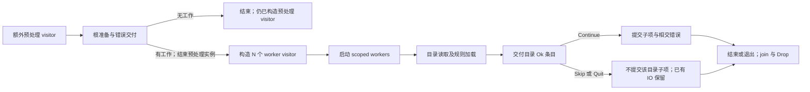

# 共享路径匹配与遍历库的产品合同

本源补足[路径选择政策](../intent/PATH-SELECTION.md)与[默认类型数据](default-file-types.module.json)之外的公开库含义。规则优先、根绕过、隐藏、predicate/尺寸和名称判断继续由路径政策拥有；P→Q 仅改[既定名称条款](../changes/README.md)。下列固定 P `4c2362d359d9913c7a5e391ccd79cb4da22bc89b` 的可观察行为均在其余兼容范围内。作者不维护私有 ignore AST、线程或阶段程序；系统形成实际定义与实现。当前仍缺机器声明、固定解释及完整目标接合。

## 结果、来源与错误

Match 的 None/Ignore/Whitelist 及赢家沿路径政策。invert 只交换极性、保留载荷；map 只对有载荷结果调用一次并保留极性；inner 借用载荷；or 选择左侧首个非 None。or 的右参数已作为值传入，不提供惰性生产保证。

Error 保留 Partial、行号/路径/深度包装、链接环、I/O、glob、未定义类型与非法定义等公开结构。is_partial 穿透相交包装检查实际 Partial，不能从操作部分成功推断它为 true：单个 glob 错误也可与其他已加入规则并存。I/O 查询仅在穿透包装后为单个 I/O 或恰含一个相应错误的 Partial 时返回原生错误；两个 I/O 错误不任选其一。depth 只按实际 WithPath/WithDepth 路径查询，不遍历所有包装猜深度。

Clone 重建 I/O 错误，优先 OS 错误码，否则用 kind/文字，不保留任意自定义错误对象身份。Display 按顺序以换行连接 Partial，行号/路径作上下文，深度不额外写字。错误不撤回已加入规则、已交付条目或回调作用。

## 独立 Gitignore 与全局来源

Gitignore 匹配给定路径和调用者提供的 is_dir，不自动 stat、递归、剪枝、隐藏或检查 stdout。根与路径按实际词法处理，不新增 canonicalize、存在性或安全 containment。

matched_path_or_any_parents 先匹配当前路径，任意非 None 即返回，仅 None 才逐级查询目录父路径；当前 Whitelist 因而可直接胜出，不等于 Walk 被忽略祖先的剪枝。非空 matcher 对去根后仍有根前缀的输入有断言，空 matcher 在断言前返回 None；它不是文件系统安全边界。

Glob 暴露来源路径、预处理后的原文字、编译 glob、允许与目录标志；original 不保证原文件整行字节。Gitignore 公开根、空性、规则/忽略/允许数及真实赢家 Glob 的借用。builder.build 为当前快照，不消耗 builder；后续加入和构建不热更新旧 matcher。大小写设置只影响后加规则；未闭合字符类默认按字面，可改为错误。

add_line 的注释、尾空白、转义空格、空行、`!`、转义 `!/#`、根锚点、目录尾斜杠、任意层名称及尾 `/**` 保持 P 关系，具体 glob 语法复用原 globset 合同。add(path) 按 UTF-8 行读，首行移除 BOM；非法 glob 记路径/一基行号并继续，读取错误停止该文件，已加入规则保留。集合 build 还能失败。Gitignore::new 过滤纯 I/O 错误并始终返回 matcher/可选错误，最终编译失败返回空 matcher，不能与 Builder.add 的通道合并。

全局忽略发现依次尝试 GIT_CONFIG_GLOBAL、HOME `.gitconfig`、XDG `git/config`、系统配置；系统路径取非空 GIT_CONFIG_SYSTEM，否则 `/etc/gitconfig`。没有取得值再用非空 XDG `git/ignore` 或 HOME `.config/git/ignore`。GIT_CONFIG_GLOBAL 已设置但没有取得值时仍继续回退。

P 逐行不区分大小写寻找首个 excludesfile，不核 section、不执行完整 Git include；值须能变为 UTF-8 路径，HOME 展开替换全部 `~`，不限开头。读取失败在发现处视为无结果；返回候选路径不证明存在。build_global 在没有候选或候选不是文件时直接返回空 matcher 和无错误，既有 builder 规则不进入结果，结果根也为空。只有候选为文件并进入 add→build 且构建成功时，结果才保留 builder 原根与既有规则；添加的部分错误仍返回，最终构建失败则返回空 matcher 与对应错误。

Gitignore::global 自行取得进程 CWD，失败返回空 matcher 和 I/O 错误。WalkBuilder 的 current_dir 不修改进程 CWD，可替换其首次自动发现的缓存。构建 base matcher 时可能已读全局文件，相交错误按路径记 debug，不统一成为遍历 Err；显式 add_ignore 是立即读取、通过 Option<Error> 返回的另一通道。

仓库识别保持实际 `.git`、`.jj`、`.git` 文件和 commondir 条件，不消费 GIT_DIR/GIT_COMMON_DIR，也不自动提供完整 Git worktree 解析。

## Override 与文件类型

Override 复用行语法但普通规则是 Whitelist，前导 `!` 是 Ignore；默认未闭合字符类报错，与 Gitignore 不同。大小写只影响后加规则，计数按反转极性。opaque overrides::Glob 没有公开原文字、路径或 unmatched getter，不能补造 API。

TypesBuilder 初始无默认定义，add_defaults 逐条加入原数据，不清空、不自动选择，重复加入保留重复 glob。add 验证名字并保存文字，只在 build 编译选中/反选的类型；未选的非法 glob 不一定使 build 失败。

add 拒绝 all 和非 Unicode 字母/数字字符，却允许空名；add_def 拒绝空名、空直接 glob 或空 include。include 复制当时存在定义的 glob，不建立动态关联；有缺项则在复制前返回错误。select/negate 保留顺序，未定义名延迟 build 报错；all 只展开当时已定义类型，不包含未来添加，也不保证 HashMap 顺序。

clear 删除定义但保留选择，故后继 build 可失败。definitions 按名称及各自 glob 排序，不能用定义数代替选择数。路径最终结果由最后适用的选择 glob 决定，载荷保留 FileTypeDef；unmatched-ignore 的 file_type_def 为 None，没有精确命中哪条 glob 的额外 getter。Types 只消费原名称政策，目录或空编译集合直接 None；定义列表非空不代表过滤已启用。

## 条目与串行遍历

WalkBuilder 支持空根和按加入顺序的多根，不承诺去重。构建后配置不随 builder 热变更。默认无深度/尺寸限制、不跟随非根链接、不限制文件系统、无排序/predicate/stdout 排除；标准 ignore 过滤启用、要求仓库关联、大小写敏感。后设置的 overrides/types/predicate/排序器替换前项；standard_filters 仅切换其六项，不清除其他显式配置。

min/max 深度的设置顺序保留：新 max 小于已有 min 时提升 max，新 min 大于已有 max 时降低 min，不统一改为报错。排序只在目录内，不是跨根全序；并行不使用排序器。

DirEntry 的路径、名称、symlink/file type、metadata、深度、Unix inode 与附带错误分别保留。其 file_name 是原生条目查询，不等于路径政策的特定纯值名称函数；无名称时可给整个路径。根 `-` 为 stdin，`./-` 为文件路径；stdin 的显示路径/名称为 `<stdin>`、深度零、无 file type/inode、不是链接，metadata 返回带路径错误，且不走普通条目筛选。

Walk 是 FusedIterator，逐项 Result；Err 不统一结束遍历。父规则错误可先交付后继续；目录规则错误可附在 Ok 条目上，有效规则仍参与后代。规则/predicate 跳过目录会剪枝，根例外沿 PATH-SELECTION。在串行 max-depth 边界使用空目录项建立上下文，不读取该目录后代用不到的 ignore 文件。

## 并行 visitor 与已有作用

run/visit 消耗遍历，错误通过 visitor 的 Result 条目交付，不通过统一返回 Result。visitor 持有自己的可变状态；filter 可由多个 worker 共享调用，不能合成一个可变 visitor。

P 首先额外 build 一个预处理 visitor，即使空根也会发生；有有效工作时先结束该实例，再为 N 个 worker 各 build，总计 N+1。worker visitor 全部在启动前构造，构造 panic 时尚未启动这些 worker。线程数非零照用，零则取 available_parallelism、失败取一、上限十二。scoped threads 在返回前 join，worker panic 请求退出并传播为 panic；没有额外公开 finish 回调，Drop 不证明该 visitor 收到过条目。

Continue 继续；Skip 对目录停止提交其子项，普通文件/错误没有相同递归效果；Quit 请求尽快全局结束，其他 worker 的在途回调、predicate 和作用仍可能发生。它不是无后继效果的封口。

图只说明主关系，实际深度及失败条件如下：根父规则和文件系统检查先发生；可下探时先 read_dir/加载本目录规则，再交付目录。目录读取失败时先给 Ok 目录，只有 Continue 才再给读取 Err；Skip 可抑制该错误交付而不能撤销失败。成功读取后处理/提交子项，再交付收集的枚举错误，其他 worker 不服从这个局部顺序。

min-depth 主要控制 Ok 条目交付，低于它仍可读规则、递归和交付错误。max-depth 虽不 read_dir，并行仍 add_ignore，可出现串行没有的规则 IO/附带错误。显式根链接另有读取路径，follow_links=false 不意味着所有根链接都不被解引用。

## 增量查询

build_matchers 按根顺序产生匹配器，共享基础及相交父规则，每份保留自己的根与目录状态。它不启动 Walk，也不证明文件存在。matched/matched_with_errors 的合法输入相对于根且不含 ParentDir，不自动 normalize。

normalize 是显式便利操作，用进程 CWD 绝对化并词法整理点分量，再去词法根；不 canonicalize、不跟随链接、不全平台大小写折叠，失败或根外为 None。点路径相对进程 CWD 而非 matcher 根，根的规范化首次需要时缓存；不是安全沙箱。stdin normalize 为 None，查询也为 None。

首次发现根不是目录会保留该状态，不因后续文件系统变化自动热刷新。已加载目录及祖先剪枝缓存属于 matcher 寿命，Clone 不等于重读。matched_with_errors 返回本次新加载/metadata 错误及仍可使用的结果，缓存命中不保证重报旧错误。

IncrementalMatch 的极性、should_descend、is_within_depth 是独立观察：文件不下探，目录可不 Ignore 却因 max-depth 不下探，也可低于 min-depth 仍下探。P 的越界文件 is_within_depth 也会 false，与“非目录总 true”的注释不同。invert 只反转 Match，不重算其他两项，故反转后的 Whitelist 仍可能不下探。

## 平台、公开面与来源

Windows raw entry 可保留 metadata，其他平台按路径重新查询；ino 仅 Unix 公开。同文件系统消费 Unix device/Windows volume，其他平台有 unsupported；并行 raw entry 在非 Unix/Windows 也有未支持分支。skip_stdout 在设置时尝试取得重定向普通文件的 handle，失败或非普通文件不装比较对象、不返回 setter 错误；后续比较保持真实错误。simd-accel 是 no-op feature，不证明开启/关闭某个 SIMD 实现。

| 公开族 | 固定 P 来源与覆盖 |
| --- | --- |
| Error、Match 及根导出 | `crates/ignore/src/lib.rs:51–490`；结构、公开查询/变换、呈现和相交派生 |
| Gitignore/Glob/Builder、全局配置发现 | `gitignore.rs:32–704`；全部公开构造、计数、匹配、加入/构建与解析设置 |
| Override/Glob/Builder | `overrides.rs:28–183`；极性、opaque 载荷和全部构建入口 |
| Types/FileTypeDef/Glob/Builder | `types.rs:110–494`；定义、选择、include、clear、默认与结果来源 |
| WalkBuilder、DirEntry、Walk | `walk.rs:31–231,545–1264`；所有公开构建/设置、条目查询、Iterator/FusedIterator |
| WalkParallel、visitor traits、WalkState | `walk.rs:1321–1643,1755–2060`；run/visit、构造/引用转发、调度/控制与作用 |
| IncrementalIgnore/IncrementalMatch | `incremental.rs:56–168,194–554`；查询、normalize、缓存与独立结果标志 |
| 仓库、全局与平台接合 | `dir.rs:192–259,340–441,781–858,1053–1105`；`Cargo.toml` |
| CLI 消费 | `crates/core/flags/hiargs.rs:874–925`；`core/main.rs:155–210,280–326` |

以上来自静态实现和消费者审查。未完整审计 walkdir、same-file、crossbeam-deque、globset 和系统 API 内部，未运行并发 Quit、panic、链接环、权限、跨设备或刷新实验；默认类型数据沿原证据，不重复认证。完整机器类型、ABI、固定解释、跨目标及全部 CLI 消费继续是必要接合，未由本文签发全工程完成。
