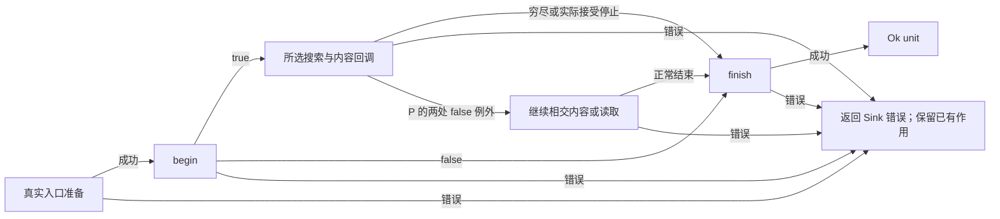

# 内容搜索的产品合同

本源拥有固定 P `4c2362d359d9913c7a5e391ccd79cb4da22bc89b` 的 grep-searcher 公开搜索关系，连接[共享 Matcher](MATCHER-CONTRACT.md)、真实输入与接收者，并由[联合产品](../intent/WHOLE-PRODUCT.md)同时约束独立库和 CLI。路径枚举、展示格式、颜色、替换及退出码分别由原拥有者决定。当前是待固定机器解释的实际设计源，不表示公共类型、方法供给或目标生成已经完成。

## 输入、结果与坐标

搜索以输入内容、Matcher 和内容处理政策产生有序的完整行、跨行行块及上下文。SinkMatch 是被选择的行块，不是每次正则命中的范围或捕获组；需要精确位置的消费者仍从相应 Matcher 取得。公开搜索返回 `Result<(), Sink::Error>`，成功可表示零匹配、正常穷尽、被接受的提前停止或二进制策略结束，不直接提供匹配数量、selected 或结束原因。不能从这个 unit 返回重建完整命令结果。

| 公开输入 | 实际准备及区别 |
| --- | --- |
| 路径 | 搜索器先打开文件，打开错误转为 Sink 错误，再沿文件入口处理。 |
| 已打开 File | 借用文件而不取得其所有权；按请求尝试映射，失败记录日志后退回读取。实际多行分支可能先完整读取，其他分支转读取器。普通读取使用该 File 当前游标；映射与之不是同一消费方式。 |
| 通用 Read | 先检查配置并建立解码器；按行可增量读取，实际多行先完整读取到内存。 |
| 字节切片 | 先检查配置；需要解码时转读取器，否则直接搜索借用字节。 |

begin 发生在所选策略输入准备之后，不是打开、解码或完整读取的事务起点。begin=false 不能撤销此前 IO；准备失败可能尚未调用 begin。P 的文件入口在未映射且实际多行的分支绕过 check_config，读取器和切片则先调用它；本次兼容不统一成所有入口相同的验证时点和错误优先。

搜索内容是解码配置得到的逻辑字节流。显式编码转为 UTF-8；默认未指定编码并启用 BOM 探测，配置中保留 BOM 对编码的作用、UTF-8 直通和移除选择。未指定编码且关闭 BOM 探测时，原字节及 BOM 不因此被转成文本。未知编码标签由 Encoding::new 返回配置错误；无编码且无 BOM 的输入不保证有效 UTF-8。外部解码器的精确行为须按真实依赖固定，本源不以概括代替它的全部状态机。

匹配、上下文、二进制位置和进度的字节坐标相对于实际消费的逻辑字节流；转码或移除 BOM 后不能直接索引原文件。绝对偏移也不是当前回调缓冲区内的索引。便利接收者 UTF8 额外拒绝交付的无效 UTF-8，Lossy 在向闭包交付时有损转字符串，Bytes 保留字节；不能把便利接收者的限制移到所有搜索输入上。

## 行、跨行与上下文

默认 LF 分行。实际终止符属于该行，没有终止符的末行仍是一行；空输入与最后终止符之后不额外产生空行。回调保留实际存在的终止符。CRLF 用 LF 定位行边界；按行慢路径和后上下文重新判定只移除完整 CRLF 尾缀，裸 LF 仍交给 Matcher。打印器自己的终止符处理不覆盖该区别。

普通按行匹配一次交付一个非空完整行，一行内多次命中不使该行重复交付。允许 multi_line 不强制完整输入策略：若 Matcher 的准确终止符/字节保证排除跨行，搜索器可选择按行；所选路径的公开差异仍须保持。

实际多行搜索将匹配扩到承载它的完整行，相交或相邻的匹配行块合并，避免同一行重复交付。一次 matched 可能含多行和多次命中，末尾终止符之后的零长行块不交付。反选的基础判据在按行时选择不匹配的行，在多行时排除承载原匹配的行、再逐行选择剩余行，不是对字符位置取补集；P 在匹配上限与后上下文相交时还存在下节所列的路径差异，实际交付不能只按这一基础判据重建。

前后上下文按行计数，默认零，重叠的已交付行不重复。Before 与 After 保留来源；passthru 把其他行作为 Other 交付，并使有效前后上下文为零。启用有限上下文、已有交付且中间存在未交付行时才需要 context_break；没有上下文配置时，它不承担普通结果间隔通知。行号默认从一开始，关闭时为 None；跨行块的行号和绝对偏移指向第一行。

## 二进制与已交付结果

检测针对指定字节，是启发式政策，不是文件格式判断。默认禁用。以下差异属于固定 P 的公开观察，不由目标生成擅自理想化：

| 政策 | 增量按行读取 | 直接切片、映射或完整输入多行 |
| --- | --- | --- |
| 不检测 | 不因该字节转换或停止 | 同左 |
| 发现后结束 | 每次 fill 检查新读字节，发现后通知并结束 | 开始先查前 64 KiB，之后检查实际将交付的匹配/上下文区域；发现后通知并结束 |
| 转成分行字节 | fill 将该字节改为配置的单字节分行符，CRLF 使用 LF，记录并通知首次发现位置 | P 不替换内容，但仍检测、通知并记录位置；接收者允许时继续 |

首次检测位置不证明整个输入的最早此字节位置。完整内容策略可能未检查没有结果的中间区域；已有输出不因后继发现而撤回。增量 quit 在匹配本次填充前结束，所以不能保证同一缓冲中、位于该字节之前的所有结果已经交付。真实回调名为 binary_data。

## 回调、停止与失败

Sink 公开声明以 true 继续、false 正常停止、错误传播为基础；固定 P 的两个实现例外单列于下。本次 P/Q 等价必须同时保持这些实际例外，不能仅按理想声明生成更严格的停止实现。

| 回调 | 条件和结果 |
| --- | --- |
| begin | 准备后、内容事件前；false 跳过该策略的内容处理并调用 finish，Err 直接返回且不调用 finish。 |
| matched | 完整行/行块、绝对偏移、可选行号和当前缓冲视图；布尔值按实际调用路径消费。 |
| context | 一个非空 Before/After/Other 行、偏移和可选行号；布尔值按实际调用路径消费。 |
| context_break | 已启用上下文的两组交付之间有间隔；不是每个搜索结果之间必有的事件。 |
| binary_data | 所选策略首次检测到指定字节；true 是否继续还取决于 binary 政策。 |
| finish | 策略无错误返回时调用，包括正常 EOF 和被接受的提前停止；自身错误直接返回，不重试。 |

回调、读取或匹配错误通常经当前路径立即返回并跳过 finish；finish 不是必须运行的 finally，之前的回调作用不回滚。实际控制关系见下图；它描述现有执行观察，不增加作者必须维护的状态对象。

**按行 fast invert 的停止例外。** 内部 false 只使外层退出其当前匹配循环，之后仍可能交付后上下文；未达上限且剩余步骤继续时，还可返回 Continue，使增量读取继续 fill 并产生后继 matched/binary_data。该 false 可来自匹配、上下文、间隔或二进制通知链，不能缩写成“只允许再调用一次 finish”。

**多行最终待交付块的停止例外。** 最后 flush 中，sink_context=false 会跳过该匹配块，却仍使后续路径继续；该处 sink_matched 的布尔结果也未被消费。之后可能继续 passthru/后上下文。主循环接受 false 后不会再进入这一尾部工作，错误仍即时传播。这是最后 flush 的条件差异，不应推广为全部回调 false 都无效。

两处都是此次参考版本的可观察行为，Q 的名称变化没有授权改变它们。若未来独立要求严格停止，应在原政策处明确兼容变化和消费者影响；本次只记录并保持，不修改参考 Rust，也不把它们固化为 Gift 所有产品的通用默认。

## 上限与收尾观察

max_matches 请求限制所选策略的普通匹配计数，但 P 不保证所有路径的计数与 matched 回调次数都不超过这个数。按行通常计选中行，多行在底层取得匹配时计数，多个匹配可组成一次块交付；多行反选也不能推成按行反选的同一数量口径。

P 的 fast 按行路径达到上限后仍处理后上下文，其中再次满足匹配判定的行可作为 matched 交付而不再增加普通计数。例如借用切片 `a\na\n`，Matcher 匹配 a 且报告相同 LF 终止符，非反选、max_matches=1、after_context=1、所有回调允许继续且无二进制检测时，静态路径给出两次 matched（偏移 0、2）和 finish.byte_count=4，没有 context。慢路径不保证相同分类，不能省掉 Matcher 的路径选择前提；本例未实际运行。

slow 按行反选还存在另一实际差异：达到上限后，只要仍需后上下文或 passthru 允许，循环可继续；此时普通匹配查询因上限直接给出无匹配，反选分支遂把后继行作为 matched 并继续增加计数，包括其中实际能匹配的行，成功交付又会重置后上下文额度。静态区分输入为 `b\na\n`，合法 Matcher 匹配 a，line_terminator 与 non_matching_bytes 均为 None，使其使用慢路径；invert=true、max_matches=1、after_context=1、其余正常且回调继续时，b 和 a 两行均会交付为 matched，计数超过 1。同一根因还使 max_matches=0、slow invert 与 passthru 的组合可以把尚未匹配检查的各行分类为 matched，不能假定都为 Other。不能把 fast 路径的“额外交付不再增加计数”推广到这条路径，也不能在本次等价任务中只按理想反选过滤掉 a。这些例子同样尚未运行。

max_matches=0 不保证零 IO、零解码或零二进制通知；真实多行可能在 begin 前读完，passthru 也不因该值自动变成无内容。CLI 的 max-count=0 快捷结果由[命令合同](../intent/COMMAND.md#正常行为不能被简化掉的区别)单独拥有，不能覆盖独立搜索库的这种输入。stop_on_nonmatch 在按行路径消费，实际多行不消费；触发停止的非匹配行可能先作为后上下文/Other 交付。

finish.byte_count 是该策略的搜索进度，不等于文件大小、底层读取量、最后回调位置或全部前缀均完成匹配。增量读取用消费偏移，切片/多行按搜索位置，并可能截到更小的二进制位置；切片 Convert 也受这一计数关系影响。binary_byte_offset 为已检测的首个位置，None 不证明整个输入是文本。

## 资源、借用与错误转换

缓冲区可以复用。回调字节是借用视图，需在回调之后保留内容的接收者自行取得所有权；buffer 只代表当时可见缓冲，不保证完整输入，bytes_range_in_buffer 才是当前结果块的相对索引。

堆限制是内容缓冲的近似限制，不覆盖整个进程、Matcher、Sink、分配器、解码器和映射资源。按行需要容纳完整行及保留上下文，多行需要全内容可寻址。固定读取路径在容量刚好用满时仍可能需要额外空间确认 EOF；输入长度恰好等于限制不保证成功，不能从数值相等推导充分资源。

映射默认关闭；自动映射消费原生文件映射的安全前提，并发截断/修改可能导致普通 Result 无法表达的进程故障。读取错误经 SinkError::error_io 转换，配置经 error_config，Matcher 错误经 error_message；Sink 自己的错误直接返回。目标不能假设不同 Sink 的转换都保留同一 io::ErrorKind。

实现可改变布局、循环、缓冲复用及算法，但必须保持已接受的公开结果、上下文、坐标、资源和错误/停止关系。P 中实际策略造成的可见差异不能被“实现自由”消掉；没有独立要求的私有形状则不成为作者约束。

## 来源与尚缺接合

| 本源关系 | 固定 P 的来源 |
| --- | --- |
| 公开入口、解码与配置、资源和读取 | `crates/searcher/src/searcher/mod.rs:129–145,210–235,315–336,436–625,643–824,875–1044` |
| 行与完整终止符处理 | `crates/searcher/src/lines.rs:17–148` |
| 回调签名、事件字段、便利接收者 | `crates/searcher/src/sink.rs:18–223,340–664` |
| 二进制与缓冲限制 | `crates/searcher/src/line_buffer.rs:406–522`；`searcher/glue.rs:38–205` |
| 匹配、上下文、上限及 fast invert 例外 | `crates/searcher/src/searcher/core.rs:114–140,217–382,385–721` |
| 多行合块与最终 flush 例外 | `crates/searcher/src/searcher/glue.rs:166–346` |
| 映射适用与故障边界 | `crates/searcher/src/searcher/mmap.rs:27–130` |

这些条款来自定义与实际执行路径的静态审查。仍需形成完整公开类型/签名/派生实现的机器源、外部解码器的准确导入、全部 CLI 选项连接、打印器的二次匹配与完整目标保持。未运行上述例子、停止/失败、并发、平台或资源实验；也没有因此取得固定解释函数、生产 Reader 或生成资格。
