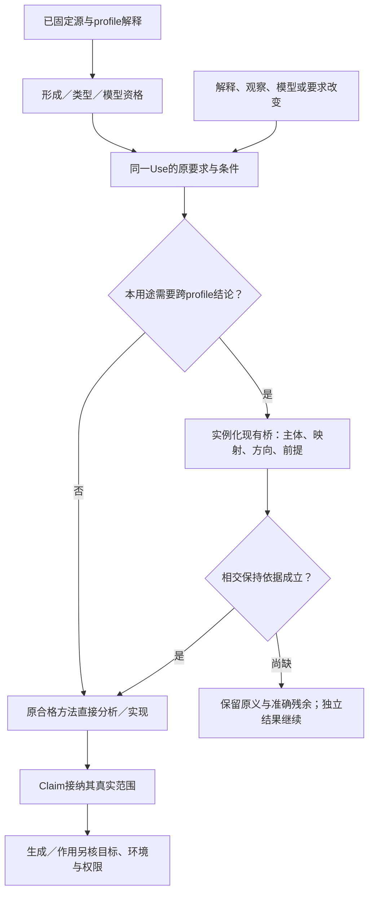

# 第一层表达收敛：准确编码、专业含义与保持合同

本文件拥有第一层专业画像的准确形成、解释和保持规则。既有正文继续拥有共同作者、源码、编译、范本、验收及客户端责任；本文件不复制它们。原26项表达审计的有限设计及后继发现的具体边界共同维护在各自章节；指定反例的设计闭合不追认当前main已支持，也不证明所有未来概念穷尽。

## 采用与解释边界

采用单一作者语言的可组合画像：普通 Definition 与已定义短写保持；现有 `extension:definition` 容纳精确的专业 Body。专业画像既不成为所有普通程序的必经层，也不把业务名单加到核心 kind。作者通常引用已形成的公开定义；库/系统负责下面完整模型。专业源码增加了真实语法与维护成本，不能以“没有新增核心 kind”冒称零成本。

`gift.author-module/design-converged` 是本包**候选解码合同**的标识，不是已发布版本。旧 `/1`、`/2` 和 `compact-design-draft` 按各自取得时的准确内容解释；同一工程有权切换后只使用一个活动 Writer。新候选可确定接纳旧精确形状及这里明定的新形状；不修改旧 schema 字符串使旧 Reader 误收。新供给未安装时保留可编辑原源并报告相交的缺能力，不能自签执行资格。

所有专业输入先无损读 UTF-8/JSON 原文，拒绝解码后重复键和非法 Unicode 标量；数字按各槽的精确词元读取。Schema 只检查形状。名称存在、类型、绑定、完整模型、环境、证据、物理资源和实际作用在各真实边界检查。保存不证明模型一致，模型有含义不证明求解成功，求解成功不证明现场结论或当前授权。

## 名称与有类型引用：保留精确公开名称

内部稳定对象身份与显示/公开符号分开。公开名、定义键、字段名和导入别名可为任意有限 Unicode 标量序列，包括中文、空字符串及冒号斜线；源格式和宿主的资源预算另判，不赋予这些字节文件路径或命令权限。已有安全 ASCII 简写保持。双向字符、混淆字符、正规化碰撞应可视警示，不自动重命名或合并。`U+007F` 等字符仍是标量，但在界面转义展示；不把其显示形式当新的符号。

引用位置允许三种互斥对象或一个旧字符串：`{space:"local",definition:Name}`、`{space:"import",alias:Name,export:Name}`、`{space:"dialect",alias:Name,consumer:Name}`，或原 ASCII Ref 字符串。旧字符串只按旧 grammar 解析；含分隔符或非 ASCII 的新名称必须使用对象，不追加第二套转义小语言。普通 Text 或 JSON 数据中的同样对象不解释为引用。

逐项解析顺序为：准确解码名称→在当前模块/导入/方言对应空间定位→固定该名字指向的实际声明/解释版本→检查公开性与类型→建立稳定声明身份及发生点。导入和方言别名不得同名造成 fallback；找不到时不在其他命名空间猜测。 `local`和`std`仍是保留的源命名空间；import与dialect都不得声明这两个别名。普通定义或公开出口可以叫同名字符串，结构引用仍明确选择其真实空间；这不限制外部协议键。固定std基底的准确内容与解释由编译输入绑定，绝不由同名用户模块替代。原 `definitionId`、`decl` 引用形状只在其旧专业 Body 的合法引用槽继续解释。文件 rename 不改变公开名；公开名改动不自动改 moduleId。F2 更新真实引用位置和独立接受映射，不替换 Text 数据。

选择此方案而不强制 NFC/NFKC 的理由：标准化可以是显式查找或公开命名政策，不能默默改变已有协议字节；结构 Ref 已解决解析歧义，无须牺牲原名。写 UTF-16 的编辑器和写 UTF-8 的内核继续按原版本化坐标转换。

Name、SourceRef与仅含三个互斥对象的StructuredSourceRef见[names.schema.json](names.schema.json)；其标量合法性仍在无损读取层检查。完整模块如何递归提升旧Ref/MemberName、保留独立旧串的原解析空间、闭合Requirement/shared/pattern-use的名字选择器，以及哪些Identifier与专业Body保持原义，唯一由[完整候选文法](../../../docs/作者/紧凑结构与同源编辑.md#final-first-layer-codec)及其[参数表](codec-parameters.json)规定。旧DefinitionRef保留形状，候选中的definitionId/import/export改用Name；改名为空或含分隔符时，递归声明引用共同更新，不因原Body的旧minLength拒绝已接受名字。新完整Body不得无条件交给只认识旧Ref的Reader；有限专业样本Schema不代替完整文法。工程根、包出口、源码直接运行/输入、原生选择及名称重构分别消费该同一名称域，不仅改模块声明。

控制及Method/Target供给的实际名称选择器也消费上述参数图，准确标记、迁移和真实消费者分别由[控制owner](../../../docs/作者/组合/稀疏控制与目标限定.md#converged-control-selectors)与[供给owner](../../../docs/编译/实现选择与设计搜索.md#converged-supply-selectors)承担。完整Type另接入[原Region/Scope存在类型](../../../docs/作者/组合/参数包与类型级值.md)的exists编码；本目录不复制其引入/消去和逃逸算法，不把专业模型中的数学存在量词当作运行资源见证。

## 旧需求声明的单源承接

新容器的 requirement 声明空间增加现行原 owner 已定义的 `req:rule / req:subject / req:value-type / req:enum-value` 分派。不是新造四种业务能力，也不把它们强行改成 Bool Meaning。**复用其准确Body形状与语义，候选解码应用前述Name参数；不手写一个不完整的业务翻译器，也不声称旧二进制Reader自动接受新名字。** 新容器装载该已固定 requirement 方言；Body 始终由[原字段目录](../../../docs/作者/结构化源码.md#5-字段目录和完整含义)维护，其[完整机器Schema](../../requirements/requirement-declarations.schema.json)经参数图进入完整候选。convergence校准仅保留自己的专业范围；真实Reader仍须取得相应结构、语义与加载资格。

| 原声明 | 保留的结构与身份 | 新容器实际消费者 |
|---|---|---|
| req:subject | nominal identity、roles、各角色类型与出现域 | Requirement 主体绑定；不凭记录布局认同不同主体 |
| req:enum-value | 原 definitionId、所属声明域、公开出口 | 名义枚举成员；不降成自由 Text |
| req:value-type | 原有限名义枚举目录及成员集合 | 值域检查；不是重新造全部 record/quantity 类型系统 |
| req:rule | strength、字段 required/type/meaning、semantics 的出处/范围及可选固定interpretation、implementation:"unbound"、可选共同typeParams；默认只归composite.parameters.default | 实际 Rule 使用点、义务生成、强软约束与选型；unbound 仍然 unbound |

迁移输入是旧字节、旧 Decoder/Body 内容、导入图和锁、Definition/Use/Root、来源与接受关系，不只有几个文件名。先以旧 Reader 得到合法对象，再按有限声明结构逐节点拷入新容器：保留 moduleId、namespace、原 definitionId、name、字段次序有用部分、出口别名和全部 typed refs；新名称规则使旧冒号/Unicode 键不再必须改名。相对资料引用保持原文档身份与原解析基准，移动文件时可换定位但不得换语义修订。

这不是盲改 schema 字符串：新 Writer 和 Reader 必须先具备该专业分派，且整张相交引用图能够按新容器取得同一声明。遍历所有 `decl / subject / enum / rule / use / require / prefer` 的实际引用槽，保持指向同一旧声明，不能只迁定义不迁消费者。对原专业 grammar 的原子项逐项同构，对列表/记录/Term 的合法组合结构归纳，因此在固定专业解释下 `Interpret_new(Migrate(s)) = Interpret_old(s)`；外部权力、执行结果和字节签名不属于此等式。

实际提交仍是一次候选事务：生成候选与语义差异→按独立接受条件检查→旧 Writer 停止准入→原像重验与提交→读回→保留旧在途操作需要的解释→其真实 consumer-zero 后退役兼容读取。失败不部分覆盖源。不支持的新旧未知方言仍明确保留，不能借这四种已知声明声称历史任意载荷都已迁完。

随包 `legacy-rule.before.json` 与 `legacy-rule.module.json` 是完整本地校准工程：复现实际 Network Rule 的强度、三字段、名义值与作用主体关系，保存真正的未绑定状态。它不是完整原 IDE 工程的字节副本；在线 policy.json 的真实形状是核对依据，未宣称运行全仓迁移。Network 的具体规范解释是：仅有当前主体/来源/目的/时间匹配且覆盖该 EffectBoundary 的 Grant 时，才可准入该网络动作；后台动作没有这种匹配时拒绝。声明此规则不会生成 Grant，观察到联网成功也不证明准入合法。Destruction 若随原工程迁入，保留其作用范围/前像许可与 RetryBasis，不并入 Network。

## 八项局部表面限制的确定处理

**常量和字段实参。** 新 `arguments` 与原 `bindings` 互斥。每项明确为 `role/bound/literal/field` 或已经合格的纯设计表达式，按签名与单位检查。原角色字符串保持。系统把投影、常量和使用点编成原共同 Expr/Requirement，而不是把 `order.total` 变成一个可任意改变的新角色。准确引用及实参只求值一次；有故障不取 false，有作用不在纯解释中偷偷执行。递归调用次序与原专业解释相容，不用对象键顺序发明效果顺序。

**动态门槛。** 保留已存在的 CountQuery.threshold 与普通参数关系。语义短写的 count 参数展开为该同一输入，不复制成一份静态常量。实际集合、身份/重数、覆盖和阈值由同一 Use 绑定，不能以不同快照拼“达到”。当前整数控制槽受限时使用已定义的精确 Int 路径，不能把 JSON Number 舍入。

**依赖量词域。** 专业域出现可写 `{ref:Members,arguments:{department:{bound:d}}}`。先在旧词法环境解释所有域实参，再创建新 binder p；因此同名遮蔽不捕获外层 d。`∀d∈Departments.∀p∈Members(d).R(d,p)`保持域依赖、空域逻辑和已有独立存在/进展义务。开放观察的未知域由原覆盖合同判，不能把尚未收齐当空。可用全体人员加成员前提的改写，只有在共同完整域与相同逻辑前提成立时才等义；多重集计数不得因此去重。

**运行缺省。** `Absent`、`Present(null)`、`Present(value)`分开。闭合 default 继续不捕获现场；运行缺省是显式策略：先取得 deadline 与 provided-timeout，只有 Absent 分支读取一次同一 clock epoch 的单调时钟，计算 `deadline-now`；显式值不读时钟。本样本负值按端点显式选择的错误合同拒绝，不偷偷截成零。读取失败/取消沿原作用协议，静态构建不求“现在”。`Option<Int>`样本拒绝 null，而不是将 null 当缺席。

**选择政策。** 硬合格集合和本用途的比较关系先固定。当前修订的eligible明确写为`hard-feasible-not-proven-dominated`，不沿用会误称全域资格的旧标签。候选只在已有合格支配证据下被支配淘汰；缺测时保留“当前未证被支配”的候选，不把它宣传为真实完整成本上的已证Pareto前沿。只有已授权的轮转政策才按固定精确身份全序选择：没有上次采用时取首项；否则取严格大于lastAccepted的最小当前候选，没有则回首。上次身份已被移出集合仍按其原值寻找后继，不要求当前集合能找到那个元素。空集返回NoEligibleCandidate；没有合格比较或身份序时保留对应缺项，不由加载顺序猜测。

预览不推进轮转状态，正式采用在原应用边界核候选集合/政策修订及当前lastAccepted后原子提交选择和状态；并发冲突重新按当前基础选择，不能两个旧预览各自消费同一轮。选择是否被采用、作用是否完成与产品要求是否履行继续分别结算。轮转是明确政策，不证明任意动态增删集合中的长期公平或全体最优；有这种要求时另保留其假设与进展义务。这里的lastAccepted属原应用协调，不增加可写需求账本。

**有理量。** `{"rational":true}`确定展开为同一候选Type中的`{tag:"rational"}`；[完整类型节点](complete-types.schema.json)约束直接有理literal使用规范`numerator`整数字符串与正`denominator`，不得把负数、零、前导零或尾换行分母当成合法值。语义为 n/d；规范值用 gcd 约分，零分母拒绝，负号仅分子，源原字节仍保留。Schema只检查直接字面结构，嵌套值及名义类型别名仍由准确类型值解码器验证。量值引用原单位定义及其仿射/线性转换，不给 1/3 偷换单位或浮点舍入。比较交叉相乘采用精确整数并记真实资源成本。已有十进制业务槽不改义；新有理画像由目标显式接受或返回适配缺项。

**未知变体。** `wireVariant`描述传输拥有者，完整形为`{tag:"wire-variant",known,unknown,encoding,duplicates}`，不改变所有闭合 variant。known按准确Name映射至同一候选Type，合法载荷不局限于样本中的text/int；实际编码资格仍须真实类型/专业消费者取得。已知 A/B严格解码；在能准确取得一个不重复的顶层 tag 时，未知 C保留完整 frame 字节、编码、标签原文和前像，可原样转发/保存，不默认具有可执行业务含义。未知 payload 的重复字段/顺序/空白也属于 raw 保存范围；重复顶层 tag 无法明确分派，必须报格式错误；对已知分支拒绝重复键。不能在编辑一个已知 sibling 时重序列化未知部分导致字节丢失；没有真实子帧边界就保留整个 frame 或请求明确接管。解码 raw 与当前公开未知封装分开，不把 raw 字节同 source JSON 二次无损断言。

**大结构参数。** 数学 Int 和字段的安全整数上限分别维护。超过原 count/replicas 范围的值作为准确 Int 参数进入专业规划合同，证明该目标提供者的实际容量与方法之前不降低到原 Number。旧 reader 继续拒绝越界；源可以表达不意味着可以建造该数量实例。静态只要比较数量的请求不必部署任何实例。业务约束无真实超大需求时不增加全局 Bignum 运行开销。

`surface.module.json`中的具名专业短例均在本节明确解释，`surface-convergence.schema.json`闭合其字段，不接受同名任意操作。示例里 Departments 是该任务输入中的有限部门序列，Members(d)为同一捕获 d.members，Approved(p,k) 为 p.approvals≥k（整数且k非负）；AmountAtLeast(a,k) 为 a≥k。它们是样本专业输入/关系的完整定义，不是声称已有真实部门系统；跨现实数据使用须原观察资格。

## 专业模型的共同接合，不新增第二运行内核

`extension:definition`保留原 `dialectRef/bodySchemaRef/payload/bindingRef` 四项。方言 alias `sem`由模块 `dialects`与冻结解释映像解析到本包的供给声明；它导出**设计签名** `Interpret`。`sem:Interpret` 在这个位置是 dialect consumer 的名字，只有该 Body 的 typed binding slot 使用这个解析空间；普通 importRef 不采用隐式回退。新的 `space:dialect`对象可显式写出同一目标。导入 alias 和 dialect alias 重名拒绝，不能通过加载顺序选一个。

供给的 decoder、typeRules、effectRules、composition、migration、evidenceObligations 都定位到真实规范正文/机器结构；`consumer-signatures.json`声明输入输出，而非提供可执行代码。解释映像只在取得真实实现及资格以后才能产生运行 binding；当前设计源有准确数学解释，但生产 capability 为 NOT_IMPLEMENTED。这个明确差别避免把几个非空引用当成已部署解释器。

处理顺序：冻结原输入→无损解码→按 profile 读结构→核名称与类型→核模型资格→形成准确 denotation/专业语义图→把要求及保持条件投给原 Requirement/Claim→按请求选择已有方法或创作→原 Target/Execution/Assurance 消费。一般程序进入原 CheckedProgram/降低，模型分析进入原合格查询/证据；都不另建可写 IR、身份库或权限库。

结果至少区分：结构不合法；模型不合格；在准确模型与假设下真/假；有定义但本次方法未取得结论；现场绑定/授权未取得。形式上真不改变任何 HostGrant。若模型状态不是现场可验证的映像，仅能报告模型结论；模型仿真不能生成“事故未发生”证明。

跨画像的 Type、主体、时钟、实例、选择量词、效果、概率、来源和恢复要有明确映射。共享 Term JSON 形状不授予共享语义：`not`在本节数学模型中是经典补，在原 Goal 中仍是证据位交换，stable 程序的 negative 是默认否定；不得把三者互换。每一 profile 给出自己的合法 Term 子集，其他运算即使形状合法也不能通过类型检查。

## 共同专业项的形状、绑定和排序

机器形状由 `semantic-convergence.schema.json`唯一规定。本节给其结构外的必要类型规则。Name 是精确标量序列；模型 ID/方言内 binder 须非空且在其域唯一，空文本数据和空公开出口并未因此禁用。Int为数学整数，Rational分子整数分母正整数。Bool/Int/Rational互不隐式替换；混合数运算只在明确的升域位置使用，例如 real-flow 将整数常数嵌入实数。

`var`读词法环境或专业规定的当前状态值；`ref`只读明确符号表；`atom`只读标签/命题表。未定义名称与未绑定变量错误，不是 false。`call`按该 profile 声明参数表逐项类型检查并捕获规避；不调用宿主 eval。`U+007F`前缀的`le`等形似操作不匹配标准名字。

Bool算子 and/or/not/implies/iff在已合格完整模型中采用经典语义；空 and=true、空 or=false 是本专业内部单位，不放宽原 Goal Body 的非空约束。eq仅用于具有既定相等的同型值，函数/资源无默认 extensional-decider；算术类型及零除域明确，div精确有理/实数，不对Int静默截断；mod对整数和正除数取欧几里得余数。if只选择一个分支；let值在旧环境建立，body在扩展环境求解释。pair/fst/snd是普通笛卡儿积，不自动构造依赖Σ。

量词 domain 必须解释为同一固定集合/多重集语义中的允许值，不枚举任意未来环境。setBuilder/function分别引入新binder，仅解释已被类型规则接纳的谓词/函数。member/subset/powerSet/union/intersection属于数学集合；量词顺序、域依赖和来源保持。integral/measure/kernel只有在相应测度 profile 或有完整签名解释的数学呈示中合法；不能把这些名称当无依据算子。

数学项不得内含未准入的现场读取。未知现实不是数学 false；它属于取得模型及解释的资格层。所有项有限保存，已定义无限域可以有准确语义，不要求无限物化。无预算的完整判定不是表达的前置。

## 有限状态、知识与跨执行的同一主体

### 分支路径

`finite-observation`给有限非空状态集合S、非空初始集合I、边R、每状态的命题与值。ID唯一，边端点及I均在S中。可选`propositions`显式给无重复的非空名字集合AP，允许AP本身为空；每个state.labels是AP的子集，属于AP但不在该状态标签中的命题为false，不属于AP的引用是绑定错误。省略该字段的旧源确定取所有状态labels的并集，不扫描公式来“补声明”。显式AP使一个合法命题可以在全部状态都为false，同时保留拼写错误的诊断；增加一个总为false的孤立状态来声明名称会改变知识/路径域，不是等义替代。

`values`中的相交公式所读字段须在其全部评价状态具有同一Bool或精确Int型，缺字段与false不同，不能按某个采样状态推型。未被本用途读取的额外字段不因此被要求全图补齐；若公开合同要求完整字段映像，则另外核该准确范围。`deadlock:reject`要求每状态至少一条边；`stutter`则**显式**给无后继状态加自环，不声称实际运行没有停机。当前有限示例`fairness:none`；需要公平时必须使用实际公平条件解释的专业模型，不把不存在的公平偷偷加入。

`Paths(s)`是从当前状态s起、沿R的无限序列；全局状态声明是在每个初始状态上分别求值。EX/AX量化s的一步后继；EF/AF分别在Paths(s)中存在/所有路径最终出现谓词，EG/AG分别存在/所有路径一直保持；EU/AU为强直到。嵌套到后继状态时重新从该状态起算，不能回到初态I；跨轨迹量词的起始域则按后节另定。

有限求法中，EX X={s｜存在后继属于X}，AX X={s｜全部后继属于X}；有效模型经deadlock处理为全转移关系。`EF p=μX.(p∨EX X)`、`AF p=μX.(p∨AX X)`、`EG p=νX.(p∧EX X)`、`AG p=νX.(p∧AX X)`；`E[p U q]=μX.(q∨(p∧EX X))`，A版本将EX换AX。μ从空集、ν从S按单调算子迭代至集合不变；未到固定点、超预算或方法异常保留未完成，不能返回false或通过。Next不消耗任意多个内部步；强直到允许当前q已真，但不接受永久只有p。所有前提来自该图，不混入现场观察。

具体区别：s有两条边到good与bad，后二者各自自环，只有good标记p。初态s满足EF p，却不满足AG EF p；在bad求EF p必须为false。把每层EF都从I起算，会错误地让后一个公式通过。该定义与[PRISM的状态起点语义](https://www.prismmodelchecker.org/manual/PropertySpecification/Non-probabilisticProperties)一致；没有运行PRISM或把该工具设为产品依赖。

Recovery 模型 s自环并可转ok，ok自环：AG EF good=true，AF good=false。删掉s自环后两者都真。第二种源变化实际删一个允许行为，不是对同一模型的更好证据。有限图的全称涵盖其无限路径，不是只检查几条采样。

### 知识和共同知识

knowledgePartitions为每个主体给S的精确等价划分：非空类、无重叠、全覆盖。`K_a φ`在s成立，当且仅当a在s所在类的每个世界都满足φ。嵌套K在每一被量化世界重新定位该主体的类，不用实际世界上的一份布尔缓存替代。

`C_G φ`要求从s沿G中任一主体不可区分关系有限次可达的全部世界都满足φ（含零步）。等价于最大固定点 `νX.(φ ∧ ∧a∈G K_a X)`。空群体不在这个短画像中接受；需要空群体时应给明确的逻辑单位，而不是把缺参与者当共同知识。

Knowledge 的w0实际为p，A类{w0,w1}/{w2}，B类{w0}/{w1,w2}，p在w0,w1真：大家知道=true，A知道B知道=false，共同知识=false。公开真实公告φ对应把模型限制到满足φ的世界及各等价关系限制；仅“发送消息”不能自动执行这种更新。私密消息、记忆丢失和虚假信念采用准确其他更新模型，不误称S5知识。

### 跨执行

traceQuantifier在同一个固定模型的全部允许路径上绑定p/q等变量。traceField在同一时间下标取该轨迹的公开值；G/F/X/U按同步离散时间解释。变量一经绑定，在整个公式作用域指同一条轨迹。初始秘密区别和公开输入对应由模型/条件式明确给出；不把两次采样当全部轨迹。

Noninterference 有秘密不同但public均false的两个自环初态，因此 `∀p∀q.G(public(p)=public(q))`为真。把h1的public改true后为假。是同一系统可允许执行集合的改变，不是第二个独立模型得出相同输出即可。目标若是异步观测，要明确对齐、终止标签和允许stutter；本同步画像不能自动把时间或终止侧信道抹掉。

状态公式由本模型的Bool常量、AP原子、当前values上的有型纯比较、经典连接词、CTL状态算子和知识/共同知识递归构成；CTL与知识都消费同一S上的状态公式，因此可以相互嵌套。同步跨轨迹片段采用一个有限量词前缀绑定全部轨迹，再对其traceField有型比较、经典连接词和G/F/X/U组成的路径体求值，量词从∪s∈I Paths(s)取值，时间下标初始0。该片段内不允许在G/F内部新绑定轨迹、不让未限定的当前state变量冒充traceField，也不把CTL/K直接放入路径体；确需这种更强混合逻辑时，保持原要求并取得其准确专业解释，而不是删除算子后接受。路径绑定只覆盖其body，遮蔽按身份解析。

这给出了当前片段的形成规则，不把共享Term Schema的全部形状当作任何profile都能处理。公开原子、值字典、知识划分和轨迹域均是模型输入；空量词域、未知现实和有冲突证据不能偷偷替换这里的经典完整模型。

## 策略、观察与信息时点

`observation-game`定义有限S/I、某决策主体A、O:S→Observation、公共动作集合、δ(s,a)的非空后继集合以及本次horizon。环境选择初态及δ中的实际后继；决定能够读取什么由下述information模式确定，不能从求解器内部state ID取得真实观测权。公共动作集合避免“某动作是否允许”本身偷偷泄露隐藏状态。所有(state,action)配对须有且只有一项转移记录；若更复杂领域的动作可用性依观察变化，应按每个信息集完全同域解释。

`information:observation-history`时，σ消费O(s₀),a₀,…,O(sₖ)；同一观察/动作历史上的决定相同，即使求解器知道不同隐藏状态。`state-history`时，数学问题改为σ消费s₀,a₀,…,sₖ，明确表示完整状态信息假设。两种模式都必须存在同一个σ应对全部允许初态和环境后继，不能逐条完整轨迹事后选不同答案。由全信息模型取得的策略，只有真实系统能在决定前取得获准状态映像，或该策略已证明可下降为实际观察历史上的一致策略时，才能支持对应实现；更改information字符串本身不提供这种依据。

horizon=h是精确非负整数，界定从初态起**恰h次转移、h+1个状态位置**；objective从位置0按有限轨迹判断。win在s属于winning时为真；Bool和经典连接词正常解释；F在当前位置至h中存在一个满足位置，G在其间全部成立，强U要求右项在某个不晚于h的位置成立且之前左项成立，X在位置h为false，其他位置转到下一位置。h=0仍评价初态，不执行动作。该h是已接受的有限问题，不把无界目标偷偷截断；无限路径用途继续交准确的其他专业方法。

`behavioral`在所选信息历史上给分布；本画像的强canForce要求其支撑内每条允许行为都满足，和“以概率1”或“至少某概率”不同。当前有限求解可按模式枚举有限历史策略并在其全部环境展开上检查objective，或者用已证等价的知识状态/动态规划；共享观察必须约束同一策略表，不能逐隐藏状态独立择优。本有限强保证片段若存在behavioral获胜策略，可在每个可达信息历史选其支撑内一个动作，所得确定策略只保留原允许路径，仍满足同一全称路径目标；因此可枚举有限确定策略判定该存在性，无需枚举不可数概率分布。这个约化不用于概率阈值、期望优化或对随机化本身有要求的任务。有限性给出枚举存在，不保证低成本；预算不足仍未判定。所有具体节点、边、动作、winning成员和观察映射完整检查，不能删除对抗环境或提前截掉失败路径取得通过。

HiddenGuess 初态zero/one观察相同，选择0/1后分别进win/lose；只有一轮，任何确定策略至少输一种环境。即使随机化也不能保证全部路径赢。第二次源修改将zero/one公开为不同观察，identity策略可保证赢；公开这个信息本身可能受隐私政策约束，不能由优化器擅自选择。仅把information改成state-history也能使数学全信息问题为真，但原观察不变时不签发可部署的获胜策略；这与真正补充合格观察是不同修改。

一般多主体策略量词可以在准确数学呈示中使用 `Strategy(agent, observation-history, randomization)`域和逐主体 binding；嵌套次序及选策略时的可见信息不可交换。其 denotation 与有限计算方法范围分开，本包不声称所有不完全信息策略问题均可判定。选择专业游戏方法时需要它明确承接域、记忆、概率与公平，不把可计算子集作为整个语言上限。

## 默认否定与稳定模型

`stable-ground`的atoms是固定有限、允许为空的名字集合；成员名字非空且不重复。规则head为一个原子或null约束，positive/negative为原子列表，所有被引名字必须在域中。空原子域也可拥有无原子的完整性约束，不只允许空程序。没有变量或函数项，因此不暗中建立无限 grounding；有变量需求时给实际活动域和安全实例化，不能忽略没有出现的合法常量。

对候选M⊆Atoms，删掉所有negative与M相交的规则，余下规则去掉negative，得到正程序。以空集迭代正规则得到最小闭包L；null规则视为约束，若其正体满足即淘汰M。M是稳定模型，当且仅当M=L且全部约束成立。相互默认否定p/q因此有{p}、{q}两解。atoms=[]且rules=[]的解集是包含一个空模型的`[[]]`；再加入`head:null,positive:[],negative:[]`，空体为真，唯一候选被淘汰，解集才是`[]`。二者不能按显示均无原子而混同。该区别沿[ASP完整性约束](https://potassco.org/guide/basics/)及本节最小闭包定义直接成立，不需要新求解引擎。

models返回完整解集或准确未完成枚举；brave(a)为某稳定模型含a；cautious(a)为每个稳定模型含a，但**没有模型时先返回NoStableModel**，不凭空真批准所有业务要求。任何解的选择还要满足已接受选择政策，不能由求解器输出先后顺序取得业务权限。规则新增可能撤回旧结论，证据/缓存随准确程序版本失效；不改原分层否定或四态not语义。

## 概率、连续核与条件

`finite-probability`声明完整Bool变量集合及全部离散结果权重。每行必须恰含所有变量，权重非负且总和为1；相同结果可按精确值汇总，但来源/出现不能据此混淆。问题是Bool事件，返回其权重和，不将随机变量真值本身当概率。IndependentBits 的四项各1/4，两位相同概率1/2；CopiedBit的两项各1/2，相同概率1；两路边际相同不构成独立。

`borel-kernel`明确连续输入域（实数线或单位区间）与其Borel σ代数。uniform[a,b]要求a<b，μ(A)=Lebesgue(A∩[a,b])/(b−a)；normal(m,v)要求v>0，使用密度exp(−(x−m)^2/(2v))/sqrt(2πv)所定义的Borel概率测度。密度是一项数学定义，不声称目标浮点能够精确抽样任意实数。

Bernoulli条件核给可测p(x)∈[0,1]，K(x,{true})=p(x)；normal条件核给可测均值m(x)和严格正v(x)。联合律由μ(dx)K(x,dy)定义，不能改为两个独立边际。样本ContinuousCoin取x均匀[0,1]、P(y=true|x)=x，边际为∫0¹x dx=1/2。该核在每个x上的定义是作者模型的一部分，不是从零概率事件 `X=x` 的朴素比值算出。

普通条件P(A|B)只有μ(B)>0才按比值定义。`zeroCondition:undefined`保持未定义；specified-regular-kernel只有模型确实选定了对应版本的核，才按该核解释，不能宣称所有零测点上的条件都由联合分布唯一确定。明确核的选择和识别证据分开。

一般随机过程由初始测度、可测转移核及其路径测度表达；环境/策略先后和依赖关系明确，按所选理论满足存在条件后使用。模型族Θ上的要求是实际量词（如∀θ∀σ Pθ,σ(E)≤q），不能只检查最方便一个模型。完整分布、可测事件、随机源分离、耦合、条件和误差都沿同一专业供给；有限Boolean画像没有覆盖的具体连续模型应由数学呈示记录准确域、符号、解释和义务，而非伪造一张有限表。

## 结构因果与同一对象的反事实

`acyclic-scm`分开外生变量U、内生变量V、联合噪声分布P(U)与每个内生变量的结构方程。变量集合不交，方程恰好覆盖V，依赖图必须无环；P(U)精确归一。先采样同一个U，再按拓扑序计算V。内生写入不是随意重算字段；`do(X=x)`仅将X方程换成常量，其他方程和U保持。

反事实按三步：用事实证据对U的分布条件化→替换被干预方程→在同一条件化U下求结果。有限模型先求q=P(evidence)：q>0才以事件指示量乘原噪声权重并除q；q=0时该固定模型下的离散条件概率未定义，返回原方法的准确条件失败/模型与证据不相容原因，不把它命名为因果不可识别。空evidence对象表示不加条件、q=1，资料尚未取得则是缺事实，不能自动改成这个对象。未知变量、非法干预名、非Bool方程或没有归一化的噪声是绑定/模型错误，也不是概率0。

不可识别指多个仍被接受的因果模型或机制与资料相容，却对所求干预/反事实给出不同答案；本节Direct与Confounded就是这种区别见证。可保留模型族、共同界和能区分它们的观察/实验要求，不任取一个模型当现实真相。旧解释将零概率事件称UnidentifiableEvidence的结果只保留为对应旧诊断，升级重新分类其理由而不伪造新事实或改变历史。真实个体已合法固定U时可直接使用那个U；“固定”不能由当前观测自行编造。两个模型观测分布相同不授权互换结构方程。

样本CausalDirect为X=U,Y=X；CausalConfounded为X=U,Y=U。都观测到00/11各1/2；do(X=true)后前者Y总true，后者Y仍各一半；对原00对象，前者反事实Y=true，后者仍false。源能定义模型，但因果识别及现实有效性必须另有依据。循环SCM、连续噪声或多解模型须在对应呈示中固定解选择、稳定性与干预，不以本DAG方法默认处理。

## 连续、离散切换与Zeno

`hybrid-real`的变量属于数学实数，常量是准确有理数；每个模式给向量场和不变量，事件给源/目标模式、guard、同时reset、显式优先数和urgent。型检查保证流/guard/reset引用的是实际状态变量、表达式定义域成立；同一次reset全部读取原状态再共同发布，不按对象键序逐次修改。

轨迹由一串绝对连续流段和离散跳转组成。流段内几乎处处满足微分方程且每个时间点保持不变量；初态满足初模式不变量。当前修订明确选择“urgent先行、类内较小priority更高”：在当前模式guard为真的事件中，有urgent时仅保留这些urgent事件，再取最小priority的全部事件；没有urgent时取全部已启用非urgent中的最小priority。并列不按列表或名字暗排，保留非确定跳转，普遍要求覆盖每条允许选择。没有urgent时可选择合法流或非urgent跳转；有urgent时不能推进正时长。

全部reset读取同一旧状态，未写变量保持，发布后的状态必须满足目标不变量。guard为真但reset未定义或结果不合格，不通过丢掉该边、选低优先事件或继续流动掩盖：记录模型在该状态的阻塞/转换资格缺项；要证明正常进展还需证明所需启用事件具有合法后继。模型可有死锁或非唯一连续解，这些事实不得被安全判断悄悄删除。flow字段须恰好覆盖变量；from/to和所有reset键真实存在；guard/invariant/safety为Bool，导数及reset有相应实数解释。

例如同时启用urgent priority=5与非urgent priority=0时取前者；两个urgent的priority=0与1取0；同优先则都保留。这是本画像选定政策，不声称所有混合系统工具共用此优先约定。既有Thermostat单个启用事件不受影响；旧模糊优先源存在多个相交事件时须按其原已接受解释明确迁移，不静默改变其运行轨迹。

向量场不满足唯一性条件时，语义允许所有合格解，不偷选数值工具给出的某一解；存在性/可达性未证实时不自签安全。Thermostat的heat导数1、到1切cool导数−1、到0切heat，初值0；其连续安全0≤T≤1由分段解可证，不是仅看采样点。

Zeno 是无限跳转的累计时间有有限上界。stop-at-accumulation给出合法前缀及Zeno终结原因，不假装超过聚点后的运行成功；continue-with-specified-limit要求实际极限存在、指定极限状态/模式合格及后继规则满足，缺任一项不能继续。仅允许源写一个limit对象不是极限证明。延长运行要求若原本禁止停止，则stop策略不能满足它，须给正确延拓或调整有权需求。

DAE/PDE、空间边界、非局部依赖可在专业数学呈示中声明精确方程域、解概念、初/边条件与误差；当前ODE机器短画像不偷称承接所有物理模型。表达资格与特定求解方法、观测映射和真实设备安全分别取得。

## 量子模型与物理线性资源

`finite-quantum`给正整数维数d、d×d Hermitian正半定且trace=1的ρ，以及每个测量instrument的Kraus矩阵K。每个instrument应满足ΣK†K=I；任意密度/矩阵JSON不通过这些结构外条件。输出y的概率为tr(Σj Ky,j ρ Ky,j†)，非零概率时后态为该和除以概率；概率零不生成条件后态。顺序仪器作用于真正的后态，不能在同一前态上独立抽签。合成子系统使用张量积及指定耦合，不能默认产品态。

样本使用准确有理复矩阵ρ+、ρ−；Z测0均1/2，X测+分别1和0。经典模拟值可以复制；`representation:linear-physical-handle`表示模型约束用于绑定真实量子资源，**不把source里的density升级为权威现场句柄**。实际qreg由Provider签发、由线性拥有者持有，别名共享同一资源，测量/释放改变它。无依据clone、跨任务复制或清理已在用资源都拒绝；经典反馈有自己的值和权限。

当前机器矩阵标量使用有理实虚部。准确代数/超越参数可以沿数学呈示的复数/矩阵表达与已有数值画像保存；不能把目标近似后相同矩阵当原精确值。物理误差、可调用门集、测量能力及硬件状态另需真实供给。该专用模型不强制普通随机程序使用量子设施。

## 一等高阶多态与依赖类型

### 显式多态画像

选择显式 System F 型的有类型项，而不是把原rank-1推断强行扩成任意自动推断。类型为基础型、变量、箭头、有限积与任意位置的∀A.T。项有ΛA.e、e[T]、λx:T.e、应用和有限积。规则：若Γ,A:Type⊢e:T且A不自由出现于Γ中的值假设，则Γ⊢ΛA.e:∀A.T；若e:∀A.T，则e[U]:T[A:=U]。箭头与积按普通有类型规则。capture-avoiding substitution使用绑定身份，α改名不改变含义。

HigherRank的同一个f:∀A.A→A在Int和Bool处实例化；不是把∀移到整个use函数外，也不是两个预先复制的回调。源显式给必要类型，普通作者面可以由系统推导并显示，但推断未完成不填Any。纯多态值允许共享；带效果的泛化消费原value restriction/效果行和封闭捕获资格，不能把同一可变引用泛化成任意类型。

目标采用合法字典传递、专门化或原生泛型均可，但必须保持同一值的捕获、身份和效果。有限源码不以复制所有未来类型实例为编译前置。此画像不新增Type:Type，也不与下面依赖宇宙的规则混用；跨画像类型通过有定义的桥和共同签名接合。

### 积的形成、消去与纯声明闭合

`ProgramTerm.pair`仍恰两个项；新增`tuple:[e₀,…,eₙ₋₁]`要求n≥2，对应`Type.product:[T₀,…,Tₙ₋₁]`。二元tuple与pair在此纯画像具有同一积意义，源身份及原拼写仍保存；多元积不隐式展平或改成嵌套pair。`project:{value:e,index:"i"}`中的i为精确非负整数字符串；若Γ⊢e:product(T₀,…,Tₙ₋₁)且i<n，则结果型Tᵢ，否则在运行前给类型/范围错误。这样能够直接定义取第二成员的函数，不要求调用方把原生积改成Church编码或接受一个空自定义primitive。

运行采用按值、成员从左到右求值；project只对value求值一次，取得积值后选相应成员。即使只取一项，也不因此删除其余成员要求的求值、错误、资源或效果；纯且总、相关观察保持时才可按合格优化消除。数学类型换算使用该纯片段的归约和有据定义展开，不运行现场动作。形成/投影的职责可对照[Software Foundations的积类型规则](https://softwarefoundations.cis.upenn.edu/plf-current/MoreStlc.html)，这不声称本画像已有机械健全性证明。

两个TypedProgram画像的declarations先解析完整签名及值/类型名字，局部binder按身份遮蔽，顶层前向引用可解析。其**可展开定义依赖图须无环**；任意自引用或互相调用不能仅凭签名自证终止，需改用已经定义的Nat/List结构消去，或留在原通用计算画像及其真实递归语义。拒绝这个强正规化子域的未受控定义环不取消Gift一般递归能力。外部公理/不透明定义有明确假设和固定签名，不作为可展开函数执行。entry必须存在；未知primitive或混入perform/resume等作用节点在纯TypedProgram中不给资格。

字面量采用有类型检查：bool为Bool；int词元在期望Nat的位置仅非负可接纳并取得Nat值，其余通常合成为Int，未指定的数学升域不能自动发生。空list/vector需要期望元素类型或其他唯一推导依据，不填Any。System F类型变量与值变量分命名空间，∀只在该画像的Type kind量化；依赖画像按分层Uᵢ及Π/Σ形成，不把∀当Uᵢ的别名。声明中的类型换算只能依赖已确定的纯定义和结构消去；所引用的一般递归宿主函数或效果方法不进入换算。

### 依赖画像

选择谓词式、分层宇宙的强正规化类型片段：U_i:U_(i+1)，Π(x:A).B(x)、Σ(x:A).B(x)、Nat、Vector(A,n)及身份类型Id_A(x,y)。Π形成在两个域的最高宇宙，Σ相同；应用e a的类型是B[a/x]。pack(n,xs)只有在n:Nat与xs:Vector(A,n)时具有对应Σ型。unpack将fresh n和xs:Vector(A,n)同时加入作用域，存在见证不得泄漏到没有绑定n的外部结果类型。

类型换算只用该纯片段的β/定义展开和已定数据消去归约；命题相等用显式transport，不在类型检查时运行用户任意有作用函数或无界general recursion。NatElim的motive和每步类型必须正确；identity引入refl只在同项处成立，transport消费真实等式证明。开放证明/公理是显式假设，不能被擦除后当无条件安全。普通目标程序可以有一般递归，但不能把它当成类型换算或终止证明。

DependentPackage除了常量包(2,[true,false])，还给出 `Π n:Nat.Π xs:Vector(Bool,n).Σ m:Nat.Vector(Bool,m)`的repackRuntimeVector；n是运行参数，不伪装编译期常量。安全解码器可以从实际向量构造长度见证；若外部只给一个自报n，必须检查实际长度或取得可信构造结果。Proof擦除只在证明不影响公开观察、布局/行为已由独立见证保持时采用；需要运行值n就保留n，不能一概删见证。

源可以声明此强类型；某目标没有同等静态能力时，可采用已接受的可信封装/证明携带桥，也可准确报告目标不支持，不能自动降成List+Bool后声称同等类型保证。无需每个普通长度关系都使用此画像。

## 可恢复续体：深处理、shot与资源

本画像用delimiter围起被处理计算。perform(op,arg)捕获到最近匹配处理者的当前求值上下文E；调用该op clause并提供arg与k。`resume k v`恢复 `handle E[v]`，因此是deep handler。returnBody将被处理计算的正常返回A映到统一answerType B；每个handler clause必须返回同一个B。操作result决定resume值类型，不能任意给k传别的类型。

一次续体从fresh→resumed或discarded，第二次恢复是精确错误，不能静默重跑。多次续体的每次resume获得一份合法计算分支；只共享真正可安全共享的捕获。owned-linear资源不能复制进多个分支，除非有经资格核定、明确新身份与清理责任的克隆/分裂能力。共享有作用资源必须声明真实共享与作用次数，不能以“栈快照”恢复已经发生的支付或网络请求。

TwoResumptions的choose结果为Bool，return映射r到单元素List Bool；handler顺序resume(false)、resume(true)，concat两份回答得到[false,true]。这修正了容易出现的answer-type错误：若return仍产Bool而clause产pair，就不是合格handler。改为one并保留两个resume必须拒绝；加入owned-linear捕获且仍要求multi也必须拒绝。普通异步/生成器不因此失效，仍用原合格路线。

取消/discard遍历未结清理帧，按实际owner恰执行一次；取消请求不证明外部已停。已启动分支的资源及结果由该分支结算，关闭父处理者不能提前回收仍在使用的代码/内存。异常穿过delimiter时保持原typed error和恢复责任，不吞成正常返回。采用CPS/状态机/原生续体是系统工作，不要求应用作者手写底层转换。

## 对象子结构和动态分派

`subobject-dispatch`固定类图、每条基边的virtual标记、字段与方法签名。继承图有环错误。非virtual边在完整对象中创建独立子对象 occurrence；virtual边按最派生完整对象及所指基类身份合并为唯一共享子对象。两个不同完整对象的virtual Base仍不共享。视图是同一完整对象加准确子对象身份，不能拷贝字段模拟可写别名。

类可选`initialFields`给字段初值的实际有类型纯项；未给必需字段初值时模型仍可检查子对象身份，但实际构造不取得资格。VirtualDiamond中Base.value明确初始化为0，Left和Right各有virtual Base，Root由Left/Right组成，因此两条Base视图相同且只有一份value。把其中一条边改成非virtual会增加一个不同Base；不是可悄悄执行的内存优化。构造由最派生者先按声明深度优先左至右一次构造共享virtual基，再按直接非virtual基和自身成员顺序构造；销毁反序。要求精确原生ABI/构造语义时消费原native映射，不能从这个模型表宣称任何C++布局均已支持。

方法的可选`overrides:[{class,method}]`明确声明已有可达基槽；同名但未声明覆盖的冲突不按名字猜测。declared-overrides按这些已声明关系选择唯一最具体槽；两个不相容同名槽而无消歧是错误，不按对象键序选择。versioned-method-table允许经受控修改替换方法，必须保持其公开类型/效果保证或发生显式兼容迁移；每次调用在call-entry固定generation，已进入的旧调用继续使用旧代码及来源，下一次可见新代。实例身份不因方法更新改变，缓存按实际代失效，旧代码在最后真实调用/恢复责任终结后释放。

DynamicDispatch的get由返回1更新为返回2：更新前的调用仍完成1，切换后的调用返回2；它是已接受的公开行为变化，不是等义优化。更复杂元类、运行构造改变和反射权限通过原生/准确专业模型承担；不能从“有方法表”推出所有语言对象模型同义。

## custom一致性必须有实际合同

concurrency:contract中的custom只有在其准确Use的硬Requirement集合中**恰有一个被接受的完整一致性定义或显式合取的单一归并定义**时才获解释。消费点固定其Definition、参数、scope与解释内容，缺失返回NeedsConsistencyMeaning；两条独立不兼容绑定返回Conflict，不按优先标签自动择一。原qualifiers/组合即可承接，不新增平行policy数据库。

read-visibility模型给每个key初值、已完成读/写/屏障、精确program-before边。操作ID唯一，客户端顺序完整，边无环。写以operation id标记版本；readFrom恰为`{initial:key}`或`{write:operationId}`，读必须来自该初值或某个实际已完成且可选的同key写，不产生未来凭空值。本有限模型没有其他客户端写时：read-your-writes要求读看到该客户端之前最近同key写；after-explicit-barrier只在读之前存在该客户端屏障时要求看到屏障前的最近写，未过屏障的读允许初值/此前合格写。

样本A先写x=1再读到0：RYW拒绝，barrier合同在没有屏障时接受；加屏障后后者也拒绝。多客户端的更新可见性必须给出写入偏序/冲突合并与read-from关系，不能仅由值大小判断“新”；这条有限源不把同值不同版本合并。真实服务以其Provider历史映射到该合同，不能由日志名字自报合格。

## 规范义务的转移、解除、违例与补救

norm-transition是明确的**模型政策**，不是现实法律结论。义务给id、债务主体、受益主体、行为、到期时点与补救。模型权能authority独立于业务许可；真实使用还必须固定签发者、范围、有效期及现场授权，不接受作者写一个Issuer字符串取得权力。

每条事件的身份、时间、声明顺序及重复载荷沿[准确事件规则](#norm-identity)处理；不以ID排序发明同时间因果次序。accept-transfer由接收者本人绑定原承担者及代；transfer消费准确acceptanceEvent和相同义务发生点，才转移以后责任。没有接受不自动认定承接，更强任务需要原承担者同意时继续保留其独立Policy条件。

perform只处理所指准确义务，当前承担者及action须匹配；<=deadline为按时。时间越过deadline且未履行/未先解除时，记录不可抹掉的violation并创建具有结构身份的独立补救，其期限仍为旧deadline+remedyDelay。release及转移分别需要该义务的权能；解除原未来责任不删除既往violation或已成立补救。完整身份、迟到、零延迟及不递归生成补救的规则见[准确事件规则](#norm-identity)。

DutyTransfer先由B接受、Issuer转移，再越过5，7时B履行repair：原违例仍真，补救已履行。删除accept-transfer后转移拒绝，原责任仍归A；处理器不得跳过拒绝事件继续伪造B的成功。观察未覆盖不自动创建逾期证明；本模型事件是给定完整历史，现实应用必须原Observation覆盖。已发生的补偿是新事件，不使历史重写。

## 有限数学呈示：无限域不靠有限枚举伪装

semantic-presentation选择有类型的经典数学基础。基础Int/Nat/Real/Bool具有通常完整数学域；更高类型通过有限的set/function构造形成。不是一个无类型“所有集合属于自身”的宇宙。语义可用按类型层级的集合模型给出；类型层级和材料有限不要求论域有限。

sorts给基础/由其他已定义型构造的sort；definitions给明确形参、返回sort与body，按无捕获替换解释。symbols是未解释的有型常量/操作，assumptions是模型必须满足的明确约束。未解释符号加公理定义的是**模型类**，不是自动选中的真实函数；若要求唯一确定行为，需要证明唯一性或明确有权选择。模型类无成员时报告不一致/未取得一致性，不借空真关闭真实功能要求。为证明而自添的公理不能充作外部事实。

quotients只在已证明equivalence是该base上的等价关系时形成；lift一个函数必须证明对等价类代表无关，否则仍是原代表上的操作。样本Z为全体整数，sameParity(x,y)定义(x−y)mod2=0，其反身、对称、传递由整除性质给出，商域有两个类。有限JSON没有枚举所有整数，也没有把输入截成小区间。

一般路径/策略/测度/连续/量子呈示可采用这里的有型符号、完整域和准确方程/公式，也可使用已有专业语言原源与绑定解释；用哪条路线都需给本次具体解释。`Theory`机器短画像是数学定义的有限承载，不能仅写“ProbabilitySpace”名字就获得所有测度公理、存在条件或可计算算法。本包机器样本闭合了审计给出的具体见证；无限的一般模型取其完整定义与已选基础，不把有限样本提升为所有未来模型已完成。

## 消费、替换、失败与验证出口

专业声明的输出按实际用途进入原语义/Assurance/Compiler，不向作者暴露第二份必须维护的模型图。直接引用同一声明可复用其结构；源改变、模型域改变、解释修订、状态观察或授权变化分别失效相交资格。无变化且仍适用的成熟方法证据可复用；不为同一纸面定义每轮重跑工具。

完整设计出口逐项是：源形状合法且名字完整；数学/操作含义及类型明确；正常与区别例保留；第二次修改的影响可定位；下游接合与失败清楚。工程实施出口另需生产解码器、准确语义实现、合格工具、目标保持和真实运行。`NeedsMethod`不是“无法表达”，`False`不是“模型格式不支持”，`ModelInvalid`不是“业务已反证”，`NOT_RUN`不计运行通过。

本包结构检查可以核有限schema、引用与补丁；独立数学计算只支持明确小模型。未做一般类型系统的健全性机械证明、所有专业schema语义联验、完整仓库迁移或产品测试；不把设计收敛自动升级成这些状态。新反例回原owner，不把已解决的7/8/11重新复制成永久第二任务库。

### 本轮补齐的依赖消去与原生构造规则

`fromRuntimeList`现在从普通`List Bool`输入构造`Σ n:Nat.Vector(Bool,n)`，不是要求调用者先交付一个已带证明的Vector。`listElim`固定element A、motive `P(xs)`、nil分支`P([])`及step分支；在step中head:A、tail:List A、rec:P(tail)同时绑定，结果须为`P(head::tail)`。规约只对已取得列表的有限结构递归；未知流不强行完整物化成List。

本例P不依赖列表内容而固定为上述Σ。空分支pack(0,[])；非空分支unpack(rec)得到n与ys:Vector(Bool,n)，以`succ(n)`及`vcons(head,ys)`构造Vector(Bool,succ(n))并重新pack。`succ:Nat→Nat`、`vcons:A×Vector(A,n)→Vector(A,succ(n))`，向量literal长度由实际成员数确定。推导以输入列表长度归纳，因此返回的运行值n与向量类型的n来自同一构造，不是运行assert签发一个无依据静态品牌。该定义无需一般递归，也没有把运行列表提升成编译期常量。

`ProgramTerm.pair`、多元tuple及project按[积的形成与消去](#typed-product-elimination)共同检查，索引越界及多元/嵌套积不一致不能靠相同字节布局放行。样本纯primitive只允许`unit:Unit`、`succ:Nat→Nat`与`concat:List Bool×List Bool→List Bool`；不存在的primitive名是能力缺项，不按宿主函数名自动执行。`transport.family`明确写`{binder,domain,body}`。若proof:Id_A(x,y)、Γ,z:A⊢B(z):U_i且value:B(x)，结果型为B(y)。它不是一个普通Pi值，也不能省掉家族binder。`natElim.motiveBinder`只绑定motive中的Nat变量；zero分支:P(0)，step在k:Nat及ih:P(k)下须得到P(succ(k))。

`{nominal:Ref}`只在新类型槽确定展开为`{tag:nominal,ref:Ref}`，structured Ref保留原对象，不串成带歧义分隔符的文本。`wireVariant`是编码边界定义；实际unknown bytes另在运行值中保存，不把不合法JSON注入作者文件。

### 迁移补丁的真实验证范围

随包before/legacy-rule.before.json是依据当前原Schema范本形状新建的有限校准，不是伪造旧工程实测。迁移后完整definitions/imports/exports/namespace/dialects保持JSON对象相等，仅在已经设计并固定Body解码的候选容器改变schema；这一字节差额只用于验证所选同构映射，不意味着任意旧项目可以直接替换schema字符串。migration-uses.json是对照用途记录，不是新增生产协议或作者文件。实际采用需要已实现的新Reader/Writer和真实相交source closure，当前均未执行。

### 静态资格、正向编译和目标取舍的最后交点

`semantic-convergence.schema.json`复用Term/Type的结构，不等于所有节点在每个profile都合法。FiniteModel里的CTL操作只收状态谓词；trace量词体走同步trace公式；知识量词仅能引用本模型已声明主体。Game中的`atom:"win"`是winning集合的谓词，不由任意状态名产生命题；canForce主体须等于agent，information、objective和horizon按[策略规则](#strategy)联合检查，不能以共享Term形状授权当前画像之外的嵌套。不存在的标签、引用、变量、域、操作或方法均为准确缺项/错误，不是false。

Theory的sort别名依赖图必须有良基解释，不允许把A=Set(A)当普通递归alias。symbols及definitions的参数与结果必须解析到实际sort；自递归定义不能在没有固定点/终止解释时当成宏无限展开。Unit interval输入域的uniform支持必须在[0,1]内；normal输入在此有限短画像必须选real-line，否则需要明确截断归一化分布，不能不经重归一化丢掉区间外概率。normal的variance字段是方差，不与标准差互换。

History中barrier是`{id,client,kind:"barrier",keys:[...]}`，不包含一个无意义的value；它只约束所列key。先补全同client传递顺序，未给方向或有环不能装作线性顺序。跨客户端的更强保证不自动由这个一客户端校准形成。Norm每次处理事件前先推进完整模型时间，逾期事实先归当时承担者；后来的转移不改写已发生违例，转移补救责任需要针对补救义务的独立权能。事件id的去重和时间比较使用准确值，不按数值字符串字典序。

实现选择不要求建设本包描述的全部求解器：稳定模型优先绑定合格ASP方法；高阶多态/依赖类型优先复用已有准确类型与证明工具；量子、混合和概率用实际专业方法。在固定输入、解释和当前权限下核其结果范围；工具能跑不等于全部公式/误差/硬件合同成立。不存在合格方法时系统可有权形成实现与适配，不能要求应用作者补下层；还未取得时保留已表达源和准确Needs，不自签成功。

专业需求在查询目的下可终止于数学判断/未定；在代码生成目的下必须取得真实实现、目标贡献和全部必需成员；在运行目的下还必须取得当前授权和实际资源。没有一个统一Bool或“支持等级”能替代三种用途的完成条件。原库/接口可以在适用处复用，不为每项专业能力新建服务、目录扫描或数据库。

规范事件按kind使用互斥字段：accept-transfer给接收actor、准确obligation、from和generation；transfer给to及acceptanceEvent；perform给action；release不带无意义的action/to；advance只记录id/time。义务引用和事件接收规则由[准确事件规则](#norm-identity)维护，不用空字符串或名称匹配填充缺失身份。

旧Rule还附有真实`req:composite`作者消费者`legacy-use.module.json`及before对照：它通过imports引用同一Network、同一EffectBoundary和两项名义枚举，以原`require/fields`语法产生硬要求。subjects、exposes、三个实参和公开出口全部保持；migration-uses.json只辅助解释，不再被当作唯一消费者。没有声明这些Source里未存在的安装或运行实现。

### Schema结构分派不重复递归验证

本轮具体结构核对发现：每个op一个oneOf分支且每分支都递归检查args，会使通用校验器对错误判别分支也重复遍历同一子树。现改为一个准确op枚举分支，只对args递归检查一次，再按已确定op检查参数数量；其他无op形状保持互斥。每个旧op分支都有唯一枚举成员且相同递归Term，所接受对象与原联合逐项相同。这个变化是文档Schema的等义组织，不是已实现的生产解码器；实际语义仍按profile和sort检查。对本轮超时只报告该次核对未完成，不从超时推成源非法或模型无解。

## 专业声明成为实际产品义务：保留原Rule消费者，不传播一个模型绿灯

本节落实已有`ModuleSemanticResult / Requirement / Claim / MethodSpec / UseBinding / LoweringReceipt`的交接，不增加第二个验收引擎。上一版有专业声明及其数学解释，但样本只有`Interpret`入口，没有把其选定公式实例化到真实`require`使用点。本轮增加的是这个缺少的设计接合，不能把上位规范原来已有的性质保持、共同见证和资格规则再次报告为全新发明。

### 源表达与解释输出的职责

`model-contract`是既有`extension:definition`内的一种**专业Requirement声明画像**。载荷只含`profile / subjectTypeRef / requirements`。`subjectTypeRef`解析到当前模块中真实`req:subject`；每项requirement含稳定的局部`id`、`specificationRef`及`claim`。引用必须定位到固定的`finite-observation`声明和真实具名公式；没有这个公式是绑定错误，不能理解为空要求或默认true。重复id、重复文件导致的多义模块及未授权私有出口均拒绝。

既有`Interpret`在`model-contract`分派返回原Rule声明角色：唯一形式字段`on`绑定`subjectTypeRef`，强度为require；不返回模型判定、真实PASS、HostGrant或执行回执。一个Rule可以产生多项独立义务，按源条款身份保留，不用一个聚合布尔隐藏未完成项。原`req:composite.terms[].require`解析这个已解释Rule后沿同一管道处理；只有确实解析成Rule声明角色才可以放入require槽，普通模型、一个Bool或同名函数都不能靠名字混入。

供给仍然只使用原有`Interpret`入口，不新增第二公共consumer或工具。它先按准确profile解释，再返回对应的有类型声明角色：模型分支不自动取得Rule资格，model-contract分支也不返回一个true值。原require消费者必须核该声明角色及字段类型，不能靠共有入口名放行。普通程序不需要创建模型；生产实现仍未交付。

作者的应用文件只写：在名为service的同一主体上require `RecoveryPossible`。字段、绑定、模型解析、映射取得和符合性检查由系统承担。应用作者明确要控制时可以检查或固定这些选择，但不需要逐层维护派生图。

### 被要求的是候选主体，而不是原示范模型

以规范模型S及其公式φ为输入，该model-contract分派生成的是对实际绑定主体C的义务，而不是立即计算S⊨φ并将结果转交C。该有限画像要求C的完整可观察闭合行为符合S的允许模型，同时C自己的对应公式成立。它不允许放弃独立的输入、活性、概率、资源或安全要求。

规范模型可能允许多个实现，其中一部分满足新增要求、一部分不满足。因此S本身不满足φ，并不自动意味着没有合格实现。例如S允许一直等待或恢复，S不满足AF good；候选删除内部无进展等待并真实落实推进后，可以满足AF good。反方向，S满足AG EF good，候选只留下永远等待的分支，就不再具有恢复路径。必须检查同一个实际C，而不能在两个方向套同一个“规范模型真假”。

当前具体方法只处理非空、有限、准确、闭合、同步离散且无附加公平假设的模型，以及本节明确的CTL子集。它不把环境输入改成实现者的自由分支，不把策略/知识/hyper/概率要求降成CTL。外部交互、未说明调度和隐藏状态改变所需方法；表达继续保留，方法不足返回准确Needs。

### 有限正确路径：同一候选、观察和方法

设实际候选图C和规范图S都已通过各自模型校验。边缺失按各自已选择的deadlock政策处理，任何人为stutter都仍属于该模型而非真实设备事实。取得准确的共同原子及值观察字典：规范公式使用的原子不因候选中从不为真就成为未知名字，应使用候选的显式propositions或已有准确观察映像声明并提供每个状态的值；不能扫描公式补一个默认false。候选状态上的真假由相应合格观察给出；真正未定义的原子绝不是false。

本轮校准方法使用候选状态到规范状态的关系R和**一具体步对应一规范步**：

1. 每个可达候选状态至少有一个相容规范状态；候选初态均关联规范初态；该闭合校准还要求每个规范初态有候选初态对应，防止通过删掉起始域取得结果。
2. 每个相交状态对上的公开原子和值一致。忽略哪些状态或字段由独立接受的观察范围决定，不能由生成者为了通过而自行选投影。
3. 对每个相关对(c,s)和每条候选边c→c'，存在规范边s→s'使(c',s')仍在R中。只检查R中的几个方便节点不成立；R未覆盖实际候选是缺映射/不合格，不是无行为可检查。
4. 在同一C、同一初态和固定解释中直接检查全部选定φ。有限CTL可用集合固定点，EF为最小、AG为最大、AF为最小，EX/AX使用准确边；经典布尔及强直到保留原语义。未到固定点、资源耗尽或方法异常不是false也不是通过。
5. 将R、准确依赖、观察、公式结果和残余条件作为原Method结果及Claim依据消费；结果只是本数学模型的结论。取得现实主体的合格映像及生成保持依据之后，才可能支持产品Claim。

第3项使允许行为得到约束，却不单独保持所有存在性或混合量词性质；第4项不能省略。更一般的输入/输出模拟、双向模拟、散逸/时间/概率关系仍按原性质保持owner选择。该有限方法不要求建造全世界的双模拟证明器，已有更小充分方法可以复用。

### 一个源要求的实际使用与二次修改

`examples/第一层作者/model-contracts`包含完整spec/candidate模型、Rule式专业声明、两个真实req:composite消费者。原应用require `RecoveryPossible`，第二次只把同一发生点改为 `RecoveryInevitable`。subject、公共出口和其余源保持。

| 实际候选 | 对原规范的一步模拟 | AG EF good | AF good | 正确含义 |
|---|---|---|---|---|
| 原规范图：可自环或恢复 | 成立 | 真 | 假 | 保留可能性，不保证必然推进 |
| 只剩自环的候选 | 成立 | 假 | 假 | 允许行为收窄但恢复能力丢失，原要求不能采用 |
| 确实转入ok的候选 | 成立 | 真 | 真 | 可满足增强后的要求，真实调度/目标保持另核 |

`BothOptions`对同一个service分别要求有到zero和one的路径。OnlyZero、OnlyOne各自只满足一个；不能为两项分别选不同C然后宣告共同主体完成。保留两条路径的候选可同时成立。若真实业务要求控制某条路径，仍需相应策略义务；EF只提供存在路径，不自签系统有权且能迫使环境走该路。

`model-cases.json`是随包数学校准输入，不是作者协议、生产UseBinding或验收记录。应用源码范围只包括design/library，changes和校准文件不能作为活动模块被重复装载。当前没有Target、二进制或真实服务，不能把这些图称为已经可部署的产品。

## 跨专业结论的搬运、组合和失效

### 方法必须声明结论方向，字段相同不提供证明

沿原Claim携带主体/修订、量化域、观察、假设、模型与现实关系和用途。普通相同输入的纯值可以共享；声明已验证的强度不能从一个通用`pass`字段继承。

| 取得的依据 | 在前提合格时可以支持 | 不能直接支持 |
|---|---|---|
| 覆盖全部实际行为的上近似，所有完整行为都安全 | 对同一观察的全称安全 | 上近似中的存在路径可由实际系统执行 |
| 一条可提升到实际系统的具体路径 | 对应存在性或具体反例 | 全部调度安全、必然完成或能控制环境 |
| 非空、完整且双向保持的有限行为模型 | 该固定映像下直接检查的性质 | 未建模的成本、许可、概率、敌对宿主 |
| 概率界或耦合证明 | 明确分布、依赖、误差及策略模型上的相应概率Claim | 把支撑集包含、边际相同当联合分布保持 |
| 模型中的知识/策略/因果结论 | 固定信息、选择、结构方程和识别前提下的结论 | 新增真实观察权限、可控性或因果识别事实 |
| 已有构建/检查结果 | 对应版本、方法、环境和覆盖 | 当前源、不同配置、多根整体或实际运行已经满足 |

活性还须保留完整无限行为、停止/发散及实际公平前提。将任意多内部步隐藏成一个宏步时，不能把内部永远不退出的运行删除；有Next或时间要求时也不能随意stutter。一个失败的抽象检查可能是伪反例，需要具体化；无法提升时保留模型反例及准确映像缺口，不强称现场故障。

### 有条件合同不是自我供应的许可证

每项 `(A_i ⇒ G_i)` 必须在自己的真实输入域中成立；共同采用还要证明相应A_i由实际环境、其他部件或合格联合不变量提供。两个模块互相保证“只要对方先发出事件，我就回应”，可以同时永远等待而各自条件句成立。条件蕴含不是共同进展。

合法循环并非一律禁止。安全不变量可以通过真实初态及联合一步保持归纳建立；有状态的反馈有自己的固定点、时间或求解语义；进展还需公平/秩/期限/因果见证。没有初态种子、没有真实驱动的循环证明不成立，不能用所有节点已访问维持资格。实际算法复用原C3/C4义务工作表，不增设第二张永久证明图。

共同资源、主体、概率耦合和权力不因模块边界消失。把两个独立根分别判定完成，也不能代签共同发行中的版本、配置和资源耦合。无关缺项不阻塞独立合法根；真正公共前提未满足时不得选择性忽略。

### 专业解释组合的实际接线与失败继续

每个真实桥沿原Meaning/Rule签名与Method描述固定来源profile及修订、目标profile及修订、主体/值域/单位/时钟/实例映射、结论方向、所需前提与允许误差；它是既有使用点的合同，不是每个作者必填的新对象。只有值转换时不附加命题保持承诺；转交证明/判断时，必须明确是等义、单向蕴含、保守界还是仅提供线索。实际消费者据其方向决定能消解哪项原义务。

先检查名字和类型及实际同一主体，再实例化桥的前提；映射需覆盖本用途的输入和公开观察，多个桥的中间模型/时刻必须相容。满足这些前提才组合保持依据；只在原理论内的模型满足、两位证据投影、观测结果或统计界，均不能被同一个Bool包装洗成经典定理。没有通用自动证明器时，复用已核有限桥或专门方法；无法取得保持依据只阻塞依赖该桥的强结论，已有源、独立数学结果及不相交根继续。

| 来源及目标用途 | 合格传递 | 应保留的差额 |
|---|---|---|
| stable-ground的cautious结论交普通硬要求 | 固定非空完整稳定模型域及该程序解释，命题在全部模型中成立 | 无稳定模型、未枚举完或只取首解均不形成无条件true；默认新增使结论失效 |
| 有限模型AG安全交现实系统 | 保守覆盖全部允许实际行为，保持AP/时间/终止与所需观察，取得环境前提 | EF存在性不能由上近似中的一条路径转成实际可达；知识/策略另保信息与选择归属 |
| 概率判断交“绝不发生” | 仅在原要求接受相应概率语义、或另有排除全部坏执行的证据时采用 | 概率1与所有轨迹、有限估计与精确分布不同；不能把概率零事件直接从允许行为中删除 |
| 有理或实数模型交浮点目标 | 按实际数域、单位、误差距离与组合界保持该Claim | 一项模型精确不能自动接受近似；误差前提失败不改原阈值 |
| 规范permit交现实动作 | 先获得该政策下的准确许可判断，再由原Execution取得实际Grant与准入 | 政策文字与数学真值不创建外部权限；补救也不回写原违例为未发生 |
| 共享名字的对象、时钟或资源映射 | 真实身份/单位/时点绑定成立后传递 | 相同序列化值、哈希、名义类型或显示名不是现实同一性证明 |

对组合的要求保持采用原[性质保持](../../../docs/编译/性质保持与开放环境.md#property-preservation-scope)，不复制另一套满足关系。闭合图中的硬规则可以合取，多个解释的全体合法组合不因此可判定；指定连接尚缺桥与语言完全无法表达是不同结论。这里的结构图和条件推导是设计，不是运行中的桥已安装。

### 依赖分层与失效不是全量重算

专业解释结果固定源字节与codec/解释内容；模型检查固定公式、模型、初态、环境/公平与方法；映像资格固定目标主体、观察、目标版本与覆盖；作用准入还核当前授权、资源、实际前像和未结尝试。这些依赖由原Query/Claim/Operation拥有者维护，不作为新作者必填字段。

模型不变但要求从AG EF变AF：可复用模型解析及图，但重核相交公式；需求未变但目标关闭一个恢复分支：规范图分析可以复用，目标映像和满足关系必须重评；规则/解释修订：同名模型不再足以命中旧资格；现实许可撤销：纯数学结论可能仍真，新作用仍不被允许。

查询结果晚到、源在检查过程中更新、多个VS Code缓冲与磁盘不一致时，结果只能安装到匹配输入和请求代的槽。旧结果可准确保留为历史，但不能覆盖新要求的未完成状态。证明载荷由原保证系统保存或复用，不用把一个Schema文件或口头自述签成独立证据。

### 正向编译出口与完整交付

系统先解释作者要求，再选择/构造实际候选并取得合格方法；通过固定绑定进入原lowering，形成真实ArtifactSet及所求接口、依赖、配置、资源和来源。验证候选与独立接受条件分别保留。用户只要求查询/设计时止于对应结果；要求生成时不能仅返回一个模型true；要求运行时必须实际完成当前准入与结算。

首次成功以后，第二次修改仍回同一作者发生点。改目标关系是新的接受变化，不通过修改原测试期望掩盖；等义实现替换则重核其真正影响。没有真实方法时由application按既有授权取得/创作，编译内核返回准确Needs，不要求开发者补IR、模型映射或普通实现算法。

本轮只提供上述设计及有限模型校准。实际目标图提取、专业求解器、编译器/IDE实现、机械健全性证明和部署仍未取得，不把增加一个source consumer当作产品已执行。

## 规范事件的准确身份：原义务、补救、接受与重放分别结算

这里修正的是上一版具体专业样本的欠规定：正文说补救是新义务，样本却用`obligation:"O"`和`action:"repair"`表示它，既可能按原deliver义务拒绝，也可能被实现私自重定向。另一个欠规定是转移未明确引用哪次接受，无法排除旧接受被多次使用。以下是明确的有限模型政策，不是法律意见或现实授权。

### 1. 两类义务引用及生成规则

显式声明的义务继续用原非空字符串ID。派生补救使用结构引用`{remedyOf:原义务ID, deadline:原截止整数词元}`；两种引用是不同标记域，即便有人把相似JSON写成字符串也不会相等。当前模型每个显式义务只有一次固定截止，后继修订、周期义务或再次激活不得复用此身份；更强生命周期要沿真实发生点另行绑定。

期限为模型的离散Nat时点，deadline包含当刻。完整历史推进到t>deadline且原义务仍未履行/未先解除时，记录当时承担者的违例，并恰好创建一个派生补救：其debtor为违例时的承担者，beneficiary保持，action=remedyAction，deadline=原deadline+remedyDelay，generation从0开始。原义务与补救分别拥有履行、转移和解除状态。补救的期限若已过去，记录补救未履行，不递归生成无限补救链；本有限政策不定义二阶补救。零延迟不会凭空产生已及时履行的机会。

`perform`只查指定准确义务，且要求当前承担者及action匹配；不能按action猜一个别的义务。补救成功不消除原违例，也不自动完成原deliver。原义务晚履行不自动完成repair。原义务被解除或转移，已成立补救不随之迁移；需要作用于补救时引用其结构身份并取得该准确权能。

### 2. 转移必须消费一次准确接受

每个义务当前持有`debtor`和精确非负`generation`，初始0，每次合法转移增加1。accept-transfer事件中的actor就是拟接收者，显式`from`及`generation`必须等于当时义务的承担者与代；它在事件历史中形成可被消费的接受，不直接改变权属。不能对尚不存在、已解除或已履行的义务预签接收。

transfer除原actor/obligation/to外，必需`acceptanceEvent`。执行时按事件ID取得此前成功的接受：同一准确义务、同一from/当前debtor、同一generation、to=接受actor，且尚未消费。再检查当前转移权能并原子地消费接受、改变承担者、推进generation。拒绝不能部分消费接受或改变权属。

这使A→B→A以后不能复用最早针对A/generation0的接受。一个接受是否过期或可撤回，若真实任务提出，必须消费相应政策；本有限模型没有暗定墙钟TTL，但权属代改变、终结或已消费已使其失效。未来所有接受不能用一个`accepted:true`替代。

### 3. 事件次序和重复身份

`events`列表是该有限输入声明的因果处理次序；首见事件时间不得下降。同时间事件按给定列表顺序解释，**不再按任意ID字典序排序**。真实分布式日志没有这个顺序保证时，应取得真实先后、枚举允许顺序或返回顺序未定；不得从时间戳或事件名发明权威顺序。

先核事件ID：同ID且完整已解码有类型载荷相同，是对原事件的重复观察，返回原结果，不重新推进时间、创建补救或消费接受；同ID不同载荷是事件身份冲突。这里的载荷比较不以一个未经相等核对的摘要代替；记录哈希可用于索引。新的ID但重复一条transfer，仍因旧接受已消费/代已变而拒绝。

本有限闭合历史计算在首个不合格事件返回该位置、拒绝原因和已经确定的前缀状态，不跳过它继续伪造后续成功。现实服务可以将拒绝事件作为另一种观察继续，但必须由该服务历史合同定义，不能借示例修改实际已发生的历史。

### 4. 样本修正与迁移

DutyTransfer中的e1明确接受从A/generation0接收O；e2引用e1；e4履行`{remedyOf:"O",deadline:"5"}`。该变化澄清原样本本来要表达的补救，而不是声称旧字节本来已经通过了这份更严格解释。

旧源若只写`obligation:"O",action:"repair"`，仅靠当前名称不能自动判断作者要履行原义务还是补救；真正有不歧义旧解释及独立接受关系时按它迁移，否则保全旧源并报告需要该区别。没有已取得的生产运行，不伪造历史回执。新的显式引用可以无损表达原意，不建立兼容猜测规则。

旧供给按准确旧内容解释；本包供给的content digest及revision更新，客户端不能按同一个profile名字静默替换旧解码/含义。原事实、未知尝试和恢复责任仍保留。此前数学文件里的norm轨迹是旧意图的推导，不能继续作为修订前源已经执行正确的证据；本包记录了这项证据范围纠正。

## 准确修订、有限区别见证与保持范围

当前供给以实际内容摘要绑定本文件、机器形状和签名；`design-semantic-boundaries`与相应surface修订只用于候选设计，不使旧`design-contract-closure`或旧Reader自动支持新字段。新增propositions、tuple/project须有权选择新解释；旧字节不含新增构造且不触及已纠正歧义时保持原意义。CTL路径起点、空原子约束、因果诊断、混合优先及选择政策的纠错，影响到的旧分析/候选必须重评，不能仅更新摘要沿用旧通过。

未指定优先或信息含义的旧资料不能凭升级被追认为已接受新规则；系统应形成准确差异与相交迁移，旧事实和未结操作仍按其原基础保存。新模型的公开字典不能通过增加不可达假状态实现，新的积投影也不由任意宿主eval补洞。一般健全性、自动类型推断、无限域求解、目标保持及现实符合性仍分别取得，不以新增语法关闭这些义务。

[有限边界材料](../../../examples/第一层作者/convergence/semantic-boundaries.json)保存具体payload、期望阶段、区别与正常对照，位于活动design源范围之外。它既不是公开作者协议，也不是生产测试结果。结构验证可以证实这些形状，有限集合/概率计算只证实相应数学例；语义检查器、求解器和编译器未运行，不能称产品已经通过。原26项设计及相关实例继续有效，新的边界修正回原P/U/S责任，不追加一个永久问题编号表。
